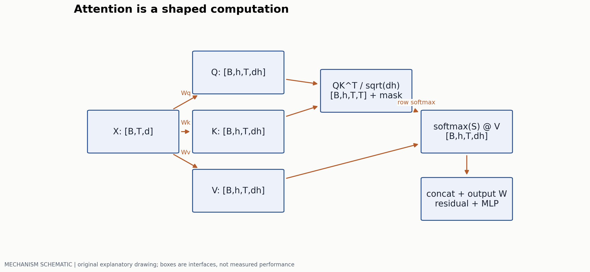
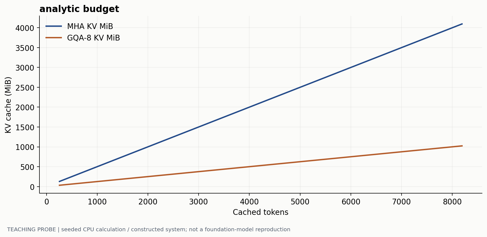
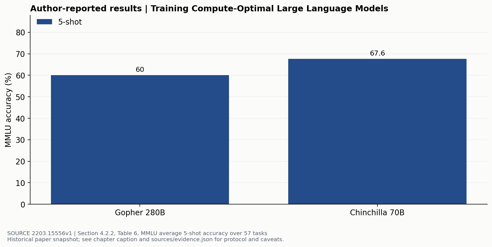

# 从计算图理解多模态 Transformer

> 副标题：用张量、梯度和资源核算连接架构选择与实验结论
> 版本日期：2026-10-16 | 先修：线性代数、交叉熵、反向传播

## 摘要

一张图经视觉编码器变成 1024 个 token，接到语言模型前，究竟增加了什么成本？回答这个问题，比记住新模型的名字更有用。本章从一层 Transformer 的计算图出发，分别核算参数、运算和缓存；再用训练目标说明哪些位置提供监督、哪些位置只提供条件。最后重读 Chinchilla 的一个实验：更小的模型为何可能在同一训练预算下更好，以及这条结论为什么不能直接变成多模态配方。文中的论文结果来自原文表格，预算曲线由公开脚本计算；两者承担不同的证据责任。

## 1. 先固定一个可计算的模型

考虑 decoder-only 模型。batch 大小为 $B$，总上下文长 $T=T_v+T_q+T_a$，分别对应视觉条件、问题和回答。隐藏维度 $d=h_qd_h$；有 $L$ 层、$h_q$ 个 query heads、$h_{kv}$ 个 KV heads。输入嵌入 $X\in\mathbb{R}^{B\times T\times d}$。下面先取普通多头注意力 $h_{kv}=h_q$，再讨论共享 KV。



线性投影后，$Q,K,V$ 的形状都是 $[B,h_q,T,d_h]$。第 $i$ 个位置只能使用允许的 key：

$$
S=\frac{QK^\top}{\sqrt{d_h}}+M,\qquad A_{ij}=\frac{\exp S_{ij}}{\sum_{k\in\mathcal{A}(i)}\exp S_{ik}},\qquad O=AV.
$$

$M$ 在不允许访问的位置为负无穷；$\mathcal{A}(i)$ 是允许的 key 集合。视觉前缀是否双向可见，是具体架构的 mask 选择，不能从“用了 causal LLM”推断全部视觉 token 之间也必须严格从左到右。$1/\sqrt{d_h}$ 控制独立、近似单位方差分量点积的尺度，避免随 head dimension 增大使 softmax 饱和；它不保证真实训练中的方差永远稳定。原始注意力结构见 [1]。

实现检查应从形状开始：最后两维相乘得到 $[T,T]$，softmax 沿 key 维进行，再乘 $V$。把 softmax 维写成 query 维，仍能得到合法张量，却改变了概率含义。另一个隐蔽错误是 mask 广播：batch 内不同长度的 padding 不能只靠一个全局三角阵处理。

### 1.1 残差、归一化与 MLP 分别解决什么

采用 pre-norm 时，可写为 $H=X+\mathrm{Attn}(\mathrm{Norm}(X))$，再令 $Y=H+\mathrm{MLP}(\mathrm{Norm}(H))$。残差给梯度保留跨层的直接路径；归一化改变数值尺度；MLP 对每个位置作特征变换。三者不能互相替代。RMSNorm 不减去均值，RoPE 作用于 query/key 的位置相关旋转，均不是“额外输入一些位置 token”。

普通两层 MLP 为 $d\to d_{ff}\to d$，主参数量约 $2dd_{ff}$；门控 MLP 有两条上投影和一条下投影，约 $3dd_{ff}$。因此比较激活函数时，要说明是否同时调整了 $d_{ff}$ 来保持参数量。参数相同也不意味着 wall-clock 相同：算子融合、读写次数与硬件矩阵乘规格都会影响时间。

### 位置坐标怎样改变 attention

先把一个 head 的维度 $d_h$ 取为偶数。投影得到 $Q,K\in\mathbb R^{B\times h\times T\times d_h}$ 后，将最后一维拆成 $d_h/2$ 对。第 $j$ 对的频率为 $\theta_j=b^{-2j/d_h}$，$j=0,\ldots,d_h/2-1$，$b$ 是选定的基数；位置 $m$ 的二维旋转为

$$
R_j(m)=\begin{pmatrix}\cos(m\theta_j)&-\sin(m\theta_j)\\\sin(m\theta_j)&\cos(m\theta_j)\end{pmatrix}.
$$

对每对 query/key 分别旋转，value 按此例保持原样。设未经位置旋转的两个向量为 $q,k$，则

$$
(R(m)q)^T(R(n)k)=q^TR(n-m)k.
$$

等式来自 $R(m)^TR(n)=R(n-m)$：共同移动两个坐标保留相位差，attention 仍然可以依赖相对间隔。这是 RoPE 的关键构造。[RoFormer §3.2](https://arxiv.org/html/2104.09864v5)

用单个二维子空间手算。取 $q=k=(1,0)$、教学频率 $\theta=\pi/6$，位置为 $m=2,n=5$，内积为 $\cos(3\pi/6)=0$；整体移动到 $7,10$，内积仍为 0。若只把 key 移动到 6，相对间隔变 4，内积变为 $\cos(2\pi/3)=-1/2$。这里选择简单频率便于计算，真实模型按各自频率表旋转。

实现可以广播位置张量 `pos[B,T]` 到 heads 和成对通道：

```text
angles = pos[..., None] * frequencies[None, None, :]  # [B,T,dh/2]
for Q and K:
    even, odd = paired_coordinates(tensor)           # [B,h,T,dh/2]
    rotated_even = even*cos(angles) - odd*sin(angles)
    rotated_odd  = even*sin(angles) + odd*cos(angles)
    interleave(rotated_even, rotated_odd)
```

这里采用“缓存已经旋转过的 K”的约定：prefill 对整段 K 旋转一次；decode 只旋转新位置的 Q/K，再追加 K/V。读缓存时再次旋转会累计错误相位。batch 内两条序列即使被 padding 到相同长度，其有效末位置也可能不同，下一步的 position ID 应按各自位置规则计算。一个实用检查是：固定权重、输入与 mask，将同一序列整段计算和分段 cache 计算的最后一个 logit 比较到合理浮点容差；再改变 padding 长度重复检查。

多模态中的“位置”可以有多个坐标：文本序号、图像行列、视频真实时间。只要先定义每个 rotary 通道组采用哪种坐标，上面的二维更新仍适用。这样 03/04 的时空位置就能接回同一计算图。

### MoE 怎样分开总参数和每 token 计算

将 $T_b$ 个有效 token 展平为 $X\in\mathbb R^{T_b\times d}$。router 参数 $W_r\in\mathbb R^{d\times E}$，得到概率 $P=\mathrm{softmax}(XW_r)$。对每个 token 选 $k$ 个专家索引 $I\in\{1,\ldots,E\}^{T_b\times k}$，令选中门控归一化为 $g_{ti}$，输出

$$
Y_t=\sum_{i\in I_t}g_{ti}\,\mathrm{FFN}_i(X_t).
$$

以门控 FFN 为例，每个专家约有 $P_e=3dd_{ff}$ 参数；整个专家层约存 $EP_e+dE$ 参数，每 token 访问约 $kP_e$ 专家参数对应的计算路径。取 $d=2048,d_{ff}=8192,E=8,k=2$：单专家约 50.3M 参数，全部专家约 402.7M，每 token 选中专家约 100.7M，另加 router。这个账只包含该 MoE FFN；attention、embedding 和共享模块仍需另计。

下面是一层的执行顺序：

```text
compute router scores for valid tokens
choose top-k expert IDs and gates
group token activations by expert; retain source-token IDs
dispatch grouped activations to expert owners
run each expert on its assigned activations
return expert outputs and scatter-add with gates
add the residual; log expert counts by input modality
```

专家分布在多卡时，dispatch/return 搬运的是激活。忽略 metadata，若每个 token 发送到 k 个专家、激活元素为 s 字节，两程合计约 $2kT_bds$ 字节。取 $T_b=1024,k=2,d=2048,s=2$，得到 16MiB 的逻辑激活流量；实际网络量还取决于专家是否本地、通信算法和 padding。总权重容量没有因只选两个专家而消失。

负载也影响正确训练和速度。以 top-1 的容量限制示例，$T_b=16,E=4$，capacity factor=1，每个专家容量 4；若路由计数为 8、4、2、2，第一专家有 4 个 token 超出容量。Switch 的该实现让溢出 token 经残差旁路，并用负载均衡损失调整分配；其他实现可以选择不同容量或调度策略。[Switch §2.2](https://arxiv.org/html/2101.03961v3) 由此可以做两种诊断：固定 router 看通信/容量成本；固定资源看改变均衡约束后的主任务 loss 和各模态掉路率。仅观察全局平均负载会漏掉“图像 token 挤到一个专家”的局部问题。

训练显存还需要一张独立的状态账。对 1B 参数，若权重、梯度和 Adam 一阶/二阶状态全为 FP32，分别占 4、4、4、4GB，共 16GB，尚未计激活；若使用 BF16 权重与梯度、FP32 master weights 和两份 FP32 状态，总数仍为 16GB。冻结某模块去掉其梯度与优化器状态，checkpointing 减少需要长期保存的激活；两种操作作用在不同组成项。这类逐项核算可与[CS336 lecture_02](https://github.com/stanford-cs336/spring2025-lectures/blob/main/lecture_02.py)的资源计算方式对照。

## 2. 算清三本账，才能讨论“高效”

忽略 bias、norm 和 embedding，普通注意力四个投影约为 $4d^2$ 参数；若用 $d_{ff}=4d$ 的普通 MLP，每层约 $12d^2$ 参数。按一次乘法和一次加法记 2 FLOPs，单层前向近似为：

$$
C_{\mathrm{layer}}\approx 8BTd^2+4BT^2d+4BTdd_{ff}.
$$

第一项来自四个投影，第二项来自 $QK^\top$ 和 $AV$，第三项来自 MLP。这里没有计视觉编码器、词表输出层、通信、重计算和 padding 浪费。训练的常见近似 $C\approx6ND$ 把参数相关矩阵乘的前向和反向加总；长上下文下的二次注意力项、MoE 的激活参数与视觉编码器开销，均会使直接套用这个近似失真。

一个工作示例：文本原有 512 个位置，加入 1024 个视觉位置后，总长为 1536。投影和 MLP 的 token 相关计算约增至 3 倍，注意力配对数约增至 9 倍。这不表示整个模型运行时间增至 9 倍；需要先看两类项各占多大比例，再测实际 kernel。

| 账目 | 增加视觉 token 的直接影响 | 不能从中直接推断的量 |
|---|---|---|
| 参数 | 若复用同一 LLM，LLM 层参数不随输入长度增加 | 总系统参数仍包括视觉塔与 connector |
| 计算 | 投影近似线性，dense attention 配对近似二次 | GPU 时间还受 IO、融合与 batch 影响 |
| 推理状态 | 已缓存位置需要保留 K/V | 不包含权重、临时张量和显存碎片 |

### 2.1 KV cache 的单位不能含糊

每层、每个缓存位置保存一份 K 和一份 V。若每个元素 $s$ 字节，则：

$$
M_{KV}=2BLT h_{kv}d_hs.
$$

取 $B=1,L=32,T=4096,d_h=128,s=2$，普通 32-head MHA 的 KV 为 2048 MiB；共享成 8 个 KV heads 后为 512 MiB。这里的 MiB 指 $2^{20}$ 字节。GQA 节省的是 KV 表征和流量，不会自动把 query 数、模型权重或所有层的计算都压成四分之一。



## 3. 模型究竟在学习哪些 token

带条件生成的目标是 $p_\theta(y\mid v,q)=\prod_t p_\theta(y_t\mid v,q,y_{<t})$。在 instruction tuning 中，经常只对 assistant 回答计算交叉熵：

$$
\mathcal L=-\frac{\sum_{b,t}m_{bt}\log p_\theta(x_{b,t+1}\mid x_{b,\leq t})}{\sum_{b,t}m_{bt}}.
$$

$m_{bt}=1$ 表示该预测位置属于目标回答；视觉占位符、问题、padding 等通常不计入这类 SFT loss。需要注意 label 是下一位置，mask 也必须对应被预测的 label。mask 错一位可能让第一个回答 token 丢失监督，或把问题结尾训练成答案。

```python
# logits: [B,T,V]; labels: [B,T], masked labels are -100
shift_logits = logits[:, :-1, :]
shift_labels = labels[:, 1:]
# sum over valid answer tokens; divide by valid count, not B*T
loss = token_ce(shift_logits, shift_labels, reduction="sum")
loss = loss / (shift_labels != -100).sum()
```

这段是接口伪代码，不是可直接运行的训练程序。实际运行的预算实验在 `labs/run_probes.py`。分布式训练时，若各卡有效回答长度不同，先对各卡 loss 取均值再平均，会改变样本权重；需要与训练框架的梯度归约方式共同推导全局 token mean。长短回答也可按序列平均，但那是另一种目标，应明确说明。

## 4. 重读一次 scaling 实验

Chinchilla [2] 同时研究模型参数 $N$ 与训练 token 数 $D$。其经验拟合可写成 $E+A/N^\alpha+B/D^\beta$，约束为给定训练计算量。它不是一个由 Transformer 结构推出的物理定律；数据、优化器、训练长度和拟合范围都参与定义这条曲线。



实验支持“在该训练预算和数据设置下，重新分配参数与训练量可以优于只增大模型”。它不支持“所有模型的最优 token/参数比都是固定常数”。更不支持将图像 token、语音 codec token 与文本 token 视作同等信息量后直接相加套一个经验比例。多模态配方至少应分别报告模态样本数、编码后长度、采样权重和各阶段冻结策略。

在 `labs/check_mechanisms.py` 的已执行单头浮点检查中，共同平移位置后的 RoPE 分数最大误差约 $1.78\times10^{-15}$，整段与 KV cache 逐步计算的输出误差约 $2.22\times10^{-16}$；故意给 query 错误位置则产生约 1.04 的差异。这组正、负对照检查位置接口，不测试训练模型质量。

## 5. 一个可以执行的决策过程

如果训练显存不够，先区分权重/优化器状态与激活。冻结视觉塔会减少它的训练状态，但不会消除前向计算；activation checkpointing 用重计算换激活显存；降低输入长度会同时影响信息与计算。若 decode 慢，检查 KV 读流量和权重摊销，而不是继续优化只在 prefill 占主导的矩阵乘。

开始实验前，应保存一条真实 batch 的 shape trace、有效目标数和峰值显存。至少做一次“同一内容、不同 padding 长度”的 loss 一致性检查，以及一次短序列手算 mask 检查。然后固定数据和 token 预算，只改一个结构选择；报告质量变化时把吞吐、首 token 延迟和训练消耗同时记录。第 08 章继续讨论性能核算，第 10 章讨论实验结论的统计边界。

复算：在仓库根目录运行 `python labs/run_probes.py` 与 `python scripts/make_technical_figures.py`。本章预算是解析计算，不需要 GPU，也不能用来宣称任何真实模型的吞吐。可检验的问题是：保持 batch 和 context 不变，把 KV heads 从 8 改为 1 后，哪部分字节数严格减少八倍，哪些项不变？

## 参考文献与证据

[1] Vaswani et al. Attention Is All You Need. 2017. [原文](https://arxiv.org/html/1706.03762)  
[2] Hoffmann et al. Training Compute-Optimal Large Language Models. 2022. 重点：3 节的拟合与 4.2.2 节的 MMLU。[原文](https://arxiv.org/html/2203.15556v1)  
[3] Stanford CS336. Resource accounting 与可执行讲义。用于讲解方法参照。[原文](https://github.com/stanford-cs336/spring2025-lectures/blob/main/lecture_02.py)  
