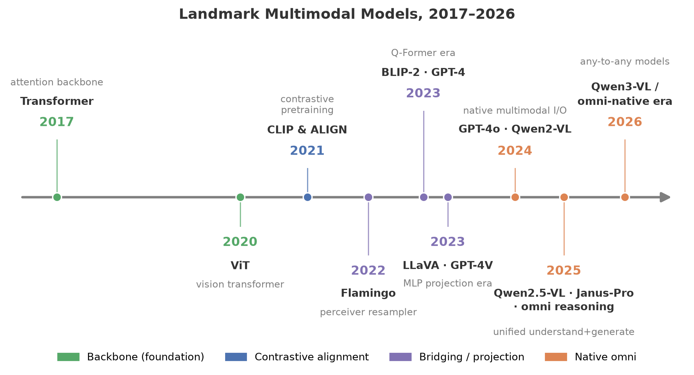
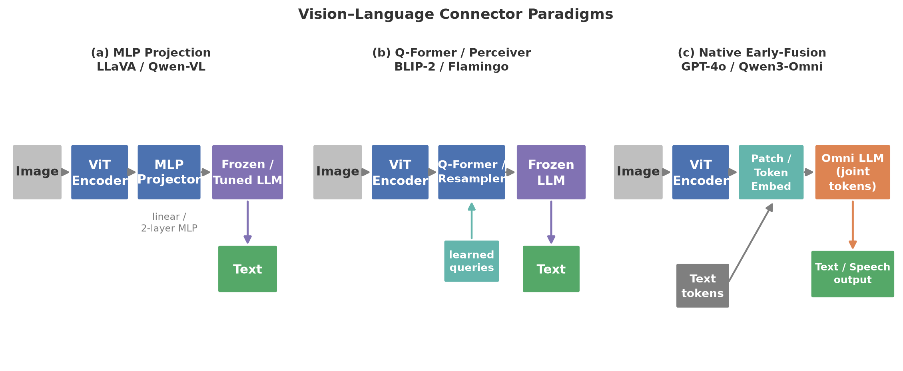

# 视觉-语言模型：从 CLIP 到原生多模态

> 副标题：一条清晰的演化主线——视觉编码器、模态连接器与语言模型的三角关系如何被逐代重构
> 版本日期：2026-09-29 | 面向读者：有深度学习基础的多模态初学者

## 摘要

视觉-语言模型（Vision-Language Model, VLM）是当下多模态大模型版图中技术栈最成熟、迭代最密集的方向。本报告以"视觉信息如何进入语言模型"这一核心问题为主线，系统梳理 2021–2026 年该方向的完整谱系。我们从对比学习的奠基工作讲起：CLIP 用 4 亿图文对证明"自然语言监督"可以替代人工类别标签，ALIGN 用 18 亿未清洗数据证明规模可以对冲噪声，SigLIP 用 sigmoid 损失解耦了对比学习与 batch size 的耦合，SigLIP 2 则将对比、自蒸馏、定位、dense 预测多目标合一，成为 2025 年新一代视觉基座。随后进入本报告的主战场——connector（模态连接器）范式的三次分野：以 Flamingo 为代表的 gated cross-attention 深插入路线、以 BLIP-2 为代表的 Q-Former 查询瓶颈路线、以 LLaVA 为代表的线性/MLP 投影极简路线。我们深入剖析 CLIP、BLIP-2、LLaVA、Qwen2.5-VL 四篇代表作，并横向讨论高分辨率策略（动态切片、NaViT 式原生分辨率、pixel shuffle）、OCR 与文档理解、GUI grounding 等前沿子方向，以及 2025 年开源旗舰（Qwen2.5-VL、InternVL3、DeepSeek-VL2）所体现的"原生多模态"转向。报告最后给出技术路线对比表、开放问题与面向入门研究者的机会点评。全文只引用经 arXiv 验证的文献，所有关键数字均可在原文摘要或正文复核。

## 1. 引言：本方向在多模态版图中的位置

在"多模态大模型"这个庞大的家族里，视觉-语言模型处于枢纽地位：向上，它的训练范式（预训练 + 指令微调 + 后训练）被音频、视频、全模态模型直接继承；向下，它依赖的视觉编码器技术（ViT、对比学习）是整个家族的地基；向外，它分化出文档智能、GUI agent、具身感知等独立赛道。可以说，**读懂 VLM，就读懂了多模态大模型一半的技术史**。

**学习地图**（先修概念 → 核心问题 → 关联方向）：

- **先修概念**：Transformer 与自注意力；ViT（图像切 patch、位置编码）；对比学习与 InfoNCE；语言模型的自回归训练；LoRA 等参数高效微调。这些你在深度学习基础课都见过，本报告只在需要处回顾。
- **本方向的核心问题**：三个层次——（1）视觉表征：什么样的图像特征适合"被语言消费"？（2）模态连接：图像特征如何注入语言模型而不破坏其语言能力？（3）能力激发：如何用最少的代价让模型学会视觉指令遵循、定位、读字、推理？
- **与其他方向的关系**：视频理解（专题 03）是 VLM 加时间轴；全模态（专题 04）是把"视觉接入"推广到音频等多路输入；具身智能（专题 06）把 VLM 作为感知前端；效率（专题 08）关心视觉 token 压缩——视觉 token 的数量级远超文本，是系统成本的主要来源。

下面这张时间线图给出了本方向的主干脉络，建议对照阅读全文：

从图可见，2021 年 CLIP/ALIGN 奠基，2022 年 Flamingo 首次把冻结 LLM 接入视觉，2023 年 LLaVA 引发开源视觉指令微调热潮，2024 年高分辨率与 scaling 成为主题，2025 年 Qwen2.5-VL、InternVL3、DeepSeek-VL2 等开源旗舰把竞争推向"原生多模态"——视觉编码器不再现成拿来，而是为语言模型从零定制。

## 2. 基础知识

### 2.1 双塔对比学习：VLM 的地基

对比学习的思想很朴素：把配对的图文在向量空间里拉近，不配对的推远。形式上，给定 batch 内 $N$ 对图文 $\{(v_i, t_i)\}$，图像编码器 $f$ 与文本编码器 $g$ 各自产出归一化向量，CLIP 采用对称的 InfoNCE 损失：

$$
\mathcal{L}_{\text{CLIP}} = -\frac{1}{2N}\sum_{i=1}^{N}\left[\log\frac{e^{s_{ii}/\tau}}{\sum_j e^{s_{ij}/\tau}} + \log\frac{e^{s_{ii}/\tau}}{\sum_j e^{s_{ji}/\tau}}\right]
$$

其中 $s_{ij} = f(v_i)^\top g(t_j)$，$\tau$ 为可学习温度。**motivation**：传统视觉模型（如 ImageNet 分类）的监督信号是封闭的类别集合，学不到开放世界的概念；而自然语言天然携带开放语义。CLIP 的关键洞察是——"预测哪段文字配哪张图"这个任务本身就是可扩展的监督。它的 zero-shot 用法也极优雅：把类别名填进模板 `"a photo of a {label}"`，与图像算余弦相似度即可分类，不需要任何下游训练数据。

注意这个 softmax 损失的工程含义：分母需要对**全 batch** 归一化，因此负样本数量随 batch size 增长，大 batch 几乎成了性能前提（CLIP 用了 32768 的 batch）。这正是 SigLIP 要解决的问题（见 §3）。

### 2.2 视觉编码器：ViT 与 patch 化

VLM 的视觉侧几乎清一色是 ViT：图像被切成 $P\times P$ 的 patch，线性投影后加位置编码，过 Transformer。两个对后文至关重要的量：

- **视觉 token 数**：分辨率为 $H\times W$、patch 大小 $P$ 时，token 数 $\approx HW/P^2$。448²、patch 14 的图就是 1024 个 token——相当于一篇长文。这就是为什么"视觉 token 压缩"贯穿整个方向。
- **位置编码与分辨率外推**：ViT 的位置编码通常按固定分辨率训练，换分辨率需要插值。输入 224² 训练、推理用 896²，位置编码插值会带来失真——这是"高分辨率策略"一章（§5）所有技术的动机。

### 2.3 自回归语言模型与"视觉 token 即外语"

语言模型按 $\prod_t p(x_t \mid x_{<t})$ 建模文本。把视觉特征交给 LLM 的最简单想法是：把视觉 token 当成一种"外语 token"，拼在文本 token 前面，让 LLM 照常自回归。这个类比在概念上成立，但工程上有三个硬问题：

1. **维度与分布不匹配**：视觉编码器输出维度（如 1024）≠ LLM 词嵌入维度（如 4096），且两者表征分布差异巨大——这就是 connector 存在的理由。
2. **token 预算**：LLM 上下文有限，一张高分辨率图动辄上千 token，多图/视频输入下必须压缩。
3. **训练稳定性**：直接端到端训练容易损害 LLM 已有的语言能力（灾难性遗忘），因此多数方法冻结或分阶段解冻各模块。

### 2.4 三类 connector 范式总览

下图概括了本报告的架构主线——三种把视觉特征接入 LLM 的范式：

- **投影式（Projection）**：一层线性或浅层 MLP 把视觉 token 映射到 LLM 嵌入空间，token 数不变（或经 pixel shuffle 等减少）。代表：LLaVA、Qwen-VL 系列、InternVL 系列。优点是简单、保留全部空间信息、易扩展分辨率；缺点是高分辨率下 token 数爆炸。
- **查询瓶颈式（Query-based bottleneck）**：用固定数量的可学习 query 通过 cross-attention 从视觉特征中"抽取"信息，输出恒定数量的 token。代表：BLIP-2 的 Q-Former（32 个 query）、Flamingo 的 Perceiver Resampler。优点是 token 数恒定可控；缺点是信息瓶颈可能丢失细粒度空间信息。
- **交叉注意力插入式（Cross-attention insertion）**：在 LLM 层间插入新的 cross-attention 层，文本 token 直接 attend 视觉特征。代表：Flamingo 的 gated cross-attention、CogVLM 的 visual expert。优点是融合深、不经瓶颈；缺点是要改动 LLM 内部结构，训练与推理复杂度都更高。

第 4 节的深度剖析将逐一检验这三条路线的真实代价与收益。

### 2.5 训练流水线与评测速览

当代 VLM 的训练普遍是多阶段的：视觉-语言对齐预训练（connector 热身）→ 大规模多任务预训练 → 视觉指令微调 → （可选）偏好优化/RL。每个阶段解冻哪些模块、用什么数据配比，是各家"配方"的核心机密，也是 VILA、MM1 等论文系统研究的对象。

评测方面需要记住几个基准的名字与侧重：MME 与 MMBench 测综合感知与推理；MMMU 测大学级多学科推理；DocVQA 与 OCRBench 测文档与文字；POPE 测幻觉；ScienceQA、MathVista 测学科推理；ScreenSpot、OSWorld 测 GUI 操作。后文引用模型成绩时会指明基准。 若需全景式文献导航，早期综述见 [1]，数据中心视角的梳理见 [2]。

## 3. 经典方法谱系

### 3.1 对比学习奠基（2021–2023）：CLIP、ALIGN、SigLIP

**CLIP（2021）** 的历史地位无需赘言：4 亿图文对、batch 32768 的对比预训练，zero-shot 即可在不使用 ImageNet 训练集的情况下匹配原版 ResNet-50 的 ImageNet 精度，并在 30 余个下游数据集上展现非平凡迁移。但真正让它成为"地基"的，是后来所有 VLM 都发现：**CLIP 系编码器抽出的特征天然与语言对齐，接到 LLM 上几乎即插即用**。CLIP 于是从"一个模型"变成了"一类基础设施"。

**ALIGN（2021）** 同期独立地走通了同一条路，并补充了一个重要论点：用 18 亿未经精细清洗的 alt-text 图文对，简单双塔对比也能达到 SOTA 检索与分类性能——**数据规模可以替代数据清洗**。这个结论塑造了此后五年的数据哲学：先求多，再求净（BLIP 的 caption-filter、SigLIP 2 的在线数据筛选都是"净"这一半的回归）。

**SigLIP（2023）** 针对的是 CLIP 损失的一个结构性缺陷：softmax 归一化需要全局 batch 视图，把性能和工程（跨设备同步、显存）耦合在一起。SigLIP 把每个图文对看作独立的二分类问题，用逐对 sigmoid 损失：

$$
\mathcal{L}_{\text{SigLIP}} = -\frac{1}{N^2}\sum_{i,j}\log \sigma\big(z_{ij}\,(s_{ij}/\tau + b)\big)
$$

其中 $z_{ij}=1$ 当 $i=j$ 否则 $-1$，$\sigma$ 为 sigmoid。损失只依赖单对样本，天然支持任意切分并行。论文报告了两个有说服力的结果：结合 Locked-image Tuning（LiT，冻结预训练图像塔只训文本塔），4 块 TPUv4 两天即可训出 84.5% ImageNet zero-shot 的模型；batch 推到一百万时收益迅速饱和，**32k 已足够**——这直接降低了对比预训练的算力门槛。

**SigLIP 2（2025）** 是一次"集大成"：在 sigmoid 对比之外，叠加 captioning 预训练、自蒸馏、masked prediction 等自监督损失与在线数据筛选，统一成一个训练配方。收益是全方面的：同尺度下全面超过 SigLIP 一代，且显著改善了对比学习历来薄弱的定位与 dense 预测能力；还提供支持多分辨率、保留原生宽高比的变体，以及多语言与去偏训练。它发布 B/L/So400m/g 四个尺寸（86M–1B），迅速成为 2025 年新 VLM（含 Gemma 3 等）的默认视觉基座。

### 3.2 桥接范式（2022–2023）：BLIP、Flamingo、BLIP-2

**BLIP（2022）** 的贡献有两点：其一，用 captioner + filter 的"自举"机制净化网络噪声数据——生成合成 caption、再用过滤器筛掉不匹配的，把 ALIGN 式"以量取胜"修正为"量净兼得"；其二，用统一的 MED（Multimodal mixture of Encoder-Decoder）架构同时支持理解类与生成类任务，检索、captioning、VQA 全线提升（论文报告检索 recall@1 平均 +2.7%、captioning CIDEr +2.8%、VQA +1.6%）。

**Flamingo（2022）** 是 DeepMind 的里程碑：冻结的 CLIP 视觉编码器 → **Perceiver Resampler**（用少量 latent query 把变长视觉特征压成固定数量 token）→ 在冻结 LLM 层间插入 **gated cross-attention** 层（tanh 门控初始为零，保证训练初期不破坏语言能力）。这套设计第一次让 VLM 获得了真正的**多模态 in-context learning**：给几个图文示例作 prompt，无需微调即可适应新任务，多项基准上 few-shot 超过微调了上千倍任务数据的模型。它也首次系统支持任意交错的图文序列（interleaved），这直接来自其用 M3W 等交错网页语料训练的设计。

**BLIP-2（2023）** 把"冻结一切、只练桥"的思想做到极致：视觉编码器冻结、LLM 冻结，唯一训练的是中间的 **Q-Former**——一个带 32 个可学习 query 的小 Transformer，query 通过 cross-attention 读取冻结视觉特征。训练分两阶段：第一阶段让 Q-Former 从冻结图像编码器学视觉-语言表征（ITC/ITM/ITG 三目标）；第二阶段把 Q-Former 输出投影后接冻结 LLM，做视觉到语言的生成学习。结果令人震惊：**零样本 VQAv2 上超过 Flamingo-80B 达 8.7 个百分点，而可训练参数量只有后者的 1/54**。BLIP-2 证明了一件影响深远的事：当视觉编码器和 LLM 都足够强时，模态鸿沟可以被一个非常轻的桥跨越。

**MiniGPT-4（2023）** 则从另一侧给出了佐证：冻结的视觉编码器 + Q-Former + 冻结 Vicuna，只训单个投影层做轻量对齐，就涌现出细致描述、写诗、看图答题等类 GPT-4 行为。它说明 2023 年那次"多模态涌现"的大部分功劳属于底层的强 LLM 与强视觉编码器，而非连接结构的复杂。

### 3.3 投影范式与视觉指令微调（2023–2024）：LLaVA 系列

**LLaVA（2023）** 做了两件改变生态的事。第一是**数据**：纯文本 GPT-4 无法看图，但 LLaVA 利用 COCO 图片的 caption 与检测框作为"符号化表示"，让 GPT-4 基于这些符号生成视觉指令数据（对话、细节描述、复杂推理三类共 15.8 万条），开创了"用 LLM 造多模态指令数据"的范式。第二是**架构**：CLIP ViT-L/14 → **单层线性投影** → Vicuna，端到端微调。架构简单到近乎简陋，却在合成指令评测上达到 GPT-4 的 85.1% 相对分数，与 GPT-4 协同微调后 ScienceQA 达 92.53% 的当时 SOTA。

**LLaVA-1.5（2023）** 接着证明"改两处就成基线"：线性层换成两层 MLP projector，数据换成学术任务改造集（VQA、OCR、区域级数据混合），就在 12 个基准中的 11 个达到当时最优。LLaVA-1.5 的配方（CLIP + MLP + 学术数据混合）随后成为整个开源社区的默认起点。**mPLUG-Owl** [15]、**MiniGPT-v2** [18]、**Kosmos-2** [16]、**Qwen-VL** [17] 等同期工作则分别探索了两阶段训练、统一任务标识符、grounding 坐标 token、多图/定位/文本阅读三阶段训练——视觉指令微调的能力边界被迅速撑开。

**CogVLM（2023）** 代表了第四条 connector 路线：不改输入侧，而是在 LLM 每一层的 attention 与 FFN 中注入可训练的 **visual expert** 参数，让视觉 token 在 LLM 内部走"专用通道"。这是深融合路线，性能强（17 项基准 SOTA）但训练成本高，与 Flamingo 的 cross-attention 插入同属"改 LLM 内部"一派。

### 3.4 规模化与系统研究（2023–2024）：VILA、InternVL、MM1

当社区开始堆算力，"怎么堆"就成了科学问题。**VILA（2023）** 系统研究 VLM 预训练配方，核心结论：交错图文数据（interleaved）对保留 LLM 语言能力与激发 in-context 能力至关重要，纯图文对数据反而有害；预训练阶段解冻 LLM 优于冻结。**InternVL（2023）** 提出"视觉也要 scaling"，把视觉编码器扩到 6B 并与 LLM 中间层对齐——此前视觉塔普遍停留在 300M–1B 而 LLM 已到数十 B，视觉侧成为瓶颈。**MM1（Apple, 2024）** 则以工业级消融密度系统比较 connector、数据配比与预训练配方，是"方法论范本"；**Idefics2/3（HuggingFace, 2024）** 则全开源复现，揭示了 interleaved 数据与 pixel shuffle 的实际作用，为学术界提供了可复现的配方细节。

**关键论文一览表**：

| 论文 | 年份 | 核心思想 | 架构要点 | 备注 |
|---|---|---|---|---|
| CLIP [7] | 2021 | 自然语言监督的对比预训练 | 双塔 ViT/ResNet + InfoNCE | 4 亿对；VLM 视觉基座之源 |
| ALIGN [8] | 2021 | 规模替代清洗 | 双塔对比 | 18 亿噪声对 |
| BLIP [9] | 2022 | caption-filter 自举净化 | MED 统一编码-解码 | 理解+生成统一 |
| Flamingo [10] | 2022 | 冻结 LLM + 门控交叉注意力 | Perceiver Resampler + gated x-attn | 多模态 ICL 先河 |
| BLIP-2 [11] | 2023 | 冻结双塔 + 轻量查询桥 | Q-Former（32 query）两阶段 | VQAv2 超 Flamingo80B 8.7pt，1/54 可训练参数 |
| SigLIP [12] | 2023 | sigmoid 逐对对比损失 | 双塔，去 batch 耦合 | 4×TPUv4 两天 84.5% IN zero-shot |
| LLaVA [13] | 2023 | GPT-4 造指令数据 + 线性投影 | CLIP + linear + Vicuna | 开源 VIT 模板 |
| MiniGPT-4 [14] | 2023 | 冻结一切只训投影层 | Q-Former + 单投影层 + Vicuna | 轻量对齐即涌现 |
| Kosmos-2 [16] | 2023 | grounding 进生成目标 | 坐标 token 化 | 定位-生成统一 |
| Qwen-VL [17] | 2023 | 三阶段训练 | cross-attn connector | 多图/定位/读字 |
| LLaVA-1.5 [19] | 2023 | MLP projector + 学术数据 | CLIP + MLP + Vicuna | 社区默认基线 |
| CogVLM [20] | 2023 | LLM 内注 visual expert | 深融合 | 17 基准 SOTA |
| VILA [21] | 2023 | 预训练配方科学 | 解冻 LLM + interleaved | 数据配比结论影响深远 |
| InternVL [23] | 2023 | 视觉编码器 scaling | 6B 视觉塔对齐中间层 | "视觉也要 scaling" |
| CogAgent [22] | 2023 | 双编码器高低分辨率 | 低/高分辨率双塔 | GUI agent 专用 |
| SeeClick [24] | 2024 | 视觉 GUI grounding | 基于 Qwen-VL 微调 | ScreenSpot 基准 |
| MM1 [25] | 2024 | connector/数据/配方系统消融 | 多种架构对比 | 工业方法论范本 |
| MiniCPM-V [26] | 2024 | 端侧高分辨率切分+压缩 | perceiver resampler 压缩 | 端侧 GPT-4V 级 |
| LLaVA-OneVision [27] | 2024 | 单图→多图→视频统一迁移 | 任务统一框架 | 跨场景迁移 |
| Idefics2/3 [28] | 2024 | 全开源复现 VLM 训练 | pixel shuffle + interleaved | HF 开放配方 |
| Qwen2-VL [29] | 2024 | 原生动态分辨率 + M-RoPE | NaViT 式 ViT + 多模态 RoPE | 任意分辨率/长视频 |
| NVLM [30] | 2024 | tile 式 vs 无切分系统对比 | NVLM-D/H/X 三系 | NVIDIA 系统研究 |
| GOT-OCR2.0 [31] | 2024 | 统一端到端 OCR | 580M encoder-decoder | 文档/公式/乐谱一站 |
| Molmo [32] | 2024 | 全开放数据 + pointing | 密集 caption 数据 | 数据全公开 |
| Janus [33] | 2024 | 解耦理解/生成编码路径 | 双视觉编码器 | 统一模型结构解 |
| DeepSeek-VL2 [34] | 2024 | MoE LLM + 动态 tiling | SigLIP + DeepSeekMoE | 1.0–4.5B 激活参数 |
| InternVL 2.5 [35] | 2024 | 模型/数据/测试时三重 scaling | InternViT + pixel shuffle | 首个 MMMU>70 开源 |
| SigLIP 2 [36] | 2025 | 多目标统一训练配方 | 对比+自蒸馏+定位+dense | 新视觉基座（86M–1B） |
| Qwen2.5-VL [37] | 2025 | 原生 ViT 从零训 + 窗口注意力 | 动态分辨率 ViT + 绝对时间编码 | 文档/Agent/长视频旗舰 |
| Janus-Pro [38] | 2025 | 解耦路线规模化 | 双编码器 + 数据/模型扩展 | 理解-生成统一标杆 |
| Qwen3-VL [40] | 2025 | 开源旗舰再升级 | 更强视觉编码器 + GUI agent | 2025 末技术报告 |

（表中编号对应 §10 参考文献。）

## 4. 代表作深度剖析

本节按模板要求深读四篇：CLIP、BLIP-2、LLaVA、Qwen2.5-VL。选择理由：CLIP 是视觉编码器的一切源头；BLIP-2 是查询瓶颈范式的巅峰；LLaVA 是投影范式的起点与开源生态的引爆点；Qwen2.5-VL 则代表"原生多模态"的当代答案。四篇恰好串成一条"编码器 → 桥 → 极简投影 → 原生一体"的完整弧线。

### 4.1 CLIP：把自然语言变成视觉的监督信号（2021）

**研究问题**：计算机视觉长期困在"固定类别集合 + 人工标注"的监督形式里——每新增一个概念就要补标注、重训练。能否直接从互联网上海量天然存在的图文配对中学习视觉表征，并把自然语言本身用作迁移接口？

**关键洞察**：监督信号的瓶颈不在模型而在任务形式。"预测哪段文本配哪张图"这个看似粗糙的代理任务，配合足够大的数据与 batch，就能学到开放语义的视觉概念。CLIP 的另一层洞察是工程性的：对比目标与 Transformer 组合具有极佳的 scaling 行为，算力投入几乎线性地转化为性能。

**技术方法**：图像塔与文本塔分别编码（图像侧比较了 ResNet 与 ViT，文本侧为 Transformer），输出经线性投影到共享嵌入空间并 L2 归一化，用 §2.1 的对称 InfoNCE 训练。数据为自建 WIT（WebImageText）4 亿对；batch 32768；最大模型 ViT-L/14。zero-shot 迁移通过 prompt 模板 + 类别名嵌入的余弦相似度实现，并使用 prompt ensemble（数十个模板平均）提升稳定性。

**实验结果**：在 30 余个数据集上 zero-shot 评估——最大模型在不使用 ImageNet 128 万训练样本的情况下匹配了原版 ResNet-50 的 ImageNet 精度；OCR、动作识别、地理定位、细粒度分类等任务上多数表现非平凡，常与全监督基线竞争。摘要层面的这些结论，被此后五年数千篇工作反复复用与验证。

**批判性分析**：优点——范式开创性、接口极简（文本即分类器）、表征可迁移性空前，以至于"CLIP 特征"成了整个 VLM 时代的默认视觉先验。局限——（1）对比目标只学"全局对齐"，细粒度定位与 dense 任务弱（SigLIP 2 五年后仍在补这个课）；（2）对计数、空间关系、组合性推理表现差，这些缺陷原样遗传给了用它做视觉塔的 VLM；（3）softmax 损失对大 batch 的依赖提高了复现门槛，且 WIT 数据未公开，严格意义上不可完全复现——后来 OpenCLIP 等社区复现才补上这一环。可复现性评级中等：权重开放但数据封闭。

**一句话评价**：计算机视觉的"BERT 时刻"，此后所有 VLM 的视觉塔都活在它的阴影（或改进版）之下。评级：★★★★★（范式奠基）。

### 4.2 BLIP-2：最轻的桥跨越最深的鸿沟（2023）

**研究问题**：2022 年底的 VLP 陷入"端到端训练一切"的成本泥潭——视觉塔越来越大、LLM 越来越大，联合预训练一次就是天文数字。能否完全冻结现成的强视觉编码器与强 LLM，只训练一个轻量模块来桥接两者？

**关键洞察**：冻结的两个单模态模型各自已经把模态内结构学得极好，模态鸿沟其实是"表征对齐"问题而非"联合学习"问题；一个带少量可学习 query 的 bottleneck 结构足以完成这种对齐——信息经过瓶颈反而迫使模型只提取与语言最相关的视觉内容。

**技术方法**：核心组件 **Q-Former** 是一个 BERT 式 Transformer，内含 32 个可学习 query embedding。query 之间可自注意力交互，并通过隔层插入的 cross-attention 读取冻结视觉编码器（CLIP ViT-L/14 或 EVA-CLIP ViT-g/14）的 patch 特征。训练分两阶段：第一阶段（表征学习）冻结视觉塔，用图像-文本对比（ITC）、图文匹配（ITM）、图像引导文本生成（ITG）三目标联合训练 Q-Former，三个目标共享 query 但通过注意力掩码隔离不同输入；第二阶段（生成学习）冻结 LLM（FlanT5 编解码系或 OPT/Vicuna 解码器系），把 Q-Former 输出的 32 个 query 向量经线性投影到 LLM 词嵌入维度，作为软提示前缀做 caption 生成训练。可训练参数仅 Q-Former（约 1.9 亿）加投影层。

**实验结果**：零样本 VQAv2 上比 Flamingo-80B 高 8.7 个百分点，而可训练参数量是后者的 1/54——考虑到 Flamingo-80B 的 LLM 本身有 700 亿参数且在训练中被部分解冻，这个数字极有冲击力。零样本 captioning（COCO/NoCaps）同指标 SOTA；检索微调后亦 SOTA。论文还展示了零样本指令跟随式图像描述（"描述这张图并写成诗"）的涌现行为。

**批判性分析**：优点——训练成本范式革命：双冻结设计让学术实验室第一次有能力参与大模型级 VLP；Q-Former 成为此后两年 connector 研究的对照基线。局限——（1）32 个 query 是硬信息瓶颈：OCR、空间定位、细粒度计数等需要高带宽空间信息的任务上，Q-Former 路线系统性弱于投影路线，这也是 2024 年后旗舰模型几乎全部转向投影式的根本原因；（2）LLM 全程冻结意味着视觉信息只能"提示"LLM 而不能改造它，能力天花板受制于软提示的表达力；（3）两阶段训练流程较繁琐，且第一阶段的 ITM/ITG 目标需要精心设计掩码。可复现性好：代码与数据流程全部开源。

**一句话评价**：用 1/54 的参数证明了"桥可以比人想象的轻得多"，也用同样的瓶颈预示了查询式范式的上限。评级：★★★★★（范式确立 + 历史转折点的注脚）。

### 4.3 LLaVA：一条线性层点燃的开源生态（2023）

**研究问题**：2023 年初，GPT-4 与 Bard 展示了惊人的图文对话能力，但技术细节封闭。学术界的现实问题是：没有 Flamingo 级别的数据与算力，能否造出可用的视觉对话模型？

**关键洞察**：LLaVA 的洞察一半是工程、一半是数据哲学。工程上：既然 CLIP 特征已经与语言对齐，那么 connector 也许不需要 Q-Former 那么复杂——**一条线性投影可能就够了**。数据上：纯文本 GPT-4 虽看不见图，但把图的 caption 和检测框当符号喂给它，它就能"脑补"场景并生成高质量的视觉指令数据——**造数据比造架构便宜**。

**技术方法**：CLIP ViT-L/14 视觉塔 + 单层线性投影 + Vicuna-7B/13B。训练两阶段：阶段一用 CC3M 筛出的 59.5 万对做特征对齐，只训投影层；阶段二用 GPT-4 生成的 15.8 万条指令数据（多轮对话 5.8 万、细节描述 2.3 万、复杂推理 7.7 万）端到端微调投影层与 LLM（视觉塔冻结）。评测上引入了 GPT-4 打分的相对评分协议——这本身也成为后来争议与讨论的对象。

**实验结果**：在合成的多模态指令跟随评测集上取得 GPT-4 的 85.1% 相对分数，并在部分未见图片/指令上表现出类似多模态 GPT-4 的行为；LLaVA 与 GPT-4 协同（用 GPT-4 文本答案作补充监督）在 ScienceQA 上达 92.53%，创当时 SOTA。后续的 LLaVA-1.5 把投影升级为两层 MLP、换用学术任务混合数据后，12 个基准中 11 个最优，且训练一天内可在 8×A100 完成——"学术预算 SOTA"由此成立。

**批判性分析**：优点——（1）把 VLM 从巨头实验室手里解放出来：配方全开源、成本可承受，直接引爆了 2023–2024 年的开源 MLLM 浪潮，至今 LLaVA 代码库仍是社区事实标准；（2）证明了"投影式 + 指令微调"这条最简单路线的惊人性价比。局限——（1）GPT-4 生成数据带有系统性偏差（偏好长答案、特定句式），且用 GPT-4 评测 GPT-4 学生存在循环论证之嫌；（2）固定 336² 输入 + 不压缩 token，OCR 与高分辨率场景明显吃力，迫使后继者专门发明 AnyRes 等补丁；（3）阶段一"只训投影层"的对齐强度有限，深层表征对齐依赖阶段二的端到端微调弥补。可复现性极佳：数据、代码、权重、训练脚本全部公开。

**一句话评价**：架构上"什么都没发明"，却凭数据与开放改变了整个领域的研究方式。评级：★★★★★（生态影响）/ ★★★★（技术贡献）。

### 4.4 Qwen2.5-VL：原生多模态的工业答卷（2025）

**研究问题**：到 2024 年，"CLIP 系视觉塔 + 投影 + LLM"的拼接范式暴露出系统性短板：CLIP 系编码器按固定分辨率、以分类式目标训练，与 VLM 需要的任意分辨率、文档密集文字、视频时序理解格格不入；切块（tiling）等补丁方案又引入位置语义破碎与延迟。能否**为语言模型从零设计并训练一个视觉编码器**，让分辨率、宽高比、时序都成为原生概念？

**关键洞察**：与其给外来视觉塔打补丁，不如把视觉塔纳入多模态训练目标之内——视觉编码器应该和 LLM 一起，为"被语言消费"而优化，而不是为 ImageNet 优化。这是"原生多模态（native multimodality）"的核心主张。

**技术方法**（依据技术报告 [37] 与 Qwen2-VL [29]）：视觉侧是从零训练的**原生动态分辨率 ViT**：支持任意分辨率与宽高比输入（NaViT 式处理，不打乱 patch 序列），引入**窗口注意力**把多数计算限制在局部窗口内（仅少数层全局），使计算量随分辨率近似线性增长而非平方；配合 2D-RoPE 提供位置信息。语言侧沿用 Qwen2.5 LLM；位置编码采用 Qwen2-VL [29] 提出的 **M-RoPE**（Multimodal RoPE），把旋转位置编码分解为时间、高、宽三个分量，使文本、图像、视频在统一位置体系下建模。视频理解引入**绝对时间编码**——帧的位置 ID 与实际时间戳对齐，使模型能按秒级粒度定位长视频事件（支持长达数小时的视频输入）。训练上视觉塔从零参与多阶段多模态训练，功能侧强化了文档解析（发票、表格、表单的结构化抽取）、图表/版面分析，以及精确的框/点定位，使模型可直接充当 GUI agent 的视觉决策模块。

**实验结果**：技术报告宣称在文档理解、视觉定位、长视频理解、agent 操作等维度全面强化，旗舰尺寸与同级闭源模型竞争（具体分数见报告原文；摘要层面可确认的能力包括：小时级视频理解与秒级事件定位、发票/表格结构化抽取、框/点级目标定位）。社区评测普遍确认其文档与 GUI 能力在开源模型中处于第一梯队。

**批判性分析**：优点——（1）"原生 ViT + 窗口注意力"从根上解决了 CLIP 系视觉塔的分辨率枷锁，且计算增长近似线性，长视频/高分辨率文档的性价比质变；（2）M-RoPE + 绝对时间编码是统一时空建模的优雅方案，把视频从"一堆图"变成"一条时间轴"；（3）文档与 GUI 能力被作为一等公民设计，反映了 VLM 从"聊天玩具"走向"工具"的产品化判断。局限——（1）从零训练视觉塔意味着巨大的预训练成本，这条路线事实上抬高了开源竞争的门槛——"原生"是有钱人的自由；（2）窗口注意力对跨窗口长程空间关系的建模仍依赖少数全局层，极端长文档下的行为值得进一步公开消融；（3）训练数据与配比细节未完全公开，复现难度高。可复现性中等：权重与推理代码开放，训练配方部分披露。

**一句话评价**：宣告"借来的视觉塔"时代结束，把 VLM 竞争推进到全栈自研的深水区。评级：★★★★★（当代工程标杆）。

## 5. 研究前沿（2025–2026）

### 5.1 高分辨率策略：从切块到原生

高分辨率之争是近三年最实质的架构战场。三条路线：

1. **动态切片（dynamic tiling）**：把大图切成多块（每块缩放到视觉塔原生分辨率）加一张全局缩略图，token 拼接送入 LLM。LLaVA-NeXT 的 AnyRes、InternVL 系列的动态切片、DeepSeek-VL2 [34] 的 dynamic tiling、NVLM [30] 的 tile 系均属此类。优点是与任意 CLIP 系编码器兼容；代价是 token 数成倍增长、切块边界破坏物体完整性，且位置语义需要额外标记。NVLM [30] 的系统比较显示 tile 路线在 OCR/文档任务上优势明显，是 2024–2025 开源旗舰的主流选择。
2. **NaViT 式原生分辨率**：视觉塔直接吃任意分辨率/宽高比的 patch 序列（Patch n' Pack 思想），配合 2D 位置编码。Qwen2-VL [29] 的 Naive Dynamic Resolution 与 Qwen2.5-VL [37] 的原生 ViT 是代表；SigLIP 2 [36] 也提供保留原生宽高比的 NaFlex 变体。优点是语义完整、无切缝；代价是序列长度不均带来的训练工程复杂度（packing、变长 batch）。
3. **token 压缩与高分辨率降本**：**pixel shuffle**（把空间上相邻的 $2\times2$ 特征折叠进通道维，token 数降为 1/4）经 InternVL 系列与 Idefics2 [28] 推广后成为事实标准——几乎零信息损失换取 4 倍 token 节省。查询式压缩（MiniCPM-V [26] 用 perceiver resampler 把每块压到几十 token）则走向更激进的压缩比，面向端侧。CogAgent [22] 的"低分辨率主干 + 小高分辨率支路"双编码器是另一种取舍：用轻量高分辨率塔补细节。

### 5.2 视觉编码器之争：CLIP vs SigLIP vs 原生训练

2025 年的共识可以概括为三层：

- **CLIP 退居基线**：原始 CLIP 特征仍是大量学术工作的默认起点（LLaVA 生态），但其固定分辨率、dense 能力弱、组合性差的问题已被充分记录。
- **SigLIP/SigLIP 2 成为新基座**：SigLIP [12] 凭借更好的小 batch 行为与训练效率取代 CLIP 成为新模型首选；SigLIP 2 [36] 以多目标配方（对比 + captioning + 自蒸馏 + masked prediction + 在线数据筛选）显著补强 dense 与定位，并提供多语言与多分辨率变体，2025 年新发布的 VLM（含 Gemma 3 等）大量采用。
- **原生训练是旗舰的分水岭**：Qwen2.5-VL [37] 证明从零训练、与 LLM 目标深度耦合的视觉塔可以在文档/视频/agent 任务上换代；InternVL 系列走的是中间路线——自研 InternViT（6B 起步）与 LLM 中间层对齐 [23]，同样强调"视觉侧自主"。学术界的现实策略仍是"站在 SigLIP 2 肩上"，但研究问题已经变成：**多目标视觉预训练里，哪些目标真正服务于下游 VLM？**这是一个算力门槛适中、答案远未饱和的方向。

### 5.3 OCR 与文档理解：从子任务到独立赛道

文档智能在 2024–2026 完成了"独立成域"：一端是 **GOT-OCR2.0** [31] 这类 580M 的统一端到端 OCR 模型，把场景文字、文档、公式、表格、乐谱装进一个 encoder-decoder，证明"OCR-free"不需要大模型体量；另一端是旗舰 VLM 把文档解析做成核心卖点——Qwen2.5-VL 的发票/表单结构化抽取、InternVL 2.5 [35] 的 DocVQA 成绩都源于动态高分辨率 + 大量文档数据的针对性训练。2026 年视觉文档检索综述 [4] 的出现（OCR-free 检索、多模态 RAG）标志着该子领域有了自己的问题定义：当文档可以"看图即懂"，传统 OCR→文本→检索的级联管线是否还需要？评测侧以 DocVQA、OCRBench、ChartQA 为主战场。

### 5.4 GUI grounding 与 computer-use

GUI agent 是 VLM 走向"动手"的第一步。**CogAgent** [22] 最早用双编码器（1120² 高分辨率支路）专攻屏幕理解；**SeeClick** [24] 把 GUI grounding 定义为纯视觉任务（截图→坐标），并推出 ScreenSpot 基准；**Kosmos-2** [16] 的坐标 token 化与 Qwen2.5-VL 的框/点定位提供了通用模型侧的 grounding 能力。2025–2026 年，OSWorld 等环境基准与各家 computer-use 产品把这条线从论文推向系统竞争；学术上仍开放的问题包括：高分辨率截图下的 token 预算、动作空间的表示（坐标 vs 元素引用）、以及 grounding 精度的评测污染。

### 5.5 其他前沿动向

- **统一理解-生成**：Janus [33]/Janus-Pro [38] 给出"理解用连续编码、生成用离散 token，双路解耦共享 LLM"的结构答案，与扩散路线（专题 05）分庭抗礼。
- **推理化**：2025 年起 MLLM 全面引入长 CoT 与 RL 后训练，InternVL 2.5 报告 CoT 带来 MMMU +3.7 分（并成为首个 MMMU 超 70% 的开源模型）[35]；多模态推理的范式综述见 [5]。
- **全模态合一**：Qwen2.5-Omni [39]、Qwen3-Omni [41] 与 Gemini 2.5 [42] 表明纯 VL 正被 omni 旗舰吸收（专题 04）；纯 VL 模型的角色转向"视觉前端 + 专项能力"（文档、GUI）。
- **效率与安全**：2026 年研究重心明显转向系统效率（token 压缩、轻量化部署，综述 [6]）与多模态安全（视觉注入、跨模态 prompt injection，综述 [3]）。

## 6. 技术路线对比与权衡

**Connector 范式对比**：

| 维度 | 投影式（LLaVA 系） | 查询瓶颈式（BLIP-2/Flamingo-Resampler） | 交叉注意力插入式（Flamingo/CogVLM） |
|---|---|---|---|
| 代表 | LLaVA、Qwen-VL、InternVL | BLIP-2、MiniCPM-V | Flamingo、CogVLM |
| token 数 | 随分辨率增长（可 pixel shuffle 减 4×） | 恒定（如 32/64/96） | 视觉不进 LLM 主序列，按层 attend |
| 空间细粒度 | 最强（全量 patch 保留） | 受瓶颈限制 | 强（每层直读视觉特征） |
| 训练成本 | 低（可端到端微调） | 低（双冻结，只训桥） | 高（改 LLM 内部，需重训插入层） |
| 推理成本 | 视觉 token 占上下文，长图/视频贵 | 恒定低 | 每层额外 cross-attn，KV 结构复杂 |
| 语言能力保护 | 微调有遗忘风险（需数据配比控制） | 最强（LLM 全冻结） | 强（门控初始为零） |
| 当代地位 | **主流**（2024 后旗舰几乎全选） | 端侧/压缩场景活跃 | 少数派，但深融合理念持续影响 |

结论很清晰：当算力允许端到端微调且应用需要 OCR/定位/高分辨率时，投影式的"全量信息 + 简单结构"获胜——这正是 2024–2025 旗舰清一色选它的原因。查询瓶颈式的真正遗产是**token 预算意识**：它的思想以"压缩模块"的形式（MiniCPM-V 的 resampler、各类 token merging）活在投影式模型内部。

**视觉编码器对比**：

| 编码器 | 训练目标 | 分辨率支持 | dense/定位 | 典型使用者 |
|---|---|---|---|---|
| CLIP ViT | softmax 对比 | 固定（224/336），需插值 | 弱 | LLaVA 系、大量学术基线 |
| SigLIP | sigmoid 逐对对比 | 固定 | 中 | Qwen2-VL 前代、PaliGemma 系 |
| SigLIP 2 | 对比+caption+自蒸馏+masked 多目标 | 多分辨率/原生宽高比变体 | 强 | Gemma 3、2025 新 VLM 基座 |
| 原生 ViT（Qwen2.5-VL） | 多模态联合目标从零训 | 原生任意分辨率 + 窗口注意力 | 强（grounding 一等公民） | Qwen2.5/3-VL |
| InternViT | 对比 + 与 LLM 中间层对齐 | 动态切片 | 强 | InternVL 系 |

**高分辨率策略对比**：动态切片（兼容旧编码器、OCR 强、token 贵）/ 原生分辨率（语义完整、工程复杂、代表未来）/ pixel shuffle（正交于前两者，4× 降本已成标配）。实践中旗舰模型普遍"原生分辨率 + pixel shuffle"或"动态切片 + 压缩"二选一并叠加压缩。

## 7. 开放问题与未来方向

1. **视觉 token 的理论下界**：一张图到底需要多少 token 才能无损服务于任意语言查询？现有压缩方法（pixel shuffle、token merging、query bottleneck）全是启发式，缺乏信息论刻画。
2. **原生多模态的数据经济学**：从零训练视觉塔效果明确更好，但成本谁付得起？"在什么数据规模/预算下，自研视觉塔开始优于 SigLIP 2 微调"是缺少公开答案的关键 scaling 问题。
3. **grounding 与生成的统一表征**：坐标 token、框/点输出、分割掩码，目前各家用不同表示；统一的空间输出空间仍是开放设计问题，且直接影响 GUI/具身下游。
4. **长视频与流式**：绝对时间编码解决了"对齐"，但小时级视频的 token 预算、流式在线理解、事件记忆机制远未收敛。
5. **评测污染与可信评测**：GPT-4 造数据 + GPT-4 评分的循环、基准泄露进训练集，使 2025 年后"数字竞赛"的可信度下降；动态、过程性、agentic 评测（OSWorld 式）是补救方向。
6. **安全的系统性缺口**：视觉注入与跨模态 prompt injection（综述 [3]）表明 VLM 的攻击面随能力同步扩大，防御研究明显滞后。
7. **理解-生成统一的终局**：Janus 式解耦与 Transfusion 式共享两条路谁通向通用多模态模型，2026 年仍无定论（详见专题 05）。

## 8. 研究机会点评（给入门研究者的建议）

**算力门槛适中、问题清晰、有顶会潜力的方向**：

- **视觉 token 压缩与选择**：不需要预训练大模型，在 LLaVA 生态上即可做严谨的消融；问题定义清晰（给定预算下保信息），且与效率专题（08）合流，投稿面宽。
- **GUI/文档专项评测与方法**：ScreenSpot、OSWorld 类基准仍年轻，数据构造与细粒度错误分析有真贡献空间；端侧 grounding（参考 MiniCPM-V、SeeClick 的开源基础）是实验室可负担的系统题。
- **多目标视觉预训练的目标消融**：基于 SigLIP 2 的开源配方做"哪些目标服务下游 VLM"的对照实验——单塔规模可控，结论价值高。
- **数据-centric 研究**：MM1、Idefics、Molmo 都已证明数据配比的消融极受社区欢迎，且成本远低于模型创新（综述 [2] 提供了完整的问题清单）。

**坦诚的"巨头游戏"清单**：从零训练旗舰视觉塔、全模态 omni 模型、小时级视频理解的基础设施——这些需要千卡级预算与专有数据管道，学术界的正确姿势是**站在开源旗舰上做它们顾不过来的问题**（评测、解释性、安全、小众语言/领域适配），而不是正面复刻。

**一条务实的入门路径**：先跑通 LLaVA-1.5 复现（理解投影范式与指令微调全流程）→ 换 SigLIP 2 视觉塔做一次系统对比（亲手感受编码器之争）→ 选定一个专项（token 压缩或 GUI grounding）做出可复现的小改进。

## 9. 术语表

- **Connector（连接器）**：连接视觉编码器与 LLM 的可训练模块（投影层/Q-Former/cross-attention 层）。
- **Q-Former**：BLIP-2 提出的查询式桥接模块，用 32 个可学习 query 经 cross-attention 抽取视觉特征。
- **Perceiver Resampler**：Flamingo 的变长→定长视觉特征压缩器，基于 Perceiver 架构。
- **Gated cross-attention**：门控交叉注意力，tanh 门初始为零以在训练初期保护冻结 LLM。
- **MLP projector**：LLaVA-1.5 确立的两层 MLP 投影，把视觉 token 逐 token 映射到 LLM 嵌入空间。
- **Zero-shot 分类**：CLIP 式用法，用类别名文本嵌入与图像相似度直接分类，无下游训练。
- **InfoNCE / 对比损失**：拉近正样本对、推远负样本对的 softmax 对比目标。
- **Sigmoid 对比损失**：SigLIP 的逐对二分类损失，免除全局 batch 归一化。
- **Locked-image Tuning（LiT）**：冻结预训练图像塔、只训文本塔的对齐方法。
- **视觉指令微调（VIT）**：用（图，指令，回答）三元组微调 VLM 使其遵循视觉指令。
- **Interleaved 数据**：图文任意交错的网页式语料，对 in-context 能力与语言能力保持关键。
- **Dynamic tiling / AnyRes**：把高分辨率图切块 + 全局缩略图的高分辨率输入策略。
- **NaViT**：Native Resolution ViT，直接处理任意分辨率/宽高比 patch 序列的 ViT 训练法。
- **Pixel shuffle（空间-通道折叠）**：把相邻 $2\times2$ 特征折入通道维，token 数降为 1/4。
- **M-RoPE**：Qwen2-VL 的多模态旋转位置编码，分解为时间/高/宽三分量。
- **窗口注意力（Window Attention）**：把自注意力限制在局部窗口内以降低高分辨率计算。
- **Grounding**：把语言指称对应到图像区域（框/点/掩码）的能力。
- **GUI grounding**：特指在屏幕截图上定位可交互元素（坐标预测）。
- **OCR-free**：不经独立 OCR 模块、端到端"看图读字"的文档理解路线。
- **原生多模态（Native multimodality）**：视觉编码器与 LLM 为统一多模态目标从零联合训练的设计哲学。
- **MMMU / DocVQA / OCRBench / POPE / ScreenSpot**：多学科推理/文档问答/文字识别/幻觉/GUI 定位基准。

## 10. 参考文献

1. A Survey on Multimodal Large Language Models, 2023, arXiv:2306.13549, https://arxiv.org/abs/2306.13549
2. A Survey of Multimodal Large Language Model from A Data-centric Perspective, 2024, arXiv:2405.16640, https://arxiv.org/abs/2405.16640
3. Adversarial Attacks on Multimodal Large Language Models, 2026, arXiv:2603.27918, https://arxiv.org/abs/2603.27918
4. Unlocking Multimodal Document Intelligence: From Current Triumphs to Future Frontiers of Visual Document Retrieval, 2026, arXiv:2602.19961, https://arxiv.org/abs/2602.19961
5. From Perception to Reasoning: Deep Thinking Empowers Multimodal Large Language Models, 2025, arXiv:2511.12861, https://arxiv.org/abs/2511.12861
6. From Models to Systems: A Comprehensive Survey of Efficient Multimodal Learning, 2026, arXiv:2609.19445, https://arxiv.org/abs/2609.19445
7. Learning Transferable Visual Models From Natural Language Supervision (CLIP), OpenAI, 2021, arXiv:2103.00020, https://arxiv.org/abs/2103.00020
8. Scaling Up Visual and Vision-Language Representation Learning With Noisy Text Supervision (ALIGN), Google, 2021, arXiv:2102.05918, https://arxiv.org/abs/2102.05918
9. BLIP: Bootstrapping Language-Image Pre-training for Unified Vision-Language Understanding and Generation, Salesforce, 2022, arXiv:2201.12086, https://arxiv.org/abs/2201.12086
10. Flamingo: a Visual Language Model for Few-Shot Learning, DeepMind, 2022, arXiv:2204.14198, https://arxiv.org/abs/2204.14198
11. BLIP-2: Bootstrapping Language-Image Pre-training with Frozen Image Encoders and Large Language Models, Salesforce, 2023, arXiv:2301.12597, https://arxiv.org/abs/2301.12597
12. Sigmoid Loss for Language Image Pre-Training (SigLIP), Google, 2023, arXiv:2303.15343, https://arxiv.org/abs/2303.15343
13. Visual Instruction Tuning (LLaVA), UW–Madison/Microsoft, 2023, arXiv:2304.08485, https://arxiv.org/abs/2304.08485
14. MiniGPT-4: Enhancing Vision-Language Understanding with Advanced Large Language Models, KAUST, 2023, arXiv:2304.10592, https://arxiv.org/abs/2304.10592
15. mPLUG-Owl: Modularization Empowers Large Language Models with Multimodality, Alibaba, 2023, arXiv:2304.14178, https://arxiv.org/abs/2304.14178
16. Kosmos-2: Grounding Multimodal Large Language Models to the World, Microsoft, 2023, arXiv:2306.14824, https://arxiv.org/abs/2306.14824
17. Qwen-VL: A Versatile Vision-Language Model for Understanding, Localization, Text Reading, and Beyond, Alibaba, 2023, arXiv:2308.12966, https://arxiv.org/abs/2308.12966
18. MiniGPT-v2: Large Language Model as a Unified Interface for Vision-Language Multi-task Learning, KAUST, 2023, arXiv:2310.09478, https://arxiv.org/abs/2310.09478
19. Improved Baselines with Visual Instruction Tuning (LLaVA-1.5), UW–Madison/Microsoft, 2023, arXiv:2310.03744, https://arxiv.org/abs/2310.03744
20. CogVLM: Visual Expert for Pretrained Language Models, THU/Zhipu, 2023, arXiv:2311.03079, https://arxiv.org/abs/2311.03079
21. VILA: On Pre-training for Visual Language Models, NVIDIA/MIT, 2023, arXiv:2312.07533, https://arxiv.org/abs/2312.07533
22. CogAgent: A Visual Language Model for GUI Agents, THU/Zhipu, 2023, arXiv:2312.08914, https://arxiv.org/abs/2312.08914
23. InternVL: Scaling up Vision Foundation Models and Aligning for Generic Visual-Linguistic Tasks, OpenGVLab 等, 2023, arXiv:2312.14238, https://arxiv.org/abs/2312.14238
24. SeeClick: Harnessing GUI Grounding for Advanced Visual GUI Agents, NJU 等, 2024, arXiv:2401.10935, https://arxiv.org/abs/2401.10935
25. MM1: Methods, Analysis & Insights from Multimodal LLM Pre-training, Apple, 2024, arXiv:2403.09611, https://arxiv.org/abs/2403.09611
26. MiniCPM-V: A GPT-4V Level MLLM on Your Phone, OpenBMB/THU, 2024, arXiv:2408.01800, https://arxiv.org/abs/2408.01800
27. LLaVA-OneVision: Easy Visual Task Transfer, ByteDance/NUS 等, 2024, arXiv:2408.03326, https://arxiv.org/abs/2408.03326
28. Building and better understanding vision-language models: insights and future directions (Idefics2/3), Hugging Face, 2024, arXiv:2408.12637, https://arxiv.org/abs/2408.12637
29. Qwen2-VL: Enhancing Vision-Language Model's Perception of the World at Any Resolution, Alibaba, 2024, arXiv:2409.12191, https://arxiv.org/abs/2409.12191
30. NVLM: Open Frontier-Class Multimodal LLMs, NVIDIA, 2024, arXiv:2409.11402, https://arxiv.org/abs/2409.11402
31. General OCR Theory: Towards OCR-2.0 via a Unified End-to-end Model (GOT-OCR2.0), StepFun/THU 等, 2024, arXiv:2409.01704, https://arxiv.org/abs/2409.01704
32. Molmo and PixMo: Open Weights and Open Data for State-of-the-Art Vision-Language Models, AI2, 2024, arXiv:2409.17146, https://arxiv.org/abs/2409.17146
33. Janus: Decoupling Visual Encoding for Unified Multimodal Understanding and Generation, DeepSeek, 2024, arXiv:2410.13848, https://arxiv.org/abs/2410.13848
34. DeepSeek-VL2: Mixture-of-Experts Vision-Language Models for Advanced Multimodal Understanding, DeepSeek, 2024, arXiv:2412.10302, https://arxiv.org/abs/2412.10302
35. InternVL 2.5: Scaling Multimodal Large Language Models, OpenGVLab 等, 2024, arXiv:2412.05271, https://arxiv.org/abs/2412.05271
36. SigLIP 2: Multilingual Vision-Language Encoders with Improved Semantic Understanding, Localization, and Dense Features, Google, 2025, arXiv:2502.14786, https://arxiv.org/abs/2502.14786
37. Qwen2.5-VL Technical Report, Alibaba, 2025, arXiv:2502.13923, https://arxiv.org/abs/2502.13923
38. Janus-Pro: Unified Multimodal Understanding and Generation with Data and Model Scaling, DeepSeek, 2025, arXiv:2501.17811, https://arxiv.org/abs/2501.17811
39. Qwen2.5-Omni Technical Report, Alibaba, 2025, arXiv:2503.20215, https://arxiv.org/abs/2503.20215
40. Qwen3-VL Technical Report, Alibaba, 2025, arXiv:2511.21631, https://arxiv.org/abs/2511.21631
41. Qwen3-Omni Technical Report, Alibaba, 2025, arXiv:2509.17765, https://arxiv.org/abs/2509.17765
42. Gemini 2.5: Pushing the Frontier with Advanced Reasoning, Multimodality, Long Context, and Next Generation Agentic Capabilities, Google DeepMind, 2025, arXiv:2507.06261, https://arxiv.org/abs/2507.06261

---

## 附录 A. 关键论文 arXiv 元数据速查

以下元数据摘自 arXiv 摘要页（2026-09 复核），供撰写时快速核对"谁在何时做了什么"。

| arXiv | 标题（官方） | 版本信息 |
|---|---|---|
| 2103.00020 | Learning Transferable Visual Models From Natural Language Supervision | v1 2021-02-26；ICML 2021 |
| 2102.05918 | Scaling Up Visual and Vision-Language Representation Learning With Noisy Text Supervision | v1 2021-02-10；ICML 2021 |
| 2201.12086 | BLIP: Bootstrapping Language-Image Pre-training for Unified Vision-Language Understanding and Generation | v1 2022-01-28；ICML 2022 |
| 2204.14198 | Flamingo: a Visual Language Model for Few-Shot Learning | v1 2022-04-29；NeurIPS 2022 |
| 2301.12597 | BLIP-2: Bootstrapping Language-Image Pre-training with Frozen Image Encoders and Large Language Models | v1 2023-01-30；ICML 2023 |
| 2303.15343 | Sigmoid Loss for Language Image Pre-Training | v1 2023-03-27；ICCV 2023 |
| 2304.08485 | Visual Instruction Tuning | v1 2023-04-17；NeurIPS 2023 |
| 2310.03744 | Improved Baselines with Visual Instruction Tuning | v1 2023-10-05 |
| 2312.14238 | InternVL: Scaling up Vision Foundation Models and Aligning for Generic Visual-Linguistic Tasks | v1 2023-12-21；CVPR 2024 |
| 2403.09611 | MM1: Methods, Analysis & Insights from Multimodal LLM Pre-training | v1 2024-03-14 |
| 2409.12191 | Qwen2-VL: Enhancing Vision-Language Model's Perception of the World at Any Resolution | v1 2024-09-18 |
| 2412.05271 | Expanding Performance Boundaries of Open-Source Multimodal Models with Model, Data, and Test-Time Scaling (InternVL 2.5) | v1 2024-12-06 |
| 2412.10302 | DeepSeek-VL2: Mixture-of-Experts Vision-Language Models for Advanced Multimodal Understanding | v1 2024-12-13 |
| 2502.14786 | SigLIP 2: Multilingual Vision-Language Encoders with Improved Semantic Understanding, Localization, and Dense Features | v1 2025-02-20 |
| 2502.13923 | Qwen2.5-VL Technical Report | v1 2025-02-19 |
| 2511.21631 | Qwen3-VL Technical Report | v1 2025-11 |

## 附录 B. 缩写对照

| 缩写 | 全称 | 中文 |
|---|---|---|
| VLM | Vision-Language Model | 视觉-语言模型 |
| MLLM / LMM | Multimodal Large Language Model | 多模态大语言模型 |
| VLP | Vision-Language Pre-training | 视觉-语言预训练 |
| ViT | Vision Transformer | 视觉 Transformer |
| ITC / ITM / ITG | Image-Text Contrastive / Matching / Generation | 图文对比/匹配/生成三目标 |
| ICL | In-Context Learning | 上下文学习 |
| RoPE | Rotary Position Embedding | 旋转位置编码 |
| M-RoPE | Multimodal RoPE | 多模态旋转位置编码（时/高/宽分解） |
| KV cache | Key-Value Cache | 注意力键值缓存 |
| MoE | Mixture of Experts | 混合专家 |
| LoRA | Low-Rank Adaptation | 低秩适配（参数高效微调） |
| CoT | Chain-of-Thought | 思维链 |
| VQA | Visual Question Answering | 视觉问答 |
| OCR | Optical Character Recognition | 光学字符识别 |
| GUI | Graphical User Interface | 图形用户界面 |
| SFT | Supervised Fine-Tuning | 监督微调 |
| RLHF / DPO | RL from Human Feedback / Direct Preference Optimization | 人类反馈强化学习 / 直接偏好优化 |
| NaViT | Native Resolution ViT | 原生分辨率 ViT |
| LiT | Locked-image Tuning | 锁图调谐（冻结图像塔训文本塔） |
| CIDEr | Consensus-based Image Description Evaluation | captioning 评价指标 |
| MMMU | Massive Multi-discipline Multimodal Understanding | 大学级多学科多模态基准 |
| MME / MMBench | Multimodal Evaluation / Multimodal Benchmark | 综合多模态评测基准 |
| POPE | Polling-based Object Probing Evaluation | 幻觉评测基准 |
| WIT | WebImageText | CLIP 自建 4 亿对数据集 |
| CC3M / CC12M | Conceptual Captions 3M / 12M | 概念标题数据集 |
| LAION | Large-scale Artificial Intelligence Open Network | 大规模开放图文数据集组织 |
| VQ / VQVAE | Vector Quantization | 向量量化（图像 token 化） |
| FFN | Feed-Forward Network | 前馈网络 |
| FPS | Frames Per Second | 帧率（视频采样） |
