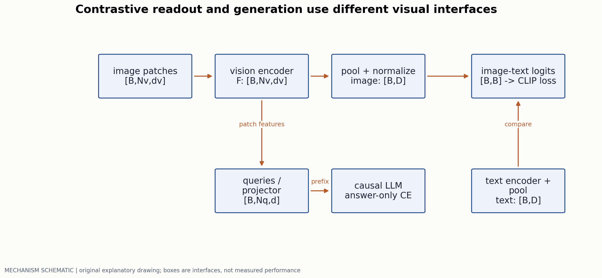
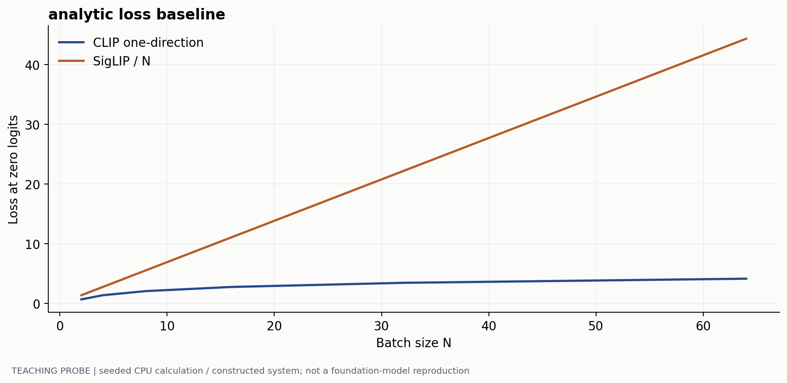
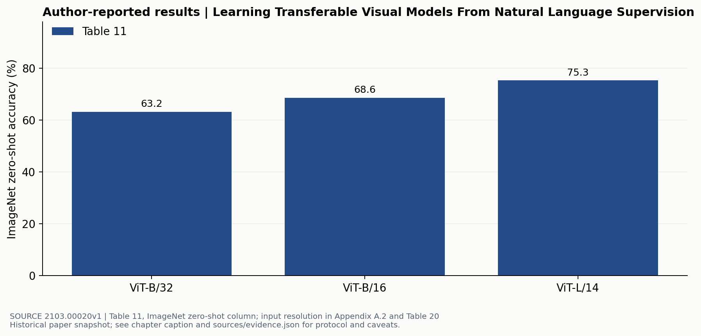

# 视觉条件怎样进入语言模型

> 副标题：从对比损失的梯度，到 connector、答案监督和分辨率实验
> 版本日期：2026-10-16 | 先修：第 00 章的张量与交叉熵

## 摘要

“视觉编码器加一个 LLM”省略了最难解释的部分：视觉特征为何可用于语言分类，却未必能支持细粒度生成；压缩视觉 token 时，信息究竟从哪里丢失；模型答案的流畅性又为何不能证明它用了图像。本章沿着训练接口追踪信息和梯度，展开 CLIP、SigLIP 与生成式 connector 的差别，并给出冻结策略、loss mask 和图像反事实对照的具体检查方法。

## 1. 先分开三个任务

CLIP [1] 学习图文的整体匹配；视觉问答学习给定图像和问题的答案分布；grounding 还要把短语连接到空间位置。一个 pooled embedding 可以给类别描述排序，却无法直接输出任意长度的答案；即使生成器接收 patch tokens，其坐标、阅读顺序和文字细节也不一定被保留。

设图像塔输出 $F_v\in\mathbb R^{B\times N_v\times d_v}$，语言模型需要维度 $d$ 的条件。对比学习常进一步池化、投影成 $[B,D]$；生成式 VLM 的 connector 则通常保留或压缩位置维，得到 $Z_v\in\mathbb R^{B\times N_q\times d}$。这是两个不同的信息接口。



## 2. 对比学习为什么会受 batch 构成影响

把归一化后的图文向量记为 $u_i,v_j$，相似度 logit 为 $s_{ij}=t u_i^\top v_j$，$t>0$ 是可学习的逆温度。CLIP 的一个方向为：

$$
\ell_i=-\log\frac{\exp s_{ii}}{\sum_{j=1}^N\exp s_{ij}},\qquad
\frac{\partial\ell_i}{\partial s_{ij}}=p_{ij}-\mathbf1[i=j].
$$

另一个方向对列作相同计算，最后对两个方向平均。因此“拉近配对、推远不配对”只是梯度的摘要：被模型误认为相近的负例有更大 $p_{ij}$，会得到更大惩罚。若 batch 内两张图都对应“红色公交车”，只把对角线当正例会把部分语义正确的配对推开，这是假负例问题，不是温度调节能完全解决的问题。

当各 logit 都为 0 时，一个方向的损失是 $\log N$。增加负例会改变随机预测基线，所以不同 batch 下的训练 loss 不能直接横向比较。分布式实现还要检查表示收集是否保留所需的梯度；能算出同一个 forward loss，不等于各设备得到同一训练更新。

### 2.1 SigLIP 改掉了归一化依赖，但没有取消负例

SigLIP [2] 对每一对图文作二分类。令 $z_{ij}=1$ 表示配对，否则为 $-1$，$a_{ij}=t u_i^\top v_j+b$。原论文 Algorithm 1 使用：

$$
\mathcal L_{\mathrm{SigLIP}}=\frac1N\sum_{i,j}\mathrm{softplus}(-z_{ij}a_{ij}),\qquad
\frac{\partial\mathcal L}{\partial a_{ij}}=-\frac{z_{ij}}N\sigma(-z_{ij}a_{ij}).
$$

这里是按图文样本数 $N$ 归一化，不是对 $N^2$ 个 pair 求均值。两种写法的整体梯度相差 $N$；如果沿用同一学习率，不能把它们看成无关紧要的记号差别。可学习 bias 也很重要：负例远多于正例时，它影响初始预测与梯度规模。



逐对 loss 允许分块累计，不需要对所有候选作同一个 softmax 分母。但若训练仍要使用全部跨设备负例，嵌入交换与 pair 计算并没有凭空消失。应分别讨论“目标函数是否需要全局归一化”和“具体实现怎样传输负例”。

新增机制检查对随机 logits 作中心有限差分，CLIP/SigLIP 的最大梯度误差约为 $1.01\times10^{-10}$/$1.67\times10^{-10}$。零 logits、零 bias 时，SigLIP 共享 bias 梯度为 $(N-2)/2$，N=64 时为 31；令 $b=-\log(N-1)$ 可使该无信息基线的正例先验为 1/N，bias 梯度为零。loss 数值、logit 梯度与编码器梯度不是同一个尺度。配置与原始梯度在 `sources/mechanism-checks.json` 和 `sources/raw/`。

## 3. Connector 是有代价的接口

线性投影 $Z=F_vW$ 把维度从 $d_v$ 改成 $d$，却不减少 $N_v$。MLP 增加非线性，但仍不能仅凭名字宣称它学到了细粒度对齐。BLIP-2 的 Q-Former [3] 使用可学习 queries，通过 cross-attention 读取冻结的视觉特征；query 数是对输出带宽的显式限制。

| 接口 | 输出长度 | 保留什么 | 需要重点检验的失败 |
|---|---|---|---|
| 逐 patch 线性/MLP | 通常 $N_v$ | patch 级表示与顺序 | 高分辨率下长度膨胀、坐标编码是否合理 |
| Query bottleneck | 固定 $N_q$ | 根据训练目标提取的摘要 | 小字、多个相似物体、密集计数被压掉 |
| LLM 内 cross-attention | 文本长度不必直接加视觉长度 | 文本查询可反复读取视觉 memory | 新模块训练稳定性、跨层 IO 和实现复杂度 |

以 patch size 14 为例，$224^2$ 图像对应 $16^2=256$ 个 patch，$448^2$ 对应 1024 个。若 query 固定为 32，读入分辨率增大四倍，送往 LLM 的槽位并没有增大。不能据此断言信息一定不足，但必须在密集 OCR 与多目标任务上作压力测试，而不能只看一项整体 VQA 平均分。

BLIP-2 的两阶段训练也不能缩成“训练一个桥”：第一阶段用图文目标让 queries 提取可与语言匹配的信息；第二阶段将 query 输出投影成冻结语言模型可使用的前缀。是否冻结某个模块，决定它能否适应接口分布，也决定需要保存哪些优化器状态。若只训练 connector，计算图仍经过冻结模型以取得对 connector 的梯度，不能把“冻结”解释成整段都不用反向信号。

### 先固定接口和读出位置

设视觉塔输出 $F\in\mathbb R^{B\times N_v\times d_v}$，可学习 queries 为 $Q_0\in\mathbb R^{N_q\times d_q}$，文字序列长 $U$。Q-Former 的 query 分支通过 cross-attention 读取 F，query 与 text 分支共享 self-attention 层。BLIP-2 使用 32 个 768 维 queries；它们的输出 $Z\in\mathbb R^{B\times32\times768}$ 是后续桥接的接口。第一阶段有三种不同的监督读出与 query–text 可见性。[BLIP-2 §3.1–3.2, Fig.2](https://arxiv.org/html/2301.12597)

把 self-attention 输入排列为 `[q1,q2,t1,t2,t3]`，mask 中的 1 表示该行 query 可以读取该列 key。三种 mask 分别为

```text
ITC                   ITG                   ITM
      q1q2 t1t2t3           q1q2 t1t2t3           q1q2 t1t2t3
q1     11  000        q1     11  000        q1     11  111
q2     11  000        q2     11  000        q2     11  111
t1     00  111        t1     11  100        t1     11  111
t2     00  111        t2     11  110        t2     11  111
t3     00  111        t3     11  111        t3     11  111
```

三种目标共享模型参数，依次执行时使用各自 mask。ITC 里的 queries 读图但不读文字，文字内部双向编码；ITG 让文字读取视觉 queries 与已出现的文字，queries 始终不读文字；ITM 让两种输入双向交互。padding 还要与这张访问表相交，不能只生成一张全局方阵。

ITC 将 query 输出与 text 的 CLS 读出分别投影、归一化。对图像 i 和文本 j，可写 $s_{ij}=\max_q z_{iq}^Tt_j/\tau$，再对图到文、文到图作对比交叉熵。最大值让某个 query 可以提供匹配证据。例如两个 query 与正确文本的点积为 0.7、0.1，与负文本的最大点积为 0.6，取 $1/\tau=10$，图到文对正确文本的 softmax 概率为 $e^7/(e^7+e^6)\approx0.731$。若 queries 已通过 self-attention 读到这条文本，模型就能把文本信息复制进图像表示，ITC 将失去独立表示匹配的意义。

ITM 输入匹配或不匹配的图文对，让每个融合后的 query 输出二分类 logits $l_q\in\mathbb R^2$，取 $\bar l=N_q^{-1}\sum_q l_q$ 后做交叉熵。此时双方需要交互，才能检查局部图文关系。ITG 则使用文本词表头，按 $-\sum_u\log p(t_u|F,t_{<u})$ 监督下一文字；视觉信息只能先由 queries 读取，再传给文字。若 queries 读取了未来文字，即使 text→text 是三角 mask，未来信息仍可绕过三角阵经 query 泄漏。这是需要同时检查四个 mask 块的原因。

### 第二阶段怎样把表示接到冻结 LLM

第二阶段加入 $W_p\in\mathbb R^{768\times d_L}$，得到视觉前缀 $P=ZW_p\in\mathbb R^{B\times32\times d_L}$。对 decoder-only LLM，把 P 接在文本 embedding 前，训练文字条件生成；对 encoder-decoder LLM，将 P 与文字前缀放入 encoder，decoder 预测后缀。[BLIP-2 §3.3, Fig.3](https://arxiv.org/html/2301.12597) 阶段一的 ITC/ITM 读出与阶段二冻结 LLM 的词表头应在计算图上分别标明。

| 模块 | 阶段一 | 阶段二 |
|---|---|---|
| 视觉塔 | 冻结，提供视觉特征 | 冻结，提供视觉特征 |
| queries 与 Q-Former | 更新，接收三种目标的梯度 | 更新，接收 LLM 生成 loss 的输入梯度 |
| ITC/ITM/ITG 读出 | 为各自目标提供监督 | 按本阶段架构移除或不参与该 loss |
| 到 LLM 维度的投影 | 未参与该桥接目标 | 更新 |
| LLM | 未接入第一阶段三目标 | 权重冻结，仍对其输入求梯度 |

冻结参数和切断计算图是两件可单独操作的事：

```text
vision.requires_grad_(False)
llm.requires_grad_(False)
with no_grad():
    F = vision(images)                 # upstream has no trainable input module here
Z = qformer(queries, visual_memory=F, task_mask=mask)
P = projector(Z)
logits = llm(embeddings=pack(P, text_embeddings))  # keep autograd to P
loss = answer_or_caption_cross_entropy(logits, shifted_labels)
loss.backward()                        # updates projector and Q-Former
```

这里若把 LLM 调用包进`no_grad`，投影与 Q-Former 也收不到这条 loss 的梯度。若把阶段一的 ITM 双向 mask 误用于生成，又会让 teacher forcing 读到未来答案。最小验收可以只用 2 个 queries 和 3 个文字位置：检查每个 loss 的非零梯度落在哪些输入/模块；再随机改变被遮蔽的未来文字，要求过去位置的生成 logits 保持一致。最后用 32/64/128 queries 在相同图像处理、数据曝光和训练计算下比较 OCR 与一般 VQA，才能把接口带宽问题变成实验。

### 固定一条图像处理路径再比较接口

一个可复现的教学配置是：RGB 图像按固定方式 resize 后中心裁到 224×224，归一化参数冻结，patch size 14，去掉 CLS，只保留行优先的 16×16=256 个 patch 特征。线性投影后是 `[B,256,d_L]`；若改为 32 queries，则接口为 `[B,32,d_L]`。本配置没有动态切块或多 crop。比较时先固定这条路径和训练曝光，只改变 query 数；再把分辨率作为下一项独立实验。否则 OCR 上的差异可能来自裁剪掉文字，而非 connector 处理不了它。

## 4. 一条训练样本应如何走完

一条 instruction 样本包含图像、用户问题、assistant 回答。先按模型约定处理图像尺寸和特殊 token，产生视觉条件；再把问题与答案拼成训练序列。视觉条件和用户部分可以参加 attention，但其 token 不应自动成为答案监督目标。

```python
# Pseudocode: trainable projector, frozen vision features
features = vision_encoder(images)          # [B,Nv,dv]
visual = projector(features)               # [B,Nv,d]
embeds, labels = pack(visual, questions, answers)
# labels are -100 outside assistant answer spans
loss = causal_lm(inputs_embeds=embeds, labels=labels).loss
```

实际实现需要额外核验：多图顺序是否与占位符一致；截断是否切掉回答而留下空监督；图像 resize/crop 是否裁掉答案；batch padding 后 position IDs 是否符合模型约定。仅检查 loss 下降抓不住这些错误，因为模型可能学会依赖问题与训练集答案先验。

## 5. 原论文的效果图应怎样读



这三个点共同改变了模型大小、patch 和训练计算（这三项输入均为 224 像素），不能据此得出“patch 从 32 改成 16 带来全部提升”。它们说明自然语言监督得到的表示可以用于零样本类别匹配；并不证明模型能够理解遮挡关系、阅读任意密集文字，或在问答时保持视觉事实性。

同样，SigLIP 中 4 个 TPUv4、两天、84.5% 的结果属于带冻结预训练图像塔的 SigLiT 设置 [2, Table 1]。把它写成随机初始化双塔的完整训练成本，会把视觉预训练的成本漏掉。这类实验条件应与数字写在一起。

## 6. 用什么对照检查“模型真的看图”

对同一问题至少保留四个输入：正确图、同类型错图、遮掉关键区域的图、仅文本。题目应需要图中细节而不能被常识唯一回答；对“通常是什么颜色”这样的题，错图对照不能自动代表视觉失效。

固定 prompt、输出长度和 decoding，分别记录答案准确率、关键对象召回、拒答，以及正确图到错图的答案变化。若模型对错图不敏感，可能是视觉分支被忽略，也可能是问题本身不依赖图像；需要逐例检查。若变得敏感却准确率下降，模型可能读取了错误线索，敏感性不是 grounding 的充分条件。

一个实际可做的小实验是只比较同一 LLM、同一视觉塔、同一数据与训练预算下的 32/64/128 queries，在整体 VQA 与密集 OCR 上分别报告曲线。记录视觉 token 数、峰值显存和 TTFT。先看信息瓶颈发生在哪里，再决定是否提高输入分辨率。第 09 章将把这类反事实对照用于偏好对齐。

本章 loss 基线可用 `python labs/run_probes.py` 复算。它只计算目标函数，不训练 CLIP，也不能据此比较真实编码器质量。

## 参考文献与证据

[1] Radford et al. Learning Transferable Visual Models From Natural Language Supervision. 2021. 2 节与 Table 11。[原文](https://arxiv.org/html/2103.00020v1)  
[2] Zhai et al. Sigmoid Loss for Language Image Pre-Training. 2023. Algorithm 1、Table 1 与分块实现。[原文](https://arxiv.org/pdf/2303.15343)  
[3] Li et al. BLIP-2: Bootstrapping Language-Image Pre-training with Frozen Image Encoders and Large Language Models. 2023. 3 节。[原文](https://arxiv.org/html/2301.12597)  
