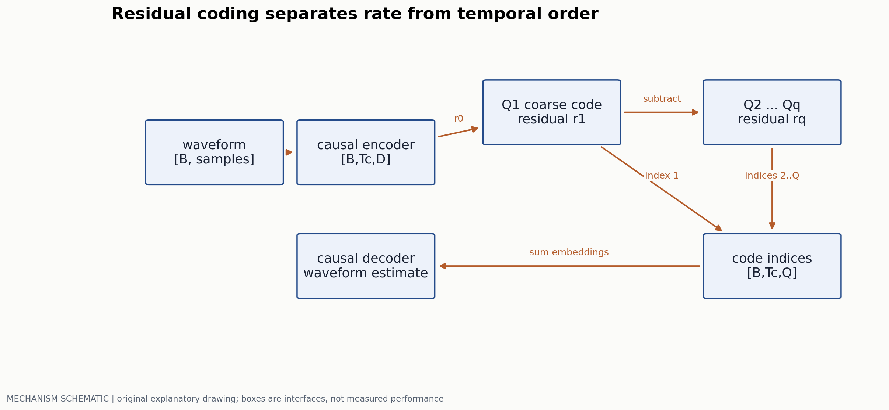
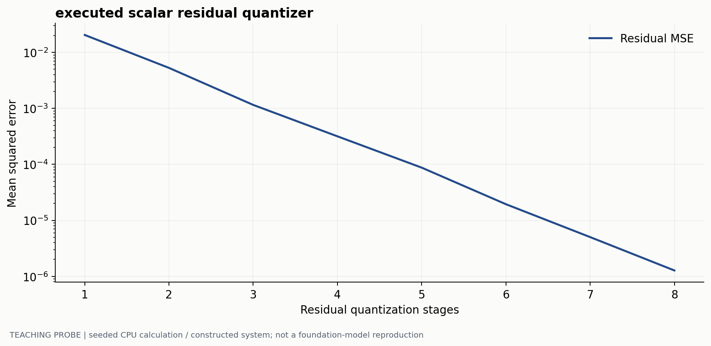
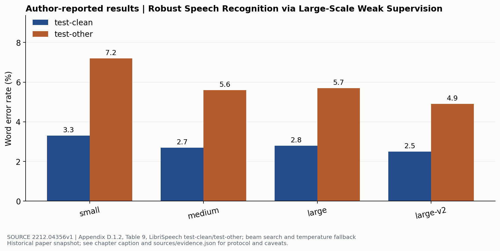

# 从波形到可流式生成的音频序列

> 副标题：时间分辨率、残差量化、因果排程与语音评测
> 版本日期：2026-10-16 | 先修：采样、离散概率与自回归模型

## 摘要

语音接口首先是时间与带宽问题。波形在几万 Hz 的采样率上变化，语言模型通常不能逐样点生成；压缩后虽然序列短了，却要决定哪些码携带语义、哪些码恢复音色，以及哪些未来信息在流式条件下可用。本章分别讨论识别与生成的接口，用码率核算和残差量化的实际教学实验解释表示选择，再通过 Whisper 的原始 WER 表说明为什么清洁语音分数不能替代鲁棒性和交互体验。

## 1. 波形、声学特征和 token 不在同一个时钟上

设采样率 $f_s=24000$ Hz，10 秒波形有 240000 个样点。若 encoder 的时间 stride 为 480 样点，输出频率是 $f_c=50$ Hz，只有 500 个潜在帧。这里的 50 Hz 是一个用于计算的设置，不是对所有 codec 的统一规格。

STFT 把局部波形映射为复数频谱。窗长控制局部频率分辨能力，hop 控制帧率；mel 变换进一步聚合频带。重叠的分析窗意味着相邻帧并不独立。若窗使用中心对齐，当前特征可能读取未来样点：离线准确率正常的前处理也可能在流式部署中引入 lookahead。

对 ASR，目标是 $p(y_{1:U}\mid x_{1:S})$；输出为文字，不需要重建每个声学细节。对语音生成，输出还必须保留说话人、韵律、停顿和噪声条件，因此“压成文字再朗读”会抹去部分原始信息。是否接受这个损失取决于产品任务：会议转写与声线保真对话的要求不同。

## 2. RVQ 如何用多个码本逐步编码残差

EnCodec [1] 的核心路径包含编码器、残差向量量化和解码器。给定一帧潜变量 $z$，令 $r_0=z$，第 $q$ 层选择离残差最近的码字：

$$
k_q=\arg\min_k\|r_{q-1}-e_{qk}\|_2^2,\qquad
r_q=r_{q-1}-e_{qk_q},\qquad \hat z=\sum_{q=1}^{Q}e_{qk_q}.
$$

第一层大致提供粗表示，后续层细化残差；这不意味着每个码本天然对应一个可解释的“语义/音色”因素。量化误差、声学感知质量与下游语义可用性是三件事，需要分别验证。



码索引的未熵编码码率为：

$$
R=f_c\sum_{q=1}^{Q}\log_2 K_q.
$$

例如 50 帧/秒、8 个码本、每个 1024 项，得到 4000 bit/s，即 4 kbps。原始 24 kHz、单声道、16-bit PCM 为 384 kbps，名义比值为 96。这个核算忽略容器、熵编码和传输开销，也不说明 4 kbps 重建能达到何种听感。把 bit/s 与 token/s 混用会漏掉每帧有多个码本这一层。

### 2.1 为什么训练不能直接对 argmin 求导

最近邻索引是离散选择。常见训练用 straight-through estimator 将解码端梯度近似传给编码器，并配合 commitment 或码本更新机制，避免编码器表示与码字相互脱离；不同 codec 的更新方案并不完全相同。重建还会组合波形、频域和感知/对抗目标，不能把整个 codec 等同于单一 MSE。



本实验的量化器无训练过程，选择规则和输入均保存在 `labs/run_probes.py`。如果增添一个层级后误差不降，应先检查码本是否包含零残差的有效选择、减法方向是否正确，再讨论网络容量。真实 RVQ 还要检查 codebook 使用率、死码、不同码本层的损失贡献和 dropout 设置。

### RVQ 的离散选择如何训练

令 codec encoder 输出 $z\in\mathbb R^{B\times T_c\times D}$，Q 个码本组成 $E\in\mathbb R^{Q\times K\times D}$；量化后索引为 `[B,Tc,Q]`，向量和 $\hat z$ 与 z 同 shape。递归最近邻已定义后，straight-through 路径可写

$$
z_{ST}=z+\operatorname{sg}(\hat z-z).
$$

前向 $z_{ST}=\hat z$，反向对 z 的局部导数按单位阵近似。decoder 的波形/频谱/对抗等 loss 因此能更新 encoder；commitment 项 $\sum_q\|r_{q-1}-\operatorname{sg}(e_{q,k_q})\|^2$ 约束各层残差接近已选码字。EnCodec 对码本使用 EMA 更新，并对未使用码字作替换；这条路径与“把码本当普通参数、加 codebook loss 再用 optimizer 更新”的 VQ 方案应分开说明。[EnCodec §3.2、3.4](https://arxiv.org/html/2210.13438)

对某层码本条目 k，当前 batch 分配数为 $n_k$、分配残差向量和为 $s_k$，可以将 EMA 教学实现写为

$$
N_k\leftarrow\lambda N_k+(1-\lambda)n_k,\quad
S_k\leftarrow\lambda S_k+(1-\lambda)s_k,\quad
e_k\leftarrow S_k/(N_k+\epsilon).
$$

数值例：二维输入 $(1.2,-0.3)$，第一层选 $(1,0)$，残差为 $(0.2,-0.3)$；第二层选 $(0.25,-0.25)$，重建为 $(1.25,-0.25)$，平方误差和为 0.005。第一层旧计数 2、旧向量和 $(2,0)$，只分配这一个新样本，取 $\lambda=0.9$，则新计数 1.9、向量和 $(1.92,-0.03)$，码字约更新为 $(1.0105,-0.0158)$。码本在向残差均值移动，encoder 则沿重建梯度与 commitment 梯度移动；两者的更新来源不同。

训练循环应记录这一分工：

```text
z = encoder(waveform)
choose active Q from the bandwidth schedule
for q in active quantizers:
    select nearest code from detached distances
    accumulate residual commitment and EMA counts/sums
    subtract the selected code from the residual
decode z + stop_gradient(sum_codes - z)
backprop reconstruction/perceptual losses and commitment into trainable networks
apply EMA updates to codebooks; inspect empty/rare codes
```

多码率训练抽取不同前缀码本数，使同一个 decoder 在不同带宽下工作；使用层数必须进入码率和质量评估。检查失败时应看每层 code usage 与 commitment、重建频谱、不同带宽的梯度，而不是只看总 MSE。若 STE 写成 `stopgrad(z)+q(z)-stopgrad(q(z))` 且 q 只含离散查表，encoder 路径可能被切断；若 EMA 与 optimizer 同时更新同一码本，又会改变预期算法。

最后把 RVQ 索引交给语言模型前，应画出因果排程。一个纯教学 delay pattern 取 Q=3、T=3，令码本 q 延迟 q 列：

```text
column        0    1    2    3    4
codebook 0   c00  c10  c20   -    -
codebook 1    -   c01  c11  c21   -
codebook 2    -    -   c02  c12  c22
```

每列内并行输出，列间 AR；第一帧全部码在第 2 列齐备，完整序列需要 T+Q−1=5 列，展平 AR 需要 9 个串行变量。实际 decoder 是否还读未来块，应接到 04 的 lookahead 账，而不能由这张索引表直接推断首个可播放波形的时刻。

## 3. 生成顺序决定延迟，不只是决定输出格式

若每帧有 $Q$ 个码，本来共有 $T_cQ$ 个离散变量。逐帧逐码本 AR 的深度约为 $T_cQ$；若先生成一层时间序列，再按帧并行补其他层，可减少时序依赖，但补层阶段可能要等待首层完整上下文，不能自动宣称可实时流式输出。

Delay pattern 将码本 $q$ 的时间位置平移，形成交错的生成列。一列内可预测多个码本，列间保持自回归。它用固定启动等待换取稳态并行；实际声学解码器还可能需要未来 code blocks，因此需要把模型排程和解码器 lookahead 加起来核算。

| 方案 | 主要串行依赖 | 首包风险 | 应实测的指标 |
|---|---|---|---|
| 展平所有码 | 时间与码本均串行 | 步数多 | 第一可播放 chunk 时间、token 吞吐 |
| AR 主层 + 补层 | 主层时间，补层条件依赖 | 补层可能依赖全句 | 首句等待、长音频稳态速率 |
| Delay 多流 | 交错列间串行 | 启动填充与 lookahead | 首包、chunk 间隔、尾部 flush |

不能用“每秒生成多少 token”直接比较这三类系统：一个 token 对应多少毫秒音频、同一时刻输出多少码本都可能不同。更稳定的速率量是实时因子 $\mathrm{RTF}=t_{compute}/t_{audio}$。RTF 小于 1 只表示平均计算可跟上播放，不保证首包低、尾延迟低或没有间歇卡顿。

## 4. ASR 怎样把声学时间对齐到文字

### CTC 把未知对齐作为路径求和

声学 encoder 输出 $H\in\mathbb R^{B\times T\times d}$，分类头给出 $p_t(k|x)$，词表大小为 V，加一个 blank。路径 $\pi\in(\mathcal V\cup\{\varnothing\})^T$ 的概率为 $\prod_t p_t(\pi_t|x)$；映射 $\mathcal B$ 先折叠相邻重复 label，再删除 blank。目标文字 $y_{1:U}$ 的概率为

$$
p(y|x)=\sum_{\pi:\mathcal B(\pi)=y}\prod_{t=1}^Tp_t(\pi_t|x),\qquad L_{CTC}=-\log p(y|x).
$$

例如目标为`aa`、输入只有 3 帧，则唯一合法路径是`a blank a`；`a a a`折叠后只有一个 a。若每帧 $p(a)=0.6,p(blank)=0.4$，则这条目标的概率为 $0.6\times0.4\times0.6=0.144$。这也说明相邻重复目标需要额外声学时间位置。[CTC §3–4](https://www.cs.toronto.edu/~graves/icml_2006.pdf)

动态规划避免枚举所有路径。将目标扩为 $y'=[blank,y_1,blank,\ldots,y_U,blank]$，$\alpha_t(s)$表示前 t 帧结束在扩展位置 s 的概率。递推为

$$
\alpha_t(s)=p_t(y'_s)\left[\alpha_{t-1}(s)+\alpha_{t-1}(s-1)+c_s\alpha_{t-1}(s-2)\right],
$$

其中 $c_s=1$ 当且仅当 $y'_s$ 非 blank 且与 $y'_{s-2}$ 不同；越界项取 0。初始只允许 blank 和首 label，终点为最后 label 与最后 blank 之和。实际计算在 log 空间用`logsumexp`。张量可为 `[B,T,2U+1]` 的教学实现，时间复杂度约 $O(TU)$；变长 batch 要使用真实 input/target lengths。把 CTC loss 误写成逐帧对齐交叉熵，会重新要求本来没有的边界标签。

### RNN-T 同时推进声学时间与输出位置

RNN-T 保留声学时间 t，再加已生成文字长度 u。encoder 产生 $h_t$，prediction network 从 $y_{\leq u}$ 得到 $g_u$，joint network 例如用 $j_{tu}=\tanh(W_hh_t+W_gg_u+b)$ 后输出 V+1 种符号概率。完整 logits 可写成 `[B,T,U+1,V+1]`，所以长语音的训练实现需要关注这部分内存。

在 $(t,u)$ 状态，blank 沿声学轴到 $(t+1,u)$，下一个 label 沿文字轴到 $(t,u+1)$。用与原文一致的一种索引约定，

$$
\alpha(t,u)=\alpha(t-1,u)p(\varnothing|t-1,u)+\alpha(t,u-1)p(y_u|t,u-1).
$$

初始 $\alpha(1,0)=1$，完整概率还乘终点 blank；实现应明确起终点约定。[RNN-T §2.3–2.5](https://arxiv.org/html/1211.3711v1) 相同文字可以在同一声学位置连续发出，且 label 概率依赖此前输出，这与 CTC 的帧级条件独立分解不同。流式推理时先缓存声学 encoder 状态，再在当前 t 预测 label，直到发出 blank 后推进声学时间；若 encoder 本身读取未来整句，采用 RNN-T loss 也不会使前端自动流式化。

### Whisper 的条件生成与解码规则

Whisper [2] 用 encoder-decoder 将声学特征映射为带任务标识的文字序列。语言、任务、时间戳等特殊 token 使同一模型承担多种条件生成；“architecture 很标准”并不能解释其全部表现，弱监督数据的规模与分布同样重要。

解码并非只有 beam size 一个参数。温度回退、重复检测、无语音判定、分段拼接和文本规范化都会改变最终 WER。论文 Appendix C 专门描述数字、标点、缩写等处理，因此复现必须把 normalizer 版本写进评测配置。



这里 large 的 clean WER 2.8 并不优于 medium 的 2.7。它既不证明模型越大越差，也提醒我们不要把单一域的一项指标画成无误差的 scaling 定律。不同 checkpoint 的训练与选择条件、其他语料上的表现都要同时查看。原论文还通过多数据集比较讨论域外鲁棒性；用 clean 分数挑出一个最小值，不能代替这类分析。

## 5. 先定义错在哪里，再选择评测

词错误率为 $\mathrm{WER}=(S+D+I)/N$，其中替换、删除、插入分别为 $S,D,I$，$N$ 是参考词数。插入可以使 WER 超过 100%。中文等语言还需要声明分词或使用字符错误率，不能拿两种分母直接比较。

语音生成需要另外测内容一致性、说话人保持、自然度和长音频稳定性。用 ASR 回译测内容时，分数同时受外部 ASR 的识别偏差影响；低 WER 不保证自然音色，较高说话人相似度也不保证内容正确。MOS 测试应报告受试者、随机化、音频长度和置信区间，不能给一个无设置的平均值。

一个基本失败案例是无语音或背景音乐输入触发完整转写。它可能来自解码先验、训练数据噪声和分段规则；应把静音、纯噪声、远场语音、口音和重叠说话分别作为测试 slice。对交互系统，还应记录模型说话期间用户插话是否被听见、取消后是否还有旧音频残留。第 04 章展开双工状态与缓冲管理。

## 6. 可复现的小实验与真正的模型复现

先运行 `python labs/run_probes.py` 检查残差量化曲线。改变信号幅度和频率，比较增加码本层与提高帧率各改变什么。这是一个可检查机制的教学实验，不能用于选择生产 codec。

如果要复现 ASR 结果，第一步不是扩充模型列表，而是固定一个 Whisper checkpoint、一份带许可的测试集与原文 normalizer，保存逐句 hypothesis 和 reference；再一次只改变 greedy/beam 或分段策略。对重复说话人用说话人分组的 bootstrap，避免把相关 utterances 当独立样本。没有执行这项真实模型实验之前，本章不会填写“本站复现 WER”。

## 参考文献与证据

[1] Défossez et al. High Fidelity Neural Audio Compression. 2022. 方法、RVQ 与流式结构。[原文](https://arxiv.org/html/2210.13438)  
[2] Radford et al. Robust Speech Recognition via Large-Scale Weak Supervision. 2022. Appendix C、D.1.2 Table 9。[原文](https://arxiv.org/html/2212.04356v1)  
