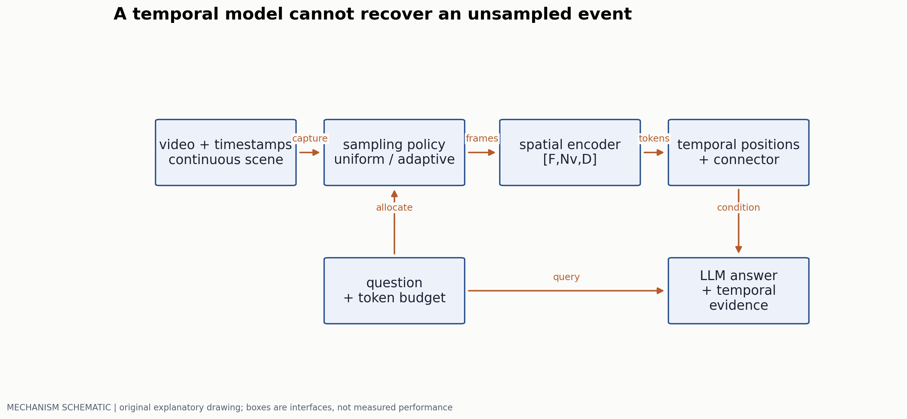
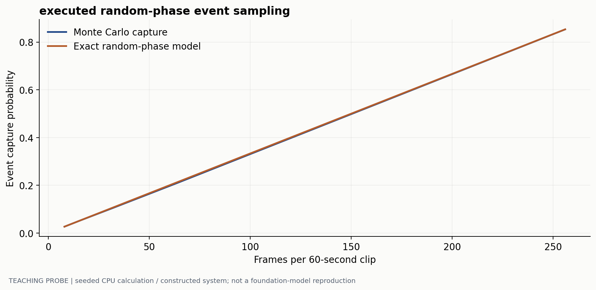
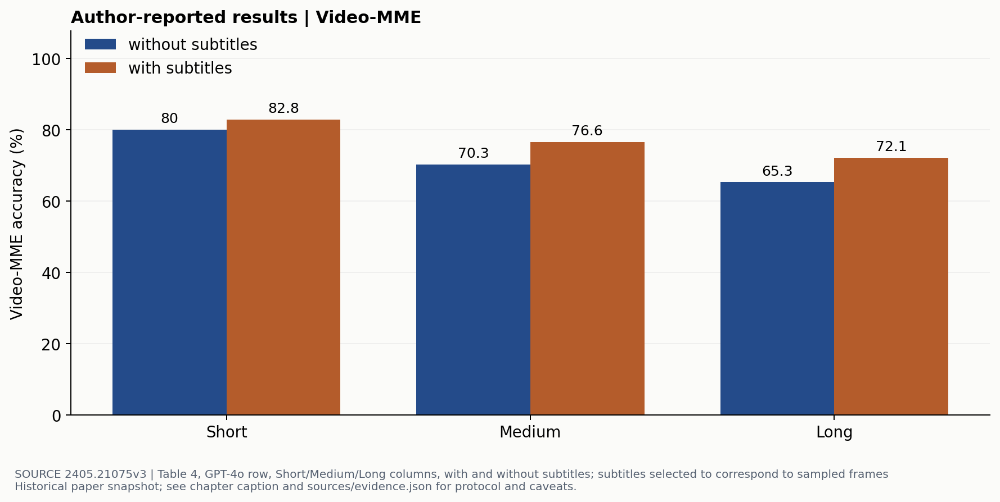

# 固定 token 预算下的视频理解

> 副标题：从采样漏检到时间编码，再到可解释的长视频评测
> 版本日期：2026-10-16 | 先修：第 01 章的视觉 token 与 connector

## 摘要

一段视频可以在几秒内包含决定答案的动作，也可以在几十分钟里只出现一次关键事件。把所有帧送给模型通常不可行；均匀抽帧又会产生不可恢复的信息缺失。本章以“固定预算下保留什么证据”为主线，区分采样、帧内编码、时间关系建模和回答验证，并用一个实际执行的随机相位实验计算漏检风险。Video-MME 的真实结果用于检验协议敏感性，而不是替代对时间推理能力的归因。

## 1. 首先核算输入，而不是先选择模型

设抽取 $F$ 帧，每帧编码成 $N_v$ 个视觉 token，连接器保留比例为 $r$，视觉长度约为 $T_v=FrN_v$。如果每帧 256 token、抽 64 帧、不做压缩，就是 16384 个视觉位置，还没有计问题、回答和系统提示。这个例子仅描述一种接口，不是 Video-MME 的统一输入协议。

增加帧数和提高空间分辨率争夺的是同一个上下文预算：OCR 题可能需要高空间密度，动作次序题则更需要时间覆盖。用同一个固定采样配置评测所有问题很方便，但可能掩盖模型在两类信息之间的取舍。



## 2. 均匀采样的漏检率可以先算出来

考虑长度 $T$ 的视频，一次关键事件持续 $\delta$。等间隔取 $F$ 帧，间隔 $\Delta=T/F$。若事件与采样网格的相位均匀随机、只需命中一帧、忽略两端边界，可得：

$$
P(\mathrm{hit})=\min\left(1,\frac{\delta}{\Delta}\right)=\min\left(1,\frac{F\delta}{T}\right).
$$

这个结果来自一个采样间隔内长度为 $\delta$ 的可命中相位区间，不是对所有真实视频成立的经验定律。若辨认动作还需要前后两帧，或者事件在镜头切换处被遮挡，命中一帧仍可能没有足够证据。

以 60 秒、0.2 秒事件为例，32 帧的该模型命中概率约为 10.7%；128 帧约为 42.7%。因此在短事件任务上，平均帧数看起来不低，仍可能主要测到“有没有采到”。



### 2.1 自适应采样改变的是哪一个环节

可以先用低成本特征寻找镜头变化、运动或与问题相关的候选时间，再分配精细帧。这把计算从均匀覆盖转成有条件的预算分配，但也引入一个新的召回瓶颈：粗检漏掉的平静事件无法被精检挽救。例如“某件物品何时从桌上消失”不一定具有大的瞬时运动。

评估采样器时应保留带证据时间段的标注，同时报告 evidence recall 与最终任务准确率。让模型先看到答案再选帧会产生泄漏；由问题驱动检索是合法条件，由标准答案驱动检索则需要明确标为 oracle 上界。

## 3. 时间关系不能由帧索引名称代替

逐帧视觉编码器输出 $V\in\mathbb R^{B\times F\times N_v\times d_v}$。展平成 $[B,FN_v,d]$ 后，模型需要知道哪些 token 属于同一帧，以及帧发生的真实时间。若视频帧率变化、采用非均匀采样，简单用 $0,1,2,\ldots$ 表示时间，会把不等间隔误表示为等间隔。

可以给位置使用 $(t,h,w)$ 的结构，或者在帧前插入时间戳 token；两者的归纳偏置与实现成本不同。时间坐标还需要与训练长度和尺度一致：同样的索引在 10 秒片段和 1 小时视频中可能对应不同速度。不能看到一个模型支持长 context，就推断它学会了长时间尺度的因果关系。

| 计算方式 | 时间交互发生在哪里 | 可检验的瓶颈 |
|---|---|---|
| 图像塔逐帧 + LLM | 主要在 LLM 的视觉序列中 | token 数、帧间重复、训练是否含时序监督 |
| 视频编码器 + connector | 上游已经混合局部时空信息 | 预训练窗口与长视频尺度是否匹配 |
| 检索/分层摘要 | 先压缩片段，再跨片段推理 | 细节丢失、摘要错误、检索召回 |

分层摘要把长上下文问题改成信息压缩问题。“A 在 B 之前”如果在摘要时丢掉了时间锚，后端推理不能补回来。因此摘要不仅要保存事件描述，还应保存时间范围、来源帧与不确定信息。

### 从帧时间到三轴旋转

假设采样后有 F 帧，每帧编码成 $H_v\times W_v$ 个 token，视觉张量为 `[B,F,Hv,Wv,d]`。展平顺序选 `frame → row → column`，所以索引 $j=fH_vW_v+hW_v+w$。保留 `frame_times[B,F]`，再构造 `position_ids[3,B,T]`，三个轴分别是时间、行、列。

为便于实现，先给出一个教学约定：时间单位 $\Delta=0.04$s，$p_t(f)=\mathrm{round}(t_f/\Delta)$，$p_h=h,p_w=w$。采样时间 0、0.6、2.0 秒对应 0、15、50，而不是 0、1、2。同帧所有 patch 共享时间 ID；同一空间位置在不同帧上使用相同行列 ID。Qwen2.5-VL 将 MRoPE 时间分量对齐实际时间；Qwen2.5-Omni 进一步给出每个时间 ID 对应 40ms 的音视频对齐方案。[Qwen2.5-VL §2.1.3](https://arxiv.org/html/2502.13923v1)、[Qwen2.5-Omni §2.2](https://arxiv.org/html/2503.20215v1) 上述 round 规则和示例是教学接口，具体 checkpoint 仍要使用官方 processor 的位置规则。

将每个 head 的成对维度分成时间、行、列三组，组内按 00 的 RoPE 旋转。设 $q=(q_t,q_h,q_w)$，则两个视觉 token 的内积由三项组成：

$$
q_t^TR_t(\Delta p_t)k_t+
q_h^TR_h(\Delta p_h)k_h+
q_w^TR_w(\Delta p_w)k_w.
$$

每组分配多少维、使用哪些频率，应从模型配置读取。若 text 的三轴 ID 取相同序号，该构造可退回一维位置形式。插入视觉段后的 text 起点也需要明确；一个教学选择是从前段三轴最大 ID 加 1 继续，这与直接使用 flatten token 个数是不同的编号法。decoder cache 应保存确切 position IDs 或可重建它们的元数据。

```text
for frame f at physical time t[f]:
    for patch (h,w):
        emit visual_token[f,h,w]
        emit coordinates(time_to_id(t[f]), h, w)
apply rotary groups using the three coordinate arrays
save source time and coordinate IDs with the flattened token sequence
```

用同一视频做两次采样，一次保留 0、0.6、2.0 秒，另一次多加入 1.0 秒；原来三帧的时间坐标应按同一个时间尺度解释。若只是重新编号成 0、1、2、3，插入一帧就改变了其他帧所表达的物理间隔。检查这一点，比只看张量 shape 更能发现时序错误。

一个具体维度例：取教学 head dimension 12，将时间、行、列各分 4 维，即各有两对旋转坐标；每组内部沿用各自频率表。同帧相邻 patch 只改变列组的角度，同一 patch 跨帧只改变时间组。若把 12 个通道都按 flatten ID 旋转，便不再是这组三轴约定。这个 4/4/4 分配是教学选择，不是 Qwen checkpoint 的真实配置。

### 空间与时间 attention 怎样分配计算

设每帧 N 个 token、共 F 帧。联合 self-attention 每 head 约有 $(FN)^2$ 个 query–key 配对。先在每帧内做空间 attention，再对同一空间槽跨帧做时间 attention，则约为 $FN^2+NF^2$。取 F=16、N=256，前者约 16.78M 配对，后者约 1.11M；投影、MLP 与层数尚未计入。节省来自限制这一层的交互方式：时空因素需要通过多层传播，而不是在一层中直接任意配对。若先对每帧所有 patch 均值池化，再做时间 attention，空间排列已经被压缩，无法要求后端从均值中恢复局部物体轨迹。

一个最小对照用相同的四张帧，排列成“物体先进入再离开”与“先离开再进入”；静态对象问题共享答案，顺序问题答案相反。固定可见帧和 token 预算，分别比较 joint/factorized/pooling，才能把时间建模与采样召回分开。

## 4. 一个时间推理实验需要哪些对照

对同一段视频制作顺序颠倒、局部片段打乱、重复帧、去掉关键片段四种对照。问题也要分类：静态对象题理应对打乱相对不敏感；事件次序题应明显受影响。若两类题都一样下降，可能只是分布外扰动；若次序题完全不变，可能依赖了语言或视觉共现捷径。

```python
# Pseudocode: keep source-time provenance through sampling
frames, times = sample(video, frame_budget)
features = encode(frames)
visual = connect(features, timestamps=times)
answer = generate(visual, question)
# Save sampled timestamps with every prediction.
```

复现日志至少保留解码版本、原视频时长、抽帧时间戳、resize/crop、最大视觉 token、字幕与音频开关、prompt、回答截断规则。只保存一个最终分数，不足以区分采样错误和模型错误。

## 5. 用 Video-MME 分清“额外信息”与“更强推理”

Video-MME [1] 将不同长度的视频纳入评测。下图来自 v3 主比较表中的同一个 GPT-4o 行，而不是不同发布日期的排行榜拼接。



长视频分数较低，可能同时受采样覆盖、信息压缩、问题难度和推理影响。字幕带来额外文本证据，可以降低对音频或视觉细节的依赖；字幕提升不是“视觉时间理解改善了”的直接证据。模型间比较还需要检查帧数、分辨率和是否把字幕作为输入，不应只对齐参数规模。

可以进一步拆出视觉必要、语音必要、字幕足够与需要跨模态整合的题。先用对应单模态基线检验这些标签，防止题目在名称上是多模态、答案却能由字幕单独给出。第 10 章的配对评测可用于比较同一题在有/无字幕条件下的变化。

## 6. 预算固定时如何选择下一项实验

如果采样召回低，优先研究帧分配，不要先把 LLM 变大。如果证据帧已命中而模型仍答错，检查空间分辨率和跨帧关系。如果信息都能定位却在长答案里混淆来源，则需要输出约束或证据引用机制。

一个可实施的实验网格是：固定总视觉 token，用 16 帧高分辨率、32 帧中分辨率、64 帧低分辨率，分别测 OCR、静态属性与短事件题。再固定帧数比较均匀与自适应采样。两组实验回答不同问题，不能混在一个“新模型更好”的对照里。

运行 `python labs/run_probes.py` 可以复算采样实验。它没有视频解码器或语言模型，只检查一个明确假设下的采样机制；真正的模型评测仍需按上述协议执行，不能从采样概率直接填出 VQA 准确率。

## 参考文献与证据

[1] Fu et al. Video-MME: The First-Ever Comprehensive Evaluation Benchmark of Multi-modal LLMs in Video Analysis. v3，主比较表。[原文](https://arxiv.org/html/2405.21075v3)  
[2] Qwen Team. Qwen2.5-Omni Technical Report. 时间对齐和流式编码作为跨模态实现案例。[原文](https://arxiv.org/html/2503.20215v1)  
