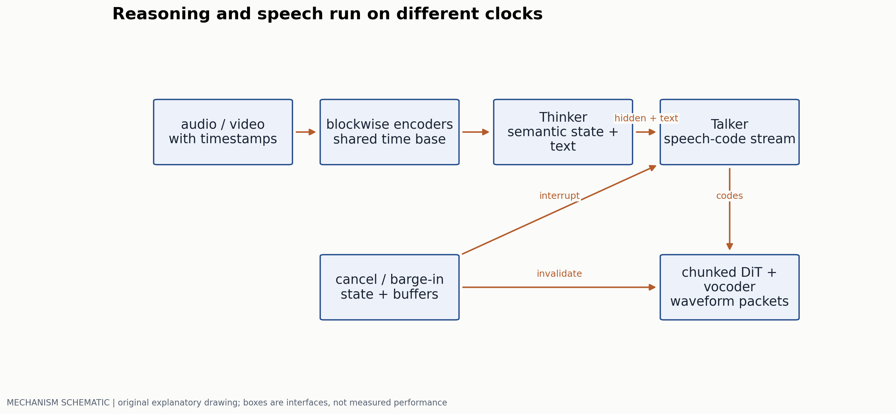
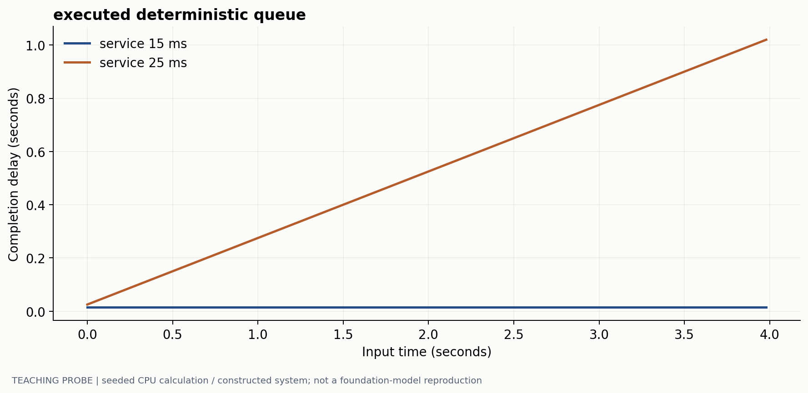
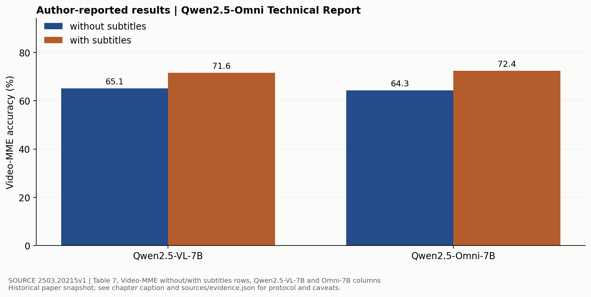

# 全模态系统的时间接口与双工执行

> 副标题：把“听见、看见、推理、说话”拆成可核算的状态和缓冲
> 版本日期：2026-10-16 | 先修：第 02 章的 codec，第 03 章的时间采样

## 摘要

一个系统能接收音频和视频、生成文字与语音，并不等于它能在用户插话时及时停止，也不等于它能持续处理长时间流。全模态建模与实时交互是相互约束的两个问题。本章以 Qwen2.5-Omni 的 Thinker–Talker 路径为具体案例，分别分析时间戳、语义与声学接口、分块生成、队列稳定性和取消状态，并通过原文的任务结果说明“统一后没有明显退化”与“统一架构带来因果提升”之间的差别。

## 1. 先列清系统承诺

离线 any-to-any 模型可以等待所有输入到齐后输出；流式系统只能访问当前已经到达的信息；全双工还要在输出期间继续感知用户输入。三者的可用上下文和调度约束不同。报告一个模型“支持实时语音”，至少应说明输入块长、未来 lookahead、首包定义、稳态速度和插话处理方式。

设视频帧时间为 $t_v$，音频块覆盖 $[t_a^{start},t_a^{end}]$，模型内部位置不能仅把两类输入独立编号后相加。更合理的接口是把它们映射到一个共同时间轴；模型可以再对不同模态采用不同空间或时间位置编码。



## 2. Thinker 与 Talker 为什么分开

Qwen2.5-Omni [1] 的 Thinker 负责理解条件和生成文字，Talker 结合语义表示与离散文字信息生成语音码，再经分块声学生成转换成波形。语义空间里的相似词不一定发音相似，因此只传隐藏状态不足以唯一确定发音；论文明确讨论了传入采样文字 token 的作用。

两条输出路径也带来监督分工：文字需要语义、知识和指令跟随，语音还需要发音、节奏与说话人信息。完全共享解码路径会让不同输出损失相互作用；分离则增加模块与同步接口。不能只用“模块少/多”判断优劣，应检查相同训练量下的质量、延迟和损失干扰。

原文 2.4 节给出一些具体实现约束：音频编码采用 2 秒块内 attention；视觉侧用 MLP 合并相邻的 2×2 tokens；声学 DiT 的分块窗口有 lookback 与 lookahead。块内因果性、块间可用信息和音频输出 lookahead 因此必须一起审查。一个编码器“支持块处理”不意味着整条链完全没有未来依赖。

### 位置对齐之后，还要定义哪些数据已到达

每块记录两种时间：事件覆盖 $[t_j^{start},t_j^{end}]$，以及本机单调时钟下的到达时刻 $a_j$。位置编码描述事件时间；在线 mask 还需要满足数据可用性。决策时刻 $\tau$ 只能使用 $a_j\leq\tau$ 的块。若块内 attention 是双向的，该块对应的可见内容应等到所需块完整到达后再提交。

Qwen2.5-Omni 将音视频按 2 秒时间片交错，片内先视觉再音频；其音频 encoder 采用 2 秒块内 attention。输出声学 DiT 使用当前块、2 个 lookback 块和 1 个 lookahead 块。[Qwen2.5-Omni §2.2–2.4, Fig.3–4](https://arxiv.org/html/2503.20215v1) 2 秒输入分片、音频表示的 40ms 时间单位和声学输出块是三个不同接口，应分别记录长度与缓存。模型报告中的这些设计本身没有定义完整产品的双工取消策略。

可以在实现中给每个 token 增加块号 c 和可用时刻：

```text
allowed(query i, key j) =
    key j has arrived before this decision
    AND j belongs to the architecture's permitted context blocks
    AND the within-block mask permits i -> j
```

如果教学系统规定收满 2 秒才编码，那么首块自然包含最多 2 秒的数据等待；若使用更小的独立块，则等待与可用上下文一起改变。把输入分片改小以后，encoder mask、训练条件和 cache 接口也要与之匹配。

### 用一条时间线核算 lookahead

构造一个输出 codec：每块表示 80ms 声音，当前块需要下一块提供上下文。假设语音码 chunk 0 在 wall-clock 100ms 齐备，chunk 1 在 180ms 齐备，mel 计算 12ms、vocoder 8ms。于是 chunk 0 最早在 200ms 成为可播放波形；只需要当前块的同成本 decoder 则可在 120ms 完成。差额 80ms 来自等待未来码块。2 块 lookback 只使用过去已经存在的信息，主要增加状态与计算；首块还需要规定左侧 padding 或启动上下文。

```text
code ready:       c0 @100ms       c1 @180ms       c2 @260ms
decode c0:                       [mel12][wav8] -> playable @200ms
decode c1:                                         [12][8] -> @280ms
audio represented: c0 is 80ms; c1 is the following 80ms
```

这组数值是接口手算。实际系统允许阶段重叠时，每个节点的开始时刻等于“资源空闲时刻”和“全部前置数据 ready 时刻”的最大值；沿依赖图求首个 playable 节点，比分别相加平均耗时更准确。首包之后还需检查每 80ms 能否持续交付下一块，避免平均 RTF 合格但缓冲耗尽。

同步也需要明确策略。例如某视频帧事件时间为 2.00 秒、到达 2.08 秒；对应音频段覆盖 2.00–2.04 秒、到达 2.10 秒。在 2.09 秒作决定时可以用该视频帧，但音频尚不可用。一个要求同步窗口的实现可维护 watermark $w=\min(w_{audio},w_{video})$，只提交两路都完整覆盖的窗口；等待超时后则显式标记缺失模态。重新把迟到音频编号成“下一段”会造成位置正确、内容错位的隐蔽错误。

## 3. 延迟不是一个数字

若用严格串行近似，首个可播放包的延迟由输入等待、编码、首个语义输出、首个语音码、声学解码和调度组成：

$$
T_{first}\approx T_{input}+T_{enc}+T_{text}+T_{code}+T_{wave}+T_{queue}.
$$

真实实现可以重叠其中一些项，所以这个式子首先是检查清单，不是测量公式。首 token 可能是文字 token、音频 code，或首个可播放波形包；三者不能写成同一个 TTFT。测量必须带起止事件和时钟来源。

稳态还要求处理能力足以跟上输入。设每隔 $a$ 秒来一块，单服务器服务时间为 $s$，完成时刻满足：

$$
f_i=\max(f_{i-1},ia)+s,\qquad d_i=f_i-ia.
$$

当 $s>a$ 且没有丢帧或反压，排队延迟会积累。平均首包较快不能掩盖长会话逐渐落后的问题。



### 3.1 分块大小同时改变三件事

小块减少初始等待，却可能降低声学质量、增加 kernel 启动开销和跨块接缝；大块提高单次计算效率，却增加首包与插话后的残余播放。lookahead 也不是免费的：如果解码需要下一块，那么当前包不能在下一块到达前完成。

因此应在同一硬件、同一会话负载下画首包/p95 与质量曲线，而不是分别挑两个最优数值。批处理增加吞吐时，调度等待可能恶化交互体验；只报告总 token/s 会遗漏这个取舍。

## 4. 插话是带版本号的状态转换

假设用户打断模型。系统至少存在已提交文字、正在生成的文字、正在生成的语音码、已解码但未播放的音频、正在扬声器播放的片段。只停止 LLM 请求，不能清除后面几层已经排队的旧输出。

```text
LISTENING -> RESPONDING(epoch=e)
barge-in detected:
  invalidate epoch e
  stop generation and discard unplayed packets tagged e
  keep input capture active
  reconcile what the user actually heard
  start a new response epoch
```

这是实现协议伪代码，非某个模型的官方推理代码。关键是给输出包附上 response epoch，使旧任务迟到的包不会进入新会话；并定义“用户实际听见了什么”如何回写上下文。否则下一轮模型可能把未播放的内容当成已说出，产生对话状态漂移。

| 测试情形 | 需要记录的事件 | 常见错误 |
|---|---|---|
| 用户在首包前打断 | 取消时刻、旧任务最终返回 | 已取消输出仍排入缓冲 |
| 用户在播放中打断 | 输入检测、最后旧音频播放 | 停止请求但不清播放器队列 |
| 背景噪声触发 | 检测置信度、回退行为 | 过敏停止，导致对话无法完成 |
| 连续长会话 | 每块完成时间、队列深度 | 首句流畅，后续延迟持续增长 |

### 打断时提交的是用户听到的前缀

每个输出块附 `(response_epoch, chunk_id, audio_start_sample, audio_end_sample)`。用户插话被检测后，作如下转换：

```text
mark epoch e invalid
cancel pending generation for e
remove all unplayed e packets from application and playback queues
continue input capture; reject any late packet whose epoch is invalid
read the final actually-played sample offset from the player
save the heard prefix and interruption event in conversation state
begin a new response epoch using that reconciled state
```

若 24kHz 播放器只播放了某 chunk 的 6400 个样点，实际听到约 266.7ms；不能把该 chunk 后半段对应的未播文字记成已经说出。文字与音频没有逐词对齐时，应保存可追溯的片段边界或不确定前缀，而不是凭完整文本覆盖实际播放状态。测试时向旧 epoch 人为延迟一个包，要求取消后它被丢弃；再分别测从插话开始到检测、从检测到最后旧音频播放的时间。这样模型的感知速度与播放器的取消速度成为两个可独立改进的量。

## 5. 一张任务效果图能支持什么



这些数字至少让“Omni 各项都更好”变成一个可检查的命题：无字幕时该表的 Omni 分数略低，有字幕时略高。差距是否稳定、是否来自训练数据或输入预算，原表没有提供充分的控制变量和置信区间。它也没有测插话质量，不能用来证明双工交互成功。

评价全模态需要分别冻结单模态任务协议与交互协议。前者比较识别/理解/生成质量；后者比较流式稳定性和状态一致性。若新模型同时改变视觉帧预算、语音训练数据和解码后端，就不能把全部差异归因于“更统一”。

## 6. 从最小可测系统开始

先用录制好的带时间戳音视频流驱动系统，保存块到达、编码完成、首语音码、首波形包和实际播放时间。先测单会话，再增加并发；只用服务器时间减去客户端时间而不校准时钟，会混进时钟偏差。

质量侧保留同一段输入的文字与语音输出，分别检查内容一致性、发音、跨模态指代和对插话的响应。系统侧比较均值与 p95，并检查有没有超时、丢块、播放残留。不能把失败请求排除后只报告成功会话的漂亮延迟。

运行 `python labs/run_probes.py` 可重现图 2 的队列行为。它的用途是让“处理时间超过到达间隔会怎样”成为可复算的事实；生产系统的数值仍必须来自真实负载测量。第 08 章提供 prefill/decode 的资源解释，第 07 章提供工具执行与状态验证的相邻问题。

## 参考文献与证据

[1] Qwen Team. Qwen2.5-Omni Technical Report. 2025. 2.3–2.4 节、Table 7。[原文](https://arxiv.org/html/2503.20215v1)  
[2] Défossez et al. High Fidelity Neural Audio Compression. codec 接口与流式约束。[原文](https://arxiv.org/html/2210.13438)  
