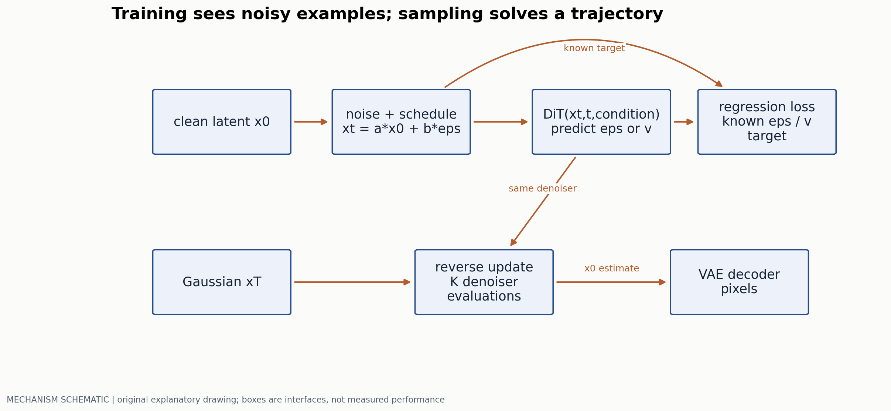
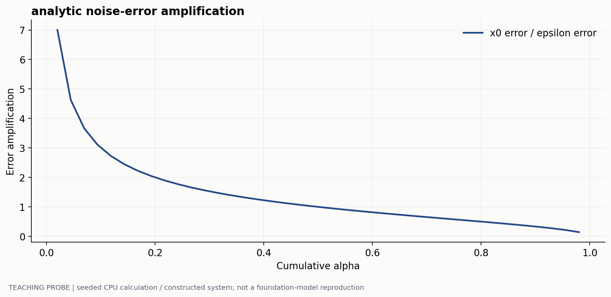
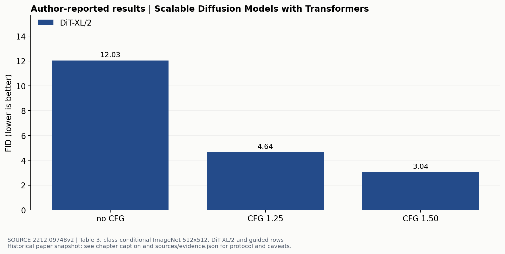

# 从去噪目标到统一图像生成

> 副标题：推导训练量，核对采样过程，并分开质量、覆盖和计算预算
> 版本日期：2026-10-16 | 先修：高斯分布、条件概率、第 00 章

## 摘要

“反复去噪得到图像”没有解释网络为何可以学习这个过程，也没有说明换一种预测目标或增加采样步数会改变什么。本章从已知的前向加噪分布推导后验和训练目标，再沿着 latent、patch、Transformer 和解码器追踪一次采样。最后用 DiT 原文中同一分辨率、同一模型的 guidance 结果，展示 FID 改善与分布覆盖下降可以同时发生；统一理解与生成则被拆成表示、attention 与损失三个具体接口。

## 1. 先构造一个可以直接采样的训练问题

DDPM [1] 定义前向过程 $q(x_t\mid x_{t-1})=\mathcal N(\sqrt{1-\beta_t}x_{t-1},\beta_t I)$。令 $\alpha_t=1-\beta_t$、$\bar\alpha_t=\prod_{s=1}^t\alpha_s$。反复代入并利用独立高斯噪声之和仍为高斯，可得：

$$
x_t=\sqrt{\bar\alpha_t}x_0+\sqrt{1-\bar\alpha_t}\epsilon,\qquad\epsilon\sim\mathcal N(0,I).
$$

因此训练时不必真的执行 $t$ 次加噪：抽一个干净样本、一个时间步和一份噪声，就能直接得到 $(x_t,t,\epsilon)$。这里 $x_0$ 可以是像素，也可以是预先训练的 autoencoder latent；后者的重建瓶颈必须另外评估。



### 1.1 真实后验为什么重要

生成时不知道 $x_0$，但训练推导可以以它为条件。由贝叶斯公式，将 $q(x_t\mid x_{t-1})q(x_{t-1}\mid x_0)$ 的高斯指数配方，得到：

$$
q(x_{t-1}\mid x_t,x_0)=\mathcal N(\tilde\mu_t,\tilde\beta_t I),\qquad
\tilde\beta_t=\beta_t\frac{1-\bar\alpha_{t-1}}{1-\bar\alpha_t}.
$$

$$
\tilde\mu_t=\frac{\sqrt{\bar\alpha_{t-1}}\beta_t}{1-\bar\alpha_t}x_0+
\frac{\sqrt{\alpha_t}(1-\bar\alpha_{t-1})}{1-\bar\alpha_t}x_t.
$$

后验均值是 $x_0$ 与 $x_t$ 的已知线性组合。模型要逼近的是这个条件后验的统计量，而不是凭空学一个任意“变清晰”算子。$t=1$ 的重建项和终点先验项在完整 variational bound 中有各自位置，不应把所有时间步都笼统叫同一个 KL 项。

## 2. 从均值回归变成噪声回归

取反向模型 $p_\theta(x_{t-1}\mid x_t)=\mathcal N(\mu_\theta(x_t,t),\sigma_t^2 I)$。将 $x_0=(x_t-\sqrt{1-\bar\alpha_t}\epsilon)/\sqrt{\bar\alpha_t}$ 代入后验均值，可将模型均值写为：

$$
\mu_\theta(x_t,t)=\frac1{\sqrt{\alpha_t}}\left(x_t-
\frac{\beta_t}{\sqrt{1-\bar\alpha_t}}\epsilon_\theta(x_t,t)\right).
$$

固定方差时，对两个高斯的 KL 会产生一个带时间权重的噪声平方误差；DDPM 的常用 simple objective 去掉了这部分权重：

$$
\mathcal L_{simple}=\mathbb E_{x_0,t,\epsilon}\|\epsilon-\epsilon_\theta(x_t,t)\|_2^2.
$$

“等价于最大似然”需要说明用了哪个 weighting、方差和离散时间设定。把 simple loss 与完整 ELBO 完全等同，会掩盖它对不同噪声级别的重新加权。

### 2.1 参数化变化也改变误差尺度

预测噪声得到的干净估计为 $\hat x_0=(x_t-\sqrt{1-\bar\alpha_t}\hat\epsilon)/\sqrt{\bar\alpha_t}$。若噪声预测存在误差 $e$，则干净估计误差是 $-\sqrt{(1-\bar\alpha_t)/\bar\alpha_t}\,e$。低信噪比时，固定的噪声误差会被放大。



常见的 $v=\sqrt{\bar\alpha_t}\epsilon-\sqrt{1-\bar\alpha_t}x_0$ 是另一种线性参数化；它与 flow matching 中沿插值轨迹定义的速度目标不是同一个符号约定。阅读论文时先写出插值和目标定义，再讨论“都在预测 velocity”。对同一数据换参数化，也要检查 t 分布和 loss weighting，不能只替换输出变量名称。

### Flow matching 学习什么速度

为避免与 DDPM 的“$x_0$表示数据”混淆，这里把噪声记为 $\eta\sim\mathcal N(0,I)$，数据记为 z，插值时间 $\tau=0$ 为噪声、$\tau=1$ 为数据。在 $\sigma_{min}\to0$ 的教学极限下，最简单的条件路径为

$$
x_\tau=(1-\tau)\eta+\tau z,\qquad u=z-\eta,
\qquad L_{CFM}=\mathbb E\|v_\theta(x_\tau,\tau;c)-u\|^2.
$$

其中 c 是文本、类别或其他条件；图像 latent 可以是 `[B,Cz,Hz,Wz]`，$x_\tau,u,v_\theta$有同样 shape，时间为 `[B]` 并广播到空间维。训练时随机抽数据、噪声、时间即可形成监督，无须先数值积分出一条模型轨迹。条件 flow matching 通过可计算的条件路径学习边际流，是 FM 论文的核心构造。[Flow Matching §3–4](https://arxiv.org/html/2210.02747v2)

平方回归还给出一个直接解释。对固定 $(x,\tau,c)$，令 $m=E[u|x,\tau,c]$，则

$$
E[\|v-u\|^2|x,\tau,c]=\|v-m\|^2+E[\|u-m\|^2|x,\tau,c].
$$

第二项不依赖 v，所以最优预测是条件平均速度。多条噪声–数据配对可能在相近位置相遇，网络学的是它们在该位置的平均；单条条件插值为直线，并不推出模型积分轨迹处处为直线。例如取教学配对 $\eta=-1,z=3$，在 $\tau=0.25$ 得到 $x=0,u=4$；以理想常速度走 $\Delta\tau=0.25$ 到 1，恰好等于该条件直线的中点。这只是可手算的一条监督路径。

DDPM 常见 $v_{DDPM}=a_t\epsilon-b_tx_{data}$ 的目标由其噪声调度定义；上式 $u=z-\eta$ 由选定插值求导得到。实现中保存 `path_type/time_direction/prediction_type`，才有可能正确互换网络输出与采样方向。

### 网络输出怎样成为下一状态

对学到的 ODE $dx/d\tau=v_\theta(x,\tau;c)$，Euler 和 Heun 分别为

$$
x' = x+h\,v_\theta(x,\tau;c),
$$

$$
k_1=v_\theta(x,\tau;c),\quad \tilde x=x+hk_1,\quad
k_2=v_\theta(\tilde x,\tau+h;c),\quad
x'=x+\tfrac h2(k_1+k_2).
$$

Euler 每步一次网络调用，Heun 通常每步两次。用已知 ODE $dx/d\tau=x$、$x(0)=1$、h=0.5 比较：Euler 为 1.5，Heun 为 1.625，精确解 $e^{0.5}\approx1.6487$。这个有曲率的例子说明高阶更新在增加调用数后可能减少积分误差；训练向量场误差仍需另外评估。比较采样器时同时报告时间表、步数、NFE、每次 batch 中的条件分支数和 wall-clock 时间。

对 DDPM，模型给出的均值还需接上随机更新 $x_{t-1}=\mu_\theta(x_t,t)+\sigma_t\xi$，并规定最后一步的随机项。DDIM 可在同一噪声模型上使用确定性跳步：设 $s<t$，

$$
\hat x_0=\frac{x_t-\sqrt{1-\bar\alpha_t}\hat\epsilon}{\sqrt{\bar\alpha_t}},\qquad
x_s=\sqrt{\bar\alpha_s}\hat x_0+\sqrt{1-\bar\alpha_s}\hat\epsilon.
$$

这是 DDIM 随机系数取 0 的更新。[DDPM Algorithm 2](https://arxiv.org/html/2006.11239)、[DDIM §4](https://arxiv.org/html/2010.02502v4) 取 $x_t=1,\hat\epsilon=0.5,\bar\alpha_t=0.25,\bar\alpha_s=0.64$，先得到 $\hat x_0\approx1.1340$，再得到 $x_s\approx1.2072$。由此可手查实现究竟用了累计 $\bar\alpha$ 还是单步 $\alpha$、时间方向是否反转。

```text
training: sample (data, condition), noise and time; regress the declared target
sampling: initialize noise with saved shape/seed
for each pair of times in the declared schedule:
    evaluate the declared prediction type
    convert to the vector/noise required by the chosen update
    apply Euler/Heun/DDIM/etc. with explicit random term
decode the final latent using the training-time scaling convention
```

训练正常但采样失败时，先拿一个二维高斯或一维已知向量场检查这个接口。时间从 1 走到 0 却沿正向 FM 速度积分、把 DDPM v 直接当 FM u、把 latent scaling 做两次，都会给出 shape 完全合法的错误采样。固定 seed 对比后，才扩展到质量、覆盖与提示遵循实验。

## 3. 一次 DiT 调用与一次完整采样不同

DiT [2] 在 latent 上切 patch，形成 token 序列，用 Transformer 处理并注入时间/类别条件，再恢复 latent 网格。autoencoder、denoiser 和采样器分担了三个任务：压缩与重建、估计去噪方向、数值积分或离散反向更新。

若 latent 空间边长为 $H_z,W_z$，patch 边长为 $p$，token 数为 $N=H_zW_z/p^2$。降低 patch size 会使 token 数增加，attention 的配对量随之增大；提高 denoiser 表达能力的同时也提高每次调用成本。完整采样还要乘网络评估次数 NFE，并计条件/无条件分支与解码器。

```python
# Pseudocode; the update rule belongs to the chosen sampler.
x = gaussian_noise(shape)
for t, t_next in schedule:
    eps_uncond = denoiser(x, t, null_condition)
    eps_cond = denoiser(x, t, condition)
    eps = eps_uncond + scale * (eps_cond - eps_uncond)
    x = sampler_update(x, eps, t, t_next)
image = latent_decoder(x)
```

这里的 scale 采用“无条件加差值”的 CFG 约定；一些论文用另一种系数定义，比较时必须先换算。条件与无条件可合在一个 batch 中计算，但不能据此声称 CFG 没有额外算力成本。采样器 NFE、推理 batch 和精度也是复现设置。

## 4. Guidance 改善 FID，为何可能减少覆盖



这组结果比跨模型排行榜更适合讨论取舍，因为模型与分辨率保持一致。更强 guidance 可以把采样推向更典型的条件样本，同时降低覆盖；这里的 FID 改善没有消除 recall 的下降。FID 使用特征分布统计，既不直接检验提示遵循，也不保证图中文字、计数和空间关系正确。

还要区分“论文报告的原始主表”与“等预算消融”。模型训练步数、采样步数、图像数量和评估统计都会影响结果。不能把 256×256 的 2.27 填进这张 512×512 图，也不能用增加 NFE 得到的结果宣称每次 denoiser 调用更强。

## 5. 统一生成与理解要统一哪些接口

离散图像路线先把图像量化成码，和文本一起做 next-token prediction。它获得统一的词表/序列接口，但图像 tokenizer 会限制可恢复细节，尤其需要检查小字和细线。连续路线保留 latent，图像区域用去噪目标、文字区域用交叉熵；Transfusion [3] 给出了一种将两类目标放进同一 Transformer 的具体实例。

统一参数并不意味着一个统一的 attention mask：文字生成需要防止读取未来答案，图像块内部可能允许双向交互，跨块又要满足条件关系。数据打包、时间步采样和模态 loss 权重共同决定梯度分配。仅看共享层数无法说明理解与生成是否真正互相促进。

一个可证伪的实验应比较：同样的数据、训练计算和参数预算下，独立模型与共享模型的理解准确率、生成质量、吞吐及负迁移。若共享模型额外看了更多图文数据，其收益不能全部归到架构统一。第 12 章将把这一问题写成具体对照设计。

已执行的代数检查用同一数据/噪声构造 $x_t$ 与 DDPM v，互换 $x_0$、epsilon、v 后最大误差约 $8.88\times10^{-16}$。它检查参数化接口的自洽性；网络预测误差、ODE 积分误差和图像质量仍是另三个测量对象。

### 同一张图，两种输出序列

取一张 512×512 图作接口例子。离散路线若 tokenizer 下采样 16 倍，得到 32×32=1024 个索引，码本大小 K，词表读出为 `[B,1024,K]`；逐 token AR 通常有 1024 个有顺序依赖的位置。连续路线若 autoencoder 下采样 8 倍且 latent channel 为 4，则 latent 是 `[B,4,64,64]`；DiT 使用 2×2 latent patch 时有 1024 个 16 维 patch。两者的 token 数恰好相同，但一个预测分类分布，一个反复更新整张连续 latent。

若后者 Euler 采样 20 步，就是 20 次整图向量场计算；用 Heun 通常约 40 次。CFG 的条件/无条件分支又会改变每次调用的实际 batch。前者的 1024 次串行位置可复用 KV，后者每次处理整组 token，不能凭“1024 对 20”得出速度比。应在相同分辨率、质量目标、硬件与 batch 下记录 NFE、串行依赖、总 FLOPs 和时间；tokenizer 的重建误差也要单独测。这些尺寸是用于比较的假设，不对应一个声称已训练的统一模型。

## 6. 复现前的检查顺序

先固定噪声调度并检查前向采样的均值/方差，再检查 $x_0$ 与噪声参数化的代数互换；然后在极小数据上做过拟合测试。保存 noise seed、time sampling、EMA 权重选择和采样器设置。固定 seed 的图片有助于逐例比较，但一组漂亮样图不能代替分布评估。

若训练 loss 正常、生成失败，先检查训练和推理是否使用同一种 latent scaling、时间索引、条件 dropout 和 prediction type。若 FID 改善但用户任务变差，加入提示遵循、对象属性和覆盖指标，而不是继续只优化一条曲线。

本站执行的是图 2 的解析计算；大型 DiT 的训练与 FID 没有在此声称复现。原文定量值及设置可在 `sources/evidence.json` 的 topic 05 逐条核对。

## 参考文献与证据

[1] Ho et al. Denoising Diffusion Probabilistic Models. 2020. 2–3 节，反向均值与 simplified objective。[原文](https://arxiv.org/html/2006.11239)  
[2] Peebles and Xie. Scalable Diffusion Models with Transformers. 2022. 架构与 Table 3。[原文](https://arxiv.org/html/2212.09748v2)  
[3] Zhou et al. Transfusion: Predict the Next Token and Diffuse Images with One Multi-Modal Model. 2024. 混合模态目标与 attention。[原文](https://arxiv.org/html/2408.11039)  
