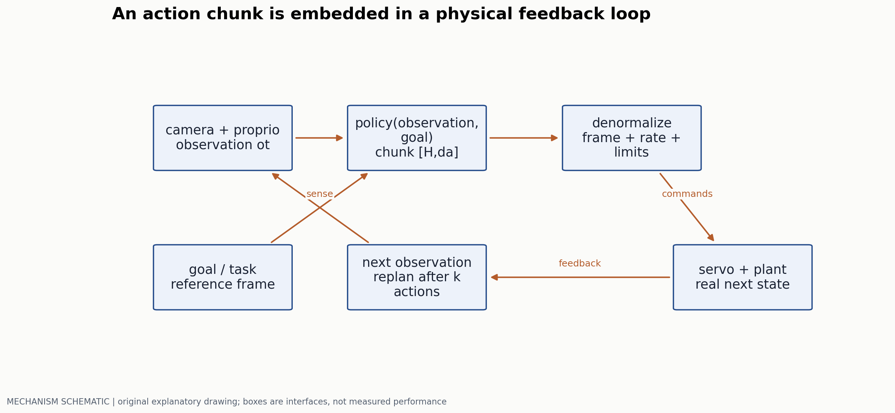
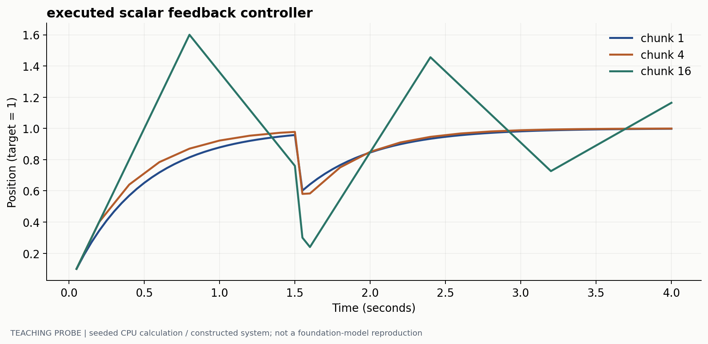
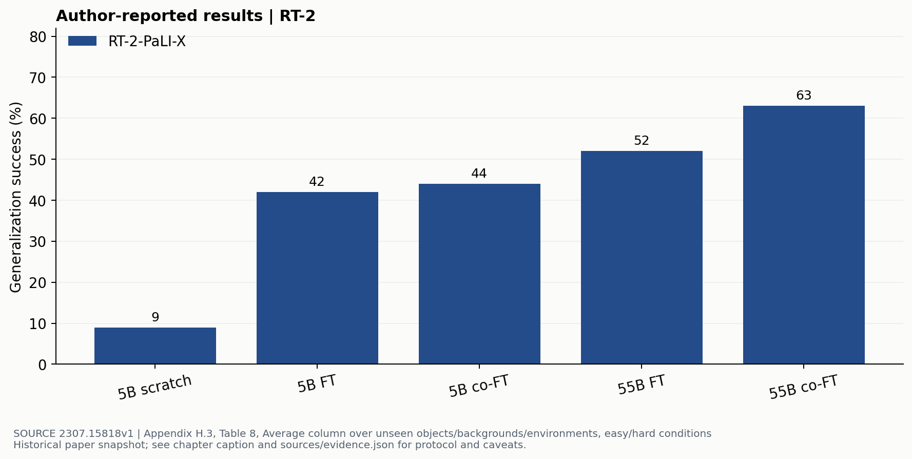

# 从视觉语言动作预测到闭环控制

> 副标题：动作坐标、归一化、动作块和任务成功率的技术边界
> 版本日期：2026-10-16 | 先修：条件生成、离散时间反馈系统

## 摘要

VLA 将机器人动作接到视觉语言模型的输出端，但动作不是“另一种可以随便生成的文字”。同样的数值在不同坐标系、控制模式和时间间隔下对应不同运动；开环预测更长的动作块能够摊薄推理成本，却会延后纠偏。本章把训练样本、动作接口和执行时钟一起展开，用 RT-2 的训练消融检验视觉语言预训练的作用，并用一个实际运行的简单反馈系统说明动作块取舍。教学系统不是机器人实验，真实任务结论仍以原论文为限。

## 1. 先写动作契约

令观测 $o_t=(I_t,s_t)$ 包含图像和本体状态，任务条件为 $g$，策略输出未来 $H$ 个动作：

$$
\pi_\theta(a_{t:t+H-1}\mid o_{\leq t},g).
$$

$a$ 可以是关节位置、末端位姿增量、速度或力；数据文件中的同一列不能在这些定义之间替换。末端位置还要说明是世界、机器人基座、相机还是工具坐标系，旋转是欧拉角、轴角还是其他表示，夹爪数值又对应位置还是离散开合。

例如同一个 $\Delta x=0.01$，如果单位是米且相对于基座，就是基座 x 方向的 1cm 位移；若相对于工具，则方向随末端姿态旋转。若该值是速度，执行频率又会参与决定每步位移。没有这个契约，离线动作误差很小也可能在执行时完全错误。



## 2. 动作 tokenizer 改变了监督问题

RT-2 [1] 将机器人动作表示为离散符号，使动作预测能够沿用视觉语言模型的序列输出接口。OpenVLA [2] 也将视觉条件、语言任务与动作预测接在统一训练路径中。它们证明接口可行，但不意味着所有 embodiment、控制频率与动作格式可以直接混合。

对一个标量动作，假设训练范围为 $[l,u]$，等宽分成 $K$ 桶。一个解释用的编码与解码规则是：

$$
k=\mathrm{clip}\!\left(\left\lfloor K\frac{a-l}{u-l}\right\rfloor,0,K-1\right),\qquad
\hat a=l+\frac{k+1/2}{K}(u-l).
$$

在桶内且取中心重建时，绝对量化误差上界约为 $(u-l)/(2K)$；超出训练范围后的 clipping 没有这个相对原动作的误差界。这个规则是用于说明量化的示例，不宣称所有 VLA 都采用同一种范围或取整方式。

动作维度间的尺度也不能忽略。若把平移、角度和夹爪直接放进一个 MSE，单位大的维度会主导 loss。归一化统计必须只用训练数据估计，推理时必须使用相同版本；混合数据集要保存 embodiment 与归一化配置的映射，不能把不同机器人相同数值区间当成同一个动作空间。

### 2.1 为什么单一均值动作可能不合理

对同一个图像，绕物体左侧和右侧可能都是有效轨迹。用平方误差回归会倾向条件均值，均值路径却可能穿过障碍。离散 AR、混合分布或生成式动作头可以表达多峰，但需要用真实闭环任务检验；仅画出多样轨迹，不足以说明控制稳定。

执行策略还要定义输出无效 token、越界动作、坐标转换失败和超时的行为。底层限幅可以避免部分危险指令，却不能把一个错误高层计划变成正确任务序列。

### 动作预测为什么需要分布而非单个均值

给定观测和任务 c，一次动作块 $A\in\mathbb R^{H\times d_a}$。行为克隆最一般的形式是：

$$
L_{BC}=-E_{(c,A)\sim D_E}\log\pi_\theta(A|c).
$$

若选择固定方差单高斯，优化等价于 MSE；若同一条件下标量动作以相同概率取−1 或+1，则

$$
E[(a-A)^2]=\tfrac12(a+1)^2+\tfrac12(a-1)^2=a^2+1,
$$

最优 a=0。将左右绕行表示为两个模式时，均值可能落到障碍物中。这是分布表达问题；更精确地拟合单一均值不会改变该目标的最优解。Diffusion Policy 以条件去噪生成动作序列，并通过滚动时域执行将序列重新接回反馈。[Diffusion Policy §3–4](https://arxiv.org/html/2303.04137v5)

| 动作头 | 输出 shape 示例 | 训练目标与依赖 |
|---|---|---|
| 确定性回归 | `[B,H,da]` | MSE/Huber，单一输出 |
| 每维独立分类 | `[B,H,da,K]` | 每维交叉熵；独立读出可能丢失跨维模式相关性 |
| AR 分类 | `[B,H*da,K]` | 按既定顺序条件生成，显式建立前缀依赖 |
| 混合分布 | `[B,M]`权重、`[B,M,H,da]`均值/尺度 | 对混合密度做负 log likelihood |
| 连续 flow 头 | `[B,H,da]`速度 | 对带噪动作块作条件速度回归 |

对于 flow 动作头，取 $\Xi\sim N(0,I)^{H\times d_a}$，构造 $A_\tau=(1-\tau)\Xi+\tau A$，目标为 $A-\Xi$，网络条件只包含动作开始前可取得的图像、语言和状态。动作区域内部可对整个带噪块双向交互，因为整块是待生成变量；输入未来真实观测或真实未加噪动作，则改变了部署时可用条件。训练时需要按有效动作维度 mask 掉 padding 的本体维度和轨迹末尾，分母使用实际有效元素数。

生成分布还有时间一致性要求：每一步独立抽“左/右”，可能在两个合法模式间来回跳；对整块联合采样能表达一条连贯候选，但每次重规划仍需观察模式是否无故切换。最小实验可用二维绕障数据同时测模式覆盖、整段碰撞率和扰动恢复，分布图与任务结果分别记录。

## 3. 动作块为何改变反馈频率

若策略推理一次耗时 $\tau_p$，每个底层动作间隔 $\Delta t$，一次执行 $k$ 个动作再观察，则感知—决策更新频率至多受 $k\Delta t$ 和推理调度共同限制。较长 chunk 摊薄调用成本，但中间发生扰动时，策略可能继续执行旧计划。

### 预测块长与实际反馈频率

取 20Hz 底层控制，即 $\Delta t=50$ms，H=16 意味着预测 0.8 秒，执行前 k=4 步意味着执行 0.2 秒。如果每次先停下收观测、推理 80ms，再执行 4 步，同步更新周期为 280ms，约 3.57Hz；底层命令仍按 20Hz 发送。若采用异步缓冲，每 200ms 取新观测并在旧块执行期间完成 80ms 推理，可以尝试每 200ms 更新，但必须核对新块的起始状态与剩余旧动作。

在理想异步周期下，扰动刚发生在一次观测之后，下一次观测最多等 200ms，随后推理 80ms，因此新策略反应可能晚约 280ms，另加感知/通信/执行调度。记录观测版本、预测起点与真正执行时刻，可以定位这段等待；把过期块放进队列只增加动作数量，不增加反馈。对照实验固定策略与 H，只改变 k 和调度，再报告任务成功、碰撞、反应延迟与每步计算。



对这个积分器，在不重新观测的 k 步内保持控制量，误差满足 $e_{j+1}=(1-2k\Delta t)e_j$，其中 j 按重规划时刻计数。$k=16$、$\Delta t=0.05$ 时乘子为 -0.6，因此轨迹会衰减振荡；它仍稳定，不应把过冲称为失稳。图中每个点记录一次更新后的状态，时间从 0.05 秒开始。

这个例子说明一个时间接口问题，而非证明短 chunk 永远更好。真实系统还存在观测噪声、通信延迟、动力学与动作相关性。高频重规划若依据噪声图像，也可能引入抖动。应在同一策略、同一任务集下改变执行步数，同时报告推理时间、跟踪误差、成功率和失败类型。

一种常见折中是预测 $H$ 步但只执行前 $k<H$ 步，之后重规划。这与完全开环执行整个 chunk 不同。异步推理还需要标明动作是基于哪个时间戳的观测，避免把迟到的旧动作块排进新状态。

## 4. RT-2 消融告诉我们什么



这张表可以区分两个问题：在论文设置下，预训练初始化使报告值大幅改变了从零训练的结果；共同微调在不同模型规模上的收益并不相同。5B 的 42 到 44 与 55B 的 52 到 63 不能合并成一个普适提升比例。表格中的 Average 也不是任意新机器人、新相机或新控制频率上的预期成功率。

更严格的复现还需要任务类别数、每类 trials、随机化方式和原始成功/失败记录。原表没有提供足够信息让本站为每个平均值重新计算置信区间，因此这里没有伪造误差棒。要估计自己的系统，应以完整任务 trial 为基本单位，而不是把一个任务里相邻的每帧都当独立成功样本。

## 5. 从离线检查到闭环实验

先检查数据：图像和动作是否有时间偏移，状态是否在动作之前采样，失败轨迹是否混入成功标签，任务说明是否透露了目标动作。然后检查接口：反归一化后单位、坐标系、夹爪方向与控制频率是否正确。最后才讨论策略本身的泛化。

```text
for each control cycle:
  read observation with timestamp
  predict action chunk and tag its source observation
  validate shape, units, range and control mode
  execute the selected prefix of the chunk
  measure post-action state, then replan
```

这里是控制流程伪代码，不调用真实机器人。实体实验应在可中止、受限运动环境中按已有实验规程执行；本章不给未经验证的硬件动作参数。

### 5.1 泛化至少有三个不同维度

新物体、新背景和新任务不是同一个 held-out split。训练场景中换一个杯子，不能直接叫跨 embodiment 泛化；新任务但已见所有物体，也不同于组合外推。划分需要按轨迹、物体与环境来源设计，防止相邻视频帧进入不同 split。

失败案例应保留抓取前定位、接触后滑移、夹爪控制、长程顺序和不可恢复状态等标签。模型生成了正确语言解释而动作失败，说明语言评价与任务结果分离；不能用解释内容替代终局状态验证。

### 行为克隆的训练分布与部署分布

离线专家轨迹给出状态分布 $d_E(o)$，训练 loss 在该分布上取期望；部署策略自己的动作诱导 $d_\pi(o)$。一次抓取偏移会带模型进入专家很少经过的状态，即使 $E_{d_E}\ell$ 很低，$E_{d_\pi}\ell$ 仍可能很大。这不是仅靠增加同类成功帧就能检查的问题。

一个受控实验固定总转移数：一组只用成功专家轨迹，一组用同数目的成功/轻微扰动后恢复轨迹混合；冻结相同初始化、控制频率与训练计算。测试分别从正常状态和预先指定的扰动状态重置，记录成功、恢复时间、碰撞及超出动作支持的比例。加入恢复数据同时改变了状态覆盖与动作标签，需要按来源保留计数；不能把结果仅归因于网络容量。

## 6. 下一项实验怎样才有信息量

固定一种机器人、一个控制模式和一份任务集，比较相同策略的 $k=1,4,16$ 执行长度，并注入受控、可恢复的小扰动。记录成功率和动作更新时间，而不是只比一次推理速度。另做完整的分布划分：已见任务、新物体、新环境分别报告。

如果要检验视觉语言预训练的作用，需在相同机器人数据、训练步数与动作头下比较初始化方式，且同时报告总预训练成本与可用 checkpoint 条件。第 12 章讨论基于 world model 的 planning；预测未来图像与真正改善闭环控制之间，还需要动作干预和真实结果校准。

## 参考文献与证据

[1] Brohan et al. RT-2: Vision-Language-Action Models Transfer Web Knowledge to Robotic Control. 2023. Appendix H.3 Table 8。[原文](https://arxiv.org/html/2307.15818v1)  
[2] Kim et al. OpenVLA: An Open-Source Vision-Language-Action Model. 2024. 动作接口、训练与迁移。[原文](https://arxiv.org/html/2406.09246)  
[3] Assran et al. V-JEPA 2: Self-Supervised Video Models Enable Understanding, Prediction and Planning. 2025. 动作条件预测与 MPC。[原文](https://arxiv.org/html/2506.09985)  
