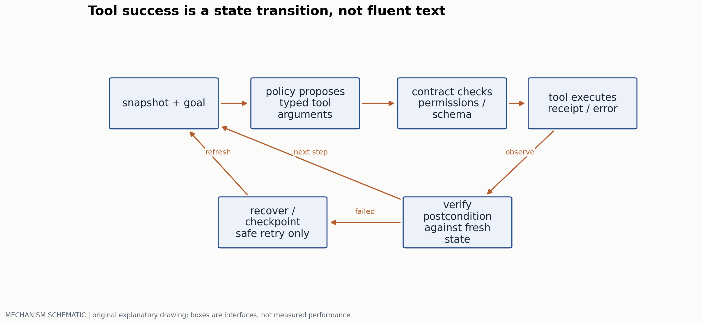
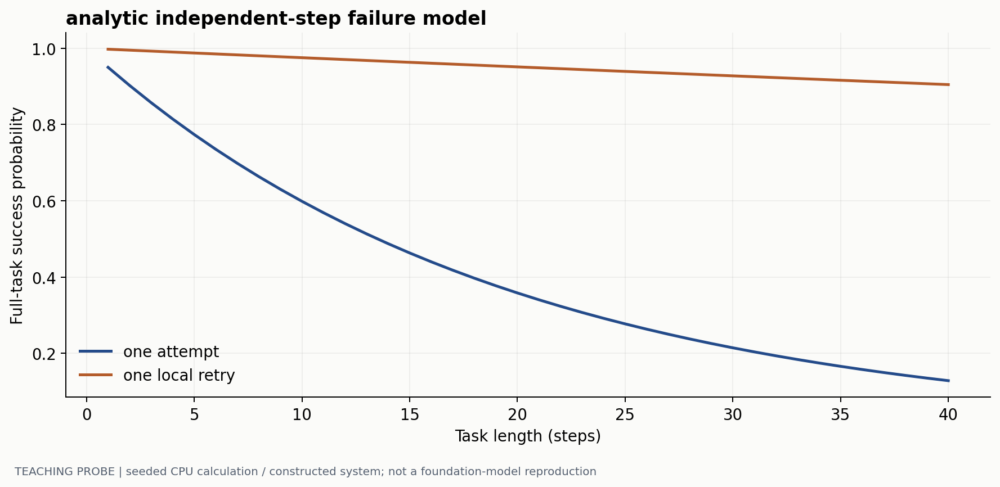
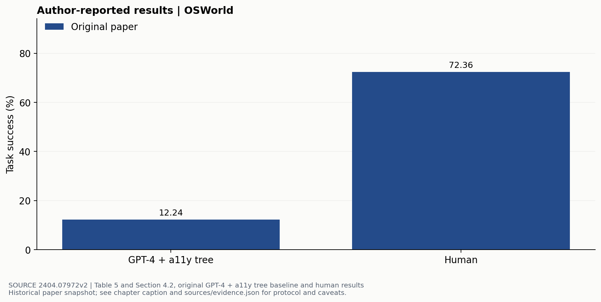

# 多模态 Agent 的执行与验证

> 副标题：从屏幕观测到有收据、可恢复的工具状态转换
> 版本日期：2026-10-16 | 先修：条件生成、状态机、基本软件接口

## 摘要

能解释截图不等于能稳定完成桌面任务。实际 Agent 还必须把像素坐标变成有效动作，确认动作是否执行，并在失败、页面变化和重复请求之后恢复。本章将 Agent 视作部分可观测系统中的执行循环，区分策略能力、工具契约和环境评测。OSWorld 的原始成功率用来说明任务级度量的重要性；一项明确假设下的多步成功率计算，则展示为什么局部准确率很高仍可能导致端到端失败。

## 1. 状态不可见时，历史比截图多包含什么

环境真实状态为 $s_t$，Agent 收到观测 $o_t$，执行动作 $a_t$。观测可能是截图、可访问性树、工具返回值或其组合。策略实际依赖历史 $h_t=(o_{\leq t},a_{<t})$，而非直接访问完整 $s_t$。

同一截图可能对应“保存成功但提示已消失”“保存请求仍在执行”“文件写到了另一个位置”三种状态。因此可见按钮消失不能自动当作任务完成，工具返回 HTTP 200 也不能自动等于业务后置条件满足。



对 GUI grounding，坐标必须关联到当前截图的宽高、缩放与视口。若模型输出归一化坐标 $(u,v)$，转换成 $(uW,vH)$ 前应核验合法范围和坐标原点。滚动、窗口移动或页面更新后，旧截图上的点不再保证落在同一对象上；动作应带上观测版本。

## 2. 将工具调用写成契约

一个可检查的工具接口不只包含名称与自然语言描述。它还需要参数 schema、前置条件、允许的副作用、幂等性、超时与错误分类，以及成功后可以检验的后置条件。

```json
{
  "operation": "write_file",
  "request_id": "stable-id-for-this-intent",
  "expected_parent_version": "observed-version",
  "arguments": {"path": "...", "content": "..."},
  "postcondition": "read_back_hash_matches"
}
```

这是契约示例，不声称某个现有协议接受这些字段。实际 API 的字段、权限与版本必须按官方定义适配；对不支持幂等 key 的操作，应用也不能凭空获得 exactly-once 语义。

工具执行结果应分开表示“未开始”“已成功”“确定失败”“是否成功未知”。最后一种常见于请求超时但服务器仍可能完成的情形。再次发送一个非幂等操作前，应先查询状态；盲目重试可能造成两次创建、重复扣款或覆盖新状态。

### 2.1 计划需要可检验的里程碑

“整理文档并完成”不是后置条件。更可执行的拆法是：定位源文件；验证读取版本；生成目标内容；写入指定位置；回读核对；确认用户可访问。每个里程碑有可观察证据，失败时才知道从哪里恢复。

工具观测中的文字属于环境数据。若网页、文件或日志要求改变任务目标、泄露信息或扩大权限，应将它视为内容，而不是高于用户请求的指令。保护这一边界需要系统接口与权限管理，也需要专门的攻击测试；仅靠在 prompt 中写“请小心”不足以证明安全。

### 同一个保存任务，两种动作接口

假设用户要求把文档 D 的标题改为“预算草案”，并保存到指定目录。任务完成谓词是：回读文档 ID=D，标题和目标目录均符合要求；本次操作没有额外创建副本。界面提示“已保存”只是一个观测，不能替代该谓词。

截图接口先观测当前视口：`screenshot_id=42, W=1440, H=900, scale=1`。一个点击动作可表示为 `click(screenshot_id=42, x=812, y=744)`，后续文本输入仍需检查焦点是否位于标题栏。结构化接口则可发送教学 schema `update(document_id=D, expected_version=7, title="预算草案", destination=F, request_id=R)`。前者候选来自可见区域的定位，后者候选来自工具清单或节点树；两者都可能漏掉正确目标。若工具检索只召回“创建文档”而没有“更新文档”，后续模型再强也无法从候选集中选出更新操作，因此应另测正确工具的候选召回。

| 接口 | 发送动作前需要的观测 | 发送的参数 | 失效信号 | 恢复动作 |
|---|---|---|---|---|
| 截图坐标 | 截图 42、当前缩放、标题控件和焦点 | 点击坐标、输入文字、保存快捷键 | 操作前页面滚动，截图版本不再匹配 | 刷新截图，重新定位并检查标题内容 |
| 结构化更新 | 文档 ID、版本 7、当前目录 | ID、期望版本、字段更新、稳定请求 ID | 服务返回版本冲突 | 回读新版本，检查他人修改，再生成适用于当前状态的更新 |

这些字段是应用侧契约示例；实际 GUI/API 是否支持版本条件与幂等键，必须按其接口检查。对只支持坐标的 GUI，可在本地记录动作意图和前后观测，却不能把本地`request_id`误当成远端幂等保证。

### 超时以后，重试之前发生什么

设结构化接口支持同一幂等键返回同一操作结果，下面回放一次“服务器已完成、客户端没收到回执”的构造故障：

```text
0 ms    读到D的version=7，生成稳定意图R和期望的内容hash H
20 ms   发送update(D, expected_version=7, request_id=R, ...)
90 ms   服务器提交version=8，并保存R -> version8的收据
120 ms  回程连接中断；客户端进入UNKNOWN，而非FAILED
150 ms  查询R的收据；若查询暂不可用，先回读D
180 ms  确认version=8、标题/目录正确、hash=H，记为SUCCEEDED
         不创建新请求ID，也不再执行“创建副本”
```

若回读看到 version=8 但内容 hash 不同，不能仅凭版本增长宣告成功；它可能来自另一用户的编辑。若收据和回读都不可用，保留 UNKNOWN 并停止非幂等的后续写入。若服务明确确认请求未提交，可在当前版本上重新制定动作；如果服务支持幂等重发，则重发同一个 R，不把一次意图变成两个新操作。对不支持幂等键且会产生副作用的接口，查询和回读只能降低不确定性，不能凭空补出 exactly-once 语义。

把上述故障注入到沙盒服务，可以分别核对完成谓词、重复副本数和恢复时间。这是一次事务/恢复测试；它与模型能否从截图找到按钮分开，失败时才知道应修改哪一层。


## 3. 多步任务为何放大局部失败

在一个刻意简化的模型中，假设每步独立成功概率为 $p$，任务需要连续完成 $n$ 步，且任何一步失败即终止，则：

$$
P_{task}=p^n.
$$

取 $p=0.95,n=20$，任务成功概率约为 35.8%。即使单步数值看起来很高，长任务仍可能经常失败。真实失败可能相关，也可能可恢复，所以这个值不是对任何 Agent 的预测。

若每步允许一次独立重试、验证器完美且重试安全，单步成功变成 $1-(1-p)^2$。这些假设很强：同一定位错误的重试往往高度相关；错误的验证器还可能提前宣告成功。



因此值得提高的可能不是“生成更长计划”，而是更早发现失效、刷新观测和缩小恢复代价。验证器也必须评估 false positive：把失败当成功，会使后续每一步基于错误状态继续运行。

### 不完美验证器的错误预算

继续使用每次执行独立成功概率 $p=0.95$ 的教学模型。令验证器对真成功的通过率为 $t=0.98$，对真失败的错误通过率为 $f=0.10$。一次执行后四种事件的概率为：

| 真实状态与判定 | 概率 | 系统后果 |
|---|---:|---|
| 成功且通过 | $pt=0.931$ | 可以继续 |
| 失败却通过 | $(1-p)f=0.005$ | 带着错误状态继续 |
| 成功却拒绝 | $p(1-t)=0.019$ | 额外查询或恢复 |
| 失败且拒绝 | $(1-p)(1-f)=0.045$ | 正确触发恢复 |

若任务含 20 步且必须每步通过、没有恢复，真正正确并被接受的任务比例为 $0.931^{20}\approx23.9\%$。验证器的拒绝会减少完成率；其错误通过又会产生虚假的“成功”。这说明验证不能只统计总通过率。

再允许所有被拒绝的步骤进行一次独立、幂等的重试，第二次仍使用相同准确率的验证器；第二次被拒绝就终止。每步首次拒绝概率为 $r=0.019+0.045=0.064$，则最终“真成功且通过”的概率为 $0.931+r\times0.931=0.990584$，“失败却通过”为 $0.005+r\times0.005=0.00532$。20 步真正正确且全被接受约为 82.8%，系统宣称全通过约为 92.1%，两者相差约 9.36 个百分点。这个差值是错误的任务成功声明，不能算进真实成功率。每个到达的步骤平均执行 $1+r=1.064$ 次；遇到终止的任务总调用数还会缩短，应逐轨迹计数。

这些数值来自独立性、错误判定不改变后续分布、重试确实安全等强假设，作用是演示错误如何进入账本。真实定位错误常会在重试中重复，验证器也可能与策略共享同一视觉误判。实际三组实验应同时记录真实终局成功、错误成功声明、重复副作用、验证/执行调用和耗时。先在相同最大调用与时间预算下比较，再报告各组实际花费；若要比较相同费用下的成功率，还应把额外预算提供给无验证基线，例如额外观察或策略重新生成，而不是默认额外验证免费。


## 4. 用 OSWorld 看任务级评价

OSWorld [1] 在真实计算机环境中定义可执行任务与终局检查。下图展示原论文基线与人类结果，不是当前排行榜。



这类 benchmark 的价值在于把“回答看起来合理”转成环境状态是否满足任务。它仍有边界：终局判定器可能忽略用户关心的副作用；任务可能有多种有效路径；网络和应用版本变化会使环境不稳定。固定版本的 benchmark 数字不能直接当作用户电脑上的成功率。

评测必须记录 step limit、timeout、输入模态、工具权限、重试与是否允许恢复。给一种 Agent 更多步数、另一种更严格停止规则，会改变任务难度。实际操作预算还应计入调用次数、总时长和外部费用，不能只报告最后成功的比例。

## 5. 轨迹日志应足以定位错误

至少保存观测时间戳/版本、模型提议、最终发送的参数、工具返回、等待时长与验证结果；敏感字段应按任务数据处理规则保护，日志不应默认公开。评审轨迹时，重点区分：视觉定位、状态估计、计划、工具参数、执行失败与验证失败。模型动作正确但环境暂时不可用，不应记成相同的策略错误。

| 现象 | 需要的证据 | 优先修复的接口 |
|---|---|---|
| 点击了相似按钮 | 当前截图与坐标转换 | grounding 与观测版本 |
| 一直重复同一操作 | 上次收据和后置状态 | 记忆、超时与恢复 |
| 工具成功但任务失败 | 回读内容与终局检查 | 验证器与成功定义 |
| 被页面文字改写目标 | 用户任务与环境内容的来源 | 指令边界与工具权限 |

```text
observe fresh state
propose one action with expected postcondition
validate arguments and preconditions
execute, then classify receipt status
verify postcondition; recover or continue
```

这个最小循环没有指定模型架构。它表达的是执行纪律；更强的策略可以改善动作选择，却不能替代可靠的收据和状态检查。

## 6. 一个有意义的改进实验

固定策略 checkpoint、prompt、工具集、环境镜像与任务集，分别比较：无验证；轻量验证；验证加有限恢复。将每组额外调用和总时长计入预算，保存失败轨迹。通过 task-level 配对比较估计成功率差，而不是用两个不同任务子集的平均数。

恢复策略还应有负对照：在无副作用的动作上允许重试，在非幂等动作上采用状态查询；人为注入“请求成功但回执丢失”的故障，检查是否发生重复副作用。这类测试更接近真实使用中的故障，而非只让模型挑一个静态截图上的坐标。

本章没有运行真实 OSWorld Agent。图 2 是公开脚本中的解析计算，图 3 是原论文结果；二者分别用于机制解释与历史实证，不能合并成“本站新策略超过基线”的结论。

## 参考文献与证据

[1] Xie et al. OSWorld: Benchmarking Multimodal Agents for Open-Ended Tasks in Real Computer Environments. 2024. 任务设计与 4.2 节。[原文](https://arxiv.org/html/2404.07972v2)  
