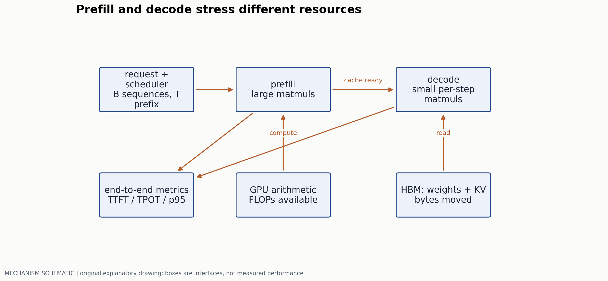
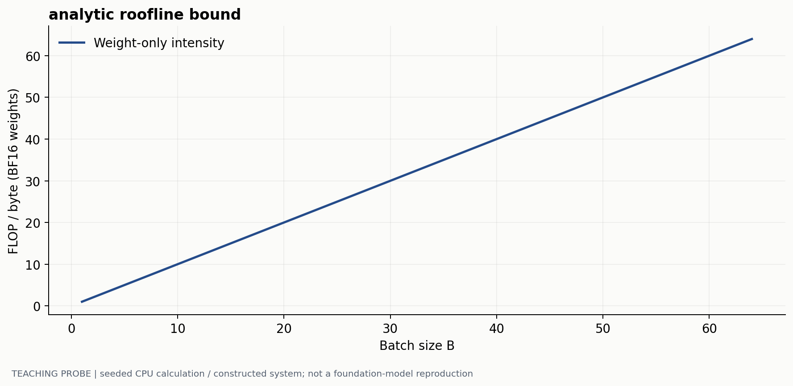
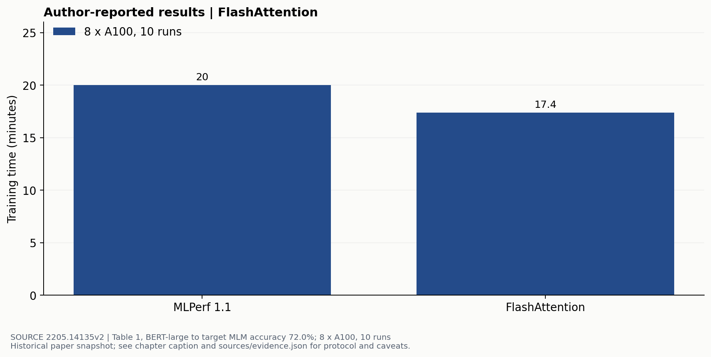

# 从瓶颈诊断到可信的多模态加速

> 副标题：区分计算、IO、缓存与调度，再比较质量和端到端时间
> 版本日期：2026-10-16 | 先修：第 00 章的 FLOPs 和 KV 核算

## 摘要

减少 FLOPs 不一定减少延迟，减少显存也不一定提高吞吐。一个多模态请求会经过图像/音频编码、prefill、逐 token decode 和输出后处理；不同阶段可能被不同资源限制。本章从一个简化 roofline 模型出发，解释 FlashAttention、GQA、量化、视觉压缩和 batching 分别改变哪部分开销，并给出可执行的测量协议。原论文 GPU 结果与本站解析计算分开呈现，避免把硬件峰值、理论字节数和实际吞吐画成同一条曲线。

## 1. 划清一次请求的阶段

Prefill 处理已有的输入序列，可对多个位置并行计算，通常包含较大的矩阵乘；decode 每次为每条序列增加一个位置，频繁读取模型权重与 KV。视觉编码器也可能在 prefill 之前占显著时间。仅测 LLM kernel 而忽略输入编码，不能代表用户看到的首 token 时间。



定义 TTFT 为请求到达至首个输出 token 的时间，TPOT 为后续 token 的平均间隔；p95 应在请求层或明确的 token 层统计。还需记录排队、失败、输出长度和并发。离线 batch throughput 与单用户交互延迟是不同目标。

## 2. 先用 roofline 排除不可能的解释

设一段操作需要 $C$ FLOPs、从主要存储层搬运 $M$ 字节，硬件计算上限为 $P$ FLOP/s、带宽上限为 $W$ byte/s。理想下界为：

$$
t\geq\max\left(\frac CP,\frac MW\right),\qquad I=\frac CM.
$$

$I$ 是 arithmetic intensity；实际时间还包含通信、调度、同步和利用率损失。峰值 $P$ 依赖精度、稀疏假设与硬件模式，不能拿一种模式的 advertised peak 去解释另一种模式的运行时间。

考虑每个 decode step 的 dense 权重矩阵，参数数为 $N$，batch 为 $B$，BF16 权重约读 $2N$ 字节，主矩阵乘约 $2BN$ FLOPs。只计权重流量时 $I\approx B$ FLOP/byte。增大 batch 允许多个请求共享一次权重读取，但 KV 和激活流量会进一步增加，因此 $I=B$ 是受限模型，不是整个系统的完整强度。



## 3. FlashAttention 改变 IO，而不是取消注意力

普通实现往往显式保存注意力分数和 softmax 矩阵。FlashAttention [1] 将 Q、K、V 分块加载到片上存储，在线维护 softmax 统计量，避免把完整 $T\times T$ 中间阵反复写回 HBM。dense attention 的配对计算仍存在；改变的是执行顺序和存储流量。

对一行 logits，已有块的最大值为 $m$、指数和为 $l$、未归一化加权和为 $o$。加入新块 $S'$ 后，令 $m'=\max(m,\max S')$，则：

$$
l'=e^{m-m'}l+\sum_j e^{S'_j-m'},\qquad
 o'=e^{m-m'}o+\sum_j e^{S'_j-m'}V'_j.
$$

最后输出 $o'/l'$。这个变换在精确算术下给出相同的 softmax 加权和；浮点归约顺序改变时，不能要求逐 bit 相等。反向也可通过重计算中间概率，减少保存量。



这是特定模型与硬件的端到端训练结果。不能据此声称多模态 decode 在任意 GPU 上也加速相同比例；尤其当视觉编码器或权重带宽成为主导时，注意力优化可能只影响较小一段时间。

仓库还在 CPU 上实际比较了完整 softmax 与分块在线更新：对 7×19 的构造 score 矩阵、block size 1/4/7/19，最大输出差异不超过 $1.95\times10^{-16}$。脚本故意保存完整矩阵作为参考，因此图中 tile 大小只是解析存储量，不能当作实际峰值 RAM 或 GPU 加速比。

## 4. 三类压缩不能相互混称

### 4.1 KV 共享与缓存量化

GQA/MQA 减少 KV heads，直接改变第 00 章的 $M_{KV}=2BLT h_{kv}d_hs$。它们与 FlashAttention 可以组合，但减掉的不是同一项。KV 量化则减少 $s$，需要测激活分布、误差累积和长上下文质量，不能把 weight-only 量化的经验直接移植。

### 4.2 权重量化不是把文件变小就结束

对一个权重块，均匀量化可写成 $q=\mathrm{clip}(\mathrm{round}(w/s)+z)$，反量化为 $\hat w=s(q-z)$。每块还要存 scale/zero-point；outlier、group size 和 kernel 支持都会改变有效字节数与误差。若推理时每次先完整反量化成 BF16，再调用普通矩阵乘，权重文件虽小，计算路径未必更快。

校准数据应来自目标请求分布，并与评测 split 分离。平均重建误差小不能保证每层、每个模态都稳定；例如视觉条件中的少数大激活，可能在普通文本校准上没有出现。应报告量化前后同一批任务的质量差、峰值显存、TTFT/TPOT，而不是只展示“4-bit”。

### 4.3 视觉 token 压缩改变可用信息

Pooling、query bottleneck、token merging 或选择性丢弃减少序列长度，同时也改变模型可见的证据。对空白背景的冗余，压缩可能几乎无损；对小字、重复物体或时间上短暂事件，保留下来的摘要可能不够。需要按任务 slice 画 quality–latency 曲线，不能拿整体平均分掩盖某类任务崩溃。

### 校准数据为什么进入量化目标

取线性层 $W\in\mathbb R^{d_{out}\times d_{in}}$，校准输入 $X\in\mathbb R^{d_{in}\times n}$，原输出 $Y=WX$。量化得到 $\hat W$ 后，层输出误差为

$$
E(W,\hat W;X)=\|(\hat W-W)X\|_F^2
=\operatorname{tr}\!\left[(\hat W-W)XX^T(\hat W-W)^T\right].
$$

因此相同的权重误差在不同激活方向上会产生不同输出误差。$XX^T/n$ 反映校准输入的二阶结构；GPTQ 按层输出重建目标利用这类信息补偿量化误差。[GPTQ §3](https://arxiv.org/html/2210.17323v2) 若只最小化 $\|\hat W-W\|^2$，就相当于没有显式考虑目标输入在哪些方向有较大能量。

给一个两通道例子。令一行权重误差为 $\Delta w=(0.1,-0.1)$。对校准输入 $x_{text}=(1,1)^T$，输出误差正好为 0；对另一输入 $x_{visual}=(10,1)^T$，误差为 0.9，平方为 0.81。这里两个输入是构造例子；它说明一套只覆盖某个输入子空间的校准数据可能把重要误差完全隐藏。实际多模态校准应明确覆盖视觉条件、OCR、语音/视频长度和文字请求中的哪些分布，并把校准集与最终质量测试分开。

一种等价缩放把 $W$ 改成 $WD$、输入改成 $D^{-1}X$，其中 D 是可逆对角阵。浮点输出保持 $WD D^{-1}X=WX$；量化以后则比较

$$
\|Q(WD)D^{-1}X-WX\|_F^2.
$$

AWQ 使用激活统计搜索通道 scale，目标是降低量化后的输出差异。[AWQ §3.2](https://arxiv.org/html/2306.00978v6) 例如 $D=\mathrm{diag}(2,1)$ 会把第一权重通道放大、第一输入通道减半；共同量化尺度也可能因放大而改变，因此 scale 需要在整组输出上评价。局部通道被保护，不代表其他通道的误差固定。

一个可检查的简单校准过程如下；它是教学搜索方案，不冒充完整 GPTQ 或 AWQ 实现：

```text
freeze a calibration record-ID list and preprocessing revision
for each quantized layer:
    capture X and full-precision target Y using the declared input path
    for group size, clipping threshold and channel-scale candidate:
        quantize W, execute the intended dequantization/kernel path
        evaluate ||Y_quantized - Y||² / (||Y||² + epsilon)
    choose the candidate on calibration/development data
    save scales, zero-points, group layout, packing and kernel version
evaluate the complete quantized model on the untouched quality test trace
```

如果使用原始浮点输入 X 作逐层诊断，测到的是该层局部敏感性；若前面各层已量化后再采集 X，则还包含上游误差传播。两种实验应分别命名，并最终检查整个模型。

### 有效 bit 数和实际算子

以对称 4-bit、每 128 个权重一组、每组一个 FP16 scale 为例，128 个权重占 64 bytes，scale 占 2 bytes，有效平均位数为 $4+16/128=4.125$ bits/weight。该例零点固定为 0；非对称量化、padding 或额外 metadata 会继续增加字节。7B 权重的这个理想打包大小约 3.609GB，而不是恰好 3.5GB；尚未计未量化层、KV、激活和分配器。

还要记录矩阵乘究竟采用什么路径：weight-only packed weights 在 kernel 内部反量化并与高精度激活相乘；权重和激活同时量化则可采用另一类整数矩阵乘。文件精度标签不足以确定每个阶段的速度。基准至少比较同一请求的质量、权重/KV/峰值显存、TTFT、TPOT，并在 batch=1 与目标并发下分别测量。

## 5. 从矩阵分片到服务调度

### 一层 MLP 的 tensor parallelism

设输入 $X\in\mathbb R^{B\times T\times d}$，两层 MLP 为 $Y=\phi(XW_1)W_2$，$W_1\in\mathbb R^{d\times f}$、$W_2\in\mathbb R^{f\times d}$。在 p 张卡上，把 $W_1$ 按输出列分为 $W_1^{(r)}\in\mathbb R^{d\times f/p}$，把 $W_2$ 按输入行分为 $W_2^{(r)}\in\mathbb R^{f/p\times d}$。每卡计算

$$
H^{(r)}=\phi(XW_1^{(r)}),\qquad
Y^{(r)}=H^{(r)}W_2^{(r)},\qquad
Y=\sum_{r=1}^pY^{(r)}.
$$

第一个矩阵乘之后可以局部激活，第二个之后需要对 `[B,T,d]` 的部分输出做 all-reduce。这是 Megatron-LM 的核心 MLP 切分。[Megatron-LM §3, Fig.3](https://arxiv.org/html/1909.08053v4) 门控 FFN 的两条上投影也需要按相同中间维切分，保持逐元素门控局部完成。

取 B=1、decode 的 T=1、d=4096、BF16，归约张量只有 8192 bytes，但每层都要支付通信启动与同步；取 prefill 的 T=2048，同一归约张量成为 16MiB。理想 ring all-reduce 中，p=4 时每卡发送体积约为 $2(p-1)/p=1.5$ 倍张量大小，即前者 12KiB、后者 24MiB，另有接收和实际网络协议。小消息可能受延迟限制，大消息可能受链路带宽限制，故同一种 TP 切分在 prefill 和 decode 中的收益可以不同。

### 数据、流水线、专家并行分别切什么

| 并行方式 | 每卡持有什么/做什么 | 主要交换与取舍 |
|---|---|---|
| 纯 data parallelism | 完整模型，处理不同样本 | 训练时归约梯度；本身不降低完整权重容量 |
| Tensor parallelism | 每层矩阵的一部分 | 层内 activation 归约/收集；降低权重分片容量但引入频繁通信 |
| Pipeline parallelism | 连续的一组层 | stage 边界传 activation；调度 microbatches 并处理 bubble |
| Expert parallelism | 一部分专家 | 按 router 的选择 dispatch/return，负载不均会产生等待 |

优化器/梯度分片可与 DP 组合，改变训练状态账；它与“每张卡保留完整状态”的纯 DP 定义不同。一个仅用于理解 bubble 的理想前向流水线有 p 个等长 stage、m 个 microbatches，耗时约 $(m+p-1)\tau$，其中填充/排空的占比为 $(p-1)/(m+p-1)$。取 p=4、m=8，占比约 27.3%；真实训练的 forward/backward 调度还需单独建模。B=1 的交互推理通常缺少大量独立 microbatches，不能把大 batch 流水线利用率直接移作其延迟结论。

例如 7B 模型仅 BF16 权重约 14GB，若单卡可用空间不足，纯 DP 复制无法解决单请求装载；TP 或 PP 可以分片权重，前提是剩余 KV/激活与通信时间也满足要求。四卡 TP 把上述权重主项分为约 3.5GB/卡，并不意味着端到端延迟严格变为 1/4；每层归约、未切分算子和输入编码都进入新时间账。

### 服务调度和 KV 布局要独立测量

Continuous batching 在某请求完成后及时补入新请求，使不同长度的 decode 共享运行批次；paged KV 则把序列的逻辑块映射到按需分配的物理块，两者改变不同的资源问题。[PagedAttention §3–4](https://arxiv.org/html/2309.06180v1) 若每块 16 个 token，长度 33 的序列需要 3 块，最后一块只用 1 个位置、剩 15 个位置是尾块内部余量；分页没有减少 33 个有效 token 对应的 K/V 元素，只改变分配浪费和共享方式。

一个基准 trace 可以固定短文字、1024 视觉 token 的 OCR 和长上下文三类请求到达时间，回放相同输入与输出长度上限。依次比较固定 batch、continuous batching、再加分页 KV，记录每请求排队/编码/prefill/decode、活动 batch 大小、物理块使用量和失败。若吞吐上升而 p95 TTFT 变差，下一步应检查调度等待；若只有 KV 可用容量改善，结果应按并发收益解释。测量落到阶段和请求，优化的作用才可被区分。

## 6. Amdahl 定律用于检查端到端收益

假设原耗时中比例 $f$ 的阶段被加速 $s$ 倍，其他阶段不变，理想总加速为：

$$
S_{total}=\frac1{(1-f)+f/s}.
$$

若某 kernel 原占 20%，即使它无限快，整条请求的最大加速也只有 1.25 倍。这个模型不含阶段重叠与资源竞争，但可用于抓住把 kernel speedup 当总 speedup 的明显错误。

优化后 bottleneck 也会迁移。例如压缩视觉 token 后 LLM prefill 变快，视觉编码器占比随之上升；并发增加后，调度等待可能反而变成主要问题。每次改动都需要重新作 phase breakdown，不能永久沿用第一次 profile 的结论。

## 7. 一个可复核的基准协议

固定 checkpoint、量化配置、视觉分辨率、输入/输出长度分布、batch 调度、硬件与软件版本。预热后测多轮，显式同步设备，保存每个请求的阶段时间与质量结果；异步 GPU API 的调用返回时间不是 kernel 完成时间。

```text
freeze request trace and quality labels
warm up the exact serving configuration
for each independent run:
  replay the same trace; include queue time and failures
  collect phase timing, peak memory, output length and answers
compare paired quality outcomes and latency distributions
```

至少保留三个负对照：仅文本请求；高分辨率 OCR 请求；长上下文 decode。再改变并发，观察改进是否只存在于一个特殊 batch。吞吐统计需要说明有效输出与失败请求如何计算，不能只对成功而短的回答取平均。

运行 `python labs/run_probes.py` 可复算图 2；它不查询 GPU，也没有任何实测 TPS。本章唯一画出的硬件训练时间来自 FlashAttention 原文，完整设置记录在 `sources/evidence.json`。没有执行相同硬件基准时，不声称复现了论文加速比。

## 参考文献与证据

[1] Dao et al. FlashAttention: Fast and Memory-Efficient Exact Attention with IO-Awareness. 2022. 算法与 Table 1。[原文](https://arxiv.org/html/2205.14135v2)  
[2] Stanford CS336. Resource accounting 与 inference lectures，用于核算和测量组织参照。[原文](https://github.com/stanford-cs336/spring2025-lectures)  
