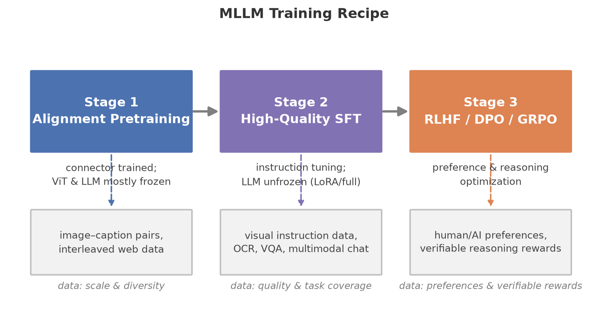

# 数据的炼金术：多模态大模型的数据工程与训练方法

> 副标题：当架构趋同之后，数据配方成为多模态大模型真正的护城河
> 版本日期：2026-09-29 | 面向读者：有深度学习基础的多模态初学者

## 摘要

过去四年，多模态大模型（MLLM）的架构创新逐渐收敛：视觉编码器加连接器再加语言模型的"三段式"成为事实标准，纯 Transformer 的统一架构则在理解与生成两端持续逼近。当模型结构日益同质化，决定模型能力上限的变量悄然转移到了训练数据与训练配方之上。本报告以"数据是多模态模型真正的护城河"为立论，系统梳理多模态数据工程的全景：从 LAION-5B 所代表的互联网规模图文爬取，到 DataComp 竞赛将"数据筛选"本身确立为一门可实验的科学；从 ShareGPT4V、ALLaVA 所开启的 caption 重写与 GPT-4V 蒸馏路线，到 OBELICS、MMC4、MINT-1T 所代表的交错图文数据范式；从 LLaVA 式指令微调数据的构造，到多阶段训练、分辨率课程、灾难性遗忘对策等配方工程；再到偏好数据与 RLVR 数据驱动的后训练时代。报告深度剖析 DataComp、ShareGPT4V、MINT-1T、DataComp-LM 与 InternVL3 五篇代表作，并讨论模态 tokenization 如何反向塑造数据管线。我们希望传达的核心观点是：数据工程不是模型训练的附属环节，而是一套拥有自身方法论、评估体系与科学问题的独立学科。

## 1. 引言：本方向在多模态版图中的位置

### 1.1 为什么是数据

2023 年之后，多模态大模型领域出现了一个耐人寻味的现象（本报告聚焦 2022–2026 年的工作，但相关方法论渊源可上溯至更早的众包数据时代）：开源社区可以在数月内复现任何一个新发布的架构——无论是 Q-Former、MLP 投影还是 Perceiver Resampler——却始终难以复现顶级闭源模型的能力。架构可以抄，权重可以蒸馏，唯独数据配方无法复制。GPT-4V、Gemini、Qwen-VL 系列的技术报告对架构往往轻描淡写，对数据却讳莫如深。DataComp [2] 的组织者用一组对照实验点破了这一层窗户纸：在固定模型架构、固定训练代码、固定算力预算的条件下，仅改变数据筛选策略，下游 38 个任务的平均性能就可以拉开超过 10 个百分点的差距。DataComp-LM [3] 在语言模态上再次确认了这一结论：同一个 7B 模型，用精心筛选的数据训练可以在 MMLU 上达到 64%，而粗糙数据连及格线都摸不到。

这就是"数据护城河"论点的经验基础：**在算力与架构趋同的时代，数据的质量、配比与课程设计是模型能力差异的主要来源**。更进一步，数据工程具备典型的复利属性——一次高质量数据资产的积累可以服务此后所有代次的模型，而架构创新往往只服务一代。这也解释了为何头部实验室愿意投入数百人年建设数据管线，却对架构细节开源得越来越大方。

### 1.2 学习地图

本报告假设读者已具备深度学习基础（反向传播、Transformer、对比学习的基本概念）。建议的阅读路径如下：

- **先修概念**：CLIP 对比学习（理解 CLIP score 筛选的前提）、指令微调与 RLHF 的基本流程、scaling law 的定性图像。本系列《00-foundations》与《01-vision-language》两篇报告可作为前置阅读。
- **本方向核心问题**：（1）海量噪声网络数据中如何筛选出有效训练信号？（2）图文对、交错文档、指令数据、偏好数据分别解决什么能力？（3）多阶段训练中各阶段数据如何配比、如何防止语言能力退化？（4）合成数据的边界在哪里？
- **与其他方向的关系**：数据工程是训练方法（09-alignment-safety 篇的对齐数据、05-generation 篇的生成数据）的上游，也是评测（10-benchmarks-eval 篇）的镜像——评测集决定了我们如何判断数据好坏。模态 tokenization（01 篇与 04 篇）决定了数据必须以何种形式被切碎喂给模型，从而反向约束数据管线的格式设计。

### 1.3 一个统一视角：数据作为能力的载体

理解多模态数据工程，最有用的思维模型是把每一类数据看作一种**能力的载体**：图文对承载"视觉概念与词汇的对齐"，详细 caption 承载"细粒度视觉描述能力"，交错文档承载"跨图文上下文的推理与少样本学习"，指令数据承载"任务泛化与对话行为"，偏好数据承载"人类价值观与输出风格"，RLVR 数据承载"可验证的长链推理"。训练配方的艺术，本质上是在有限算力预算下，对这些能力载体做组合优化。本报告即按这一视角展开。

## 2. 基础知识

### 2.1 多模态训练的三阶段骨架

几乎所有现代 MLLM 的训练都可以分解为三个阶段，每个阶段对数据的要求截然不同：

**阶段一：模态对齐预训练（alignment pretraining）**。目标是让视觉编码器的输出空间与语言模型的词嵌入空间对齐。这一阶段通常冻结 LLM（有时也冻结视觉编码器），只训练连接器，数据采用大规模图文对（image-text pairs）。数据量动辄数亿到数十亿条，单条质量要求不高，但要求概念覆盖面广。LLaVA [10] 用约 60 万条图文对完成对齐；Qwen-VL [13] 的第一阶段则使用了约 14 亿对。

**阶段二：高质量预训练与多任务训练**。视觉编码器与 LLM 解冻（或部分解冻），在更高质量、更高分辨率的数据上继续训练，注入 OCR、文档理解、定位（grounding）等能力。这一阶段是"配方工程"的主战场：交错图文、视频、纯文本的混合比例在此决定。

**阶段三：指令微调与后训练（SFT + preference/RLVR）**。用指令跟随数据教模型"如何回答问题"，再用偏好数据或可验证奖励对齐人类偏好与推理行为。数据量从百万级骤降到十万甚至万级，但单条质量要求最高。

这个三阶段骨架的隐含逻辑是**成本的阶梯**：阶段一的数据单价最低（爬取成本）、用量最大；阶段三的数据单价最高（人工或 GPT-4V 合成）、用量最小。数据工程的许多决策，本质是在这条成本曲线上做资源分配。值得强调的是，三阶段并非铁律：InternVL3 [17] 的原生预训练把前两个阶段合并为一次联合训练，而小模型团队常把后两个阶段合并为一次"混合 SFT"。阶段的划分是工具而非教条，其存在理由是让不同质量、不同单价的数据各得其所——理解了这一点，就不会把任何一家的具体配方当成普适模板。

### 2.2 图文对数据的 Anatomy

一条原始图文对 $(x_i, t_i)$ 来自网页的 `` 标签与其 alt-text。原始 alt-text 的平均质量之差，超出了多数初学者的想象：大量条目是 "IMG_2043.jpg"、"点击放大"、广告文案甚至与图片完全无关的 SEO 垃圾。LAION-5B [1] 的构建者估计，Common Crawl 中可提取的图文对超过 500 亿，但其中真正对训练有价值的不足十分之一。由此引出图文数据工程的三个基本操作：

**过滤（filtering）**。过滤的目标函数从来不是一个：要同时最大化图文匹配度、信息含量与安全性，三者经常互相冲突——一张带水印的图可能图文匹配极佳，一条 OCR 密集的信息图 caption 可能很短。最经典的过滤器是 CLIP score：用预训练 CLIP 模型计算图像与文本的 embedding 余弦相似度

$$
s(x, t) = \frac{f_v(x)^\top f_t(t)}{\|f_v(x)\|_2 \cdot \|f_t(t)\|_2},
$$

并丢弃 $s$ 低于阈值的样本。LAION-5B 保留了约 58.5 亿对英文图文对，其筛选阈值背后的直觉是：CLIP score 低意味着图文不匹配，训练这样的样本等于向模型注入噪声监督。此外还有尺寸过滤（丢弃过小图像）、长宽比过滤、NSFW 检测、水印检测、人脸/隐私过滤等一串规则过滤器，每个过滤器都在"数据量"与"数据质"之间做一次权衡。

**去重（deduplication）**。网络数据存在严重重复：热门图片被成千上万网页转载。近似去重通常用感知哈希（pHash）或 embedding 近邻（如 SemDeDup）实现。重复数据的危害不仅是浪费算力——它会扭曲数据分布，让模型对高频样本过拟合，并在评测时造成训练-测试泄漏。后者尤其隐蔽：流行评测集（如 ImageNet、COCO）的图像在网络中大量存在，若不去重，模型的"泛化能力"可能有一部分只是记忆。严肃的数据集发布（如 DataComp 候选池、MINT-1T）都会对常见评测集做显式的去污（decontamination）处理。

**重写（rewriting/recaptioning）**。既然 alt-text 质量差，不如用一个已有的强模型重新为图像写描述。这是 ShareGPT4V [8]、veCLIP [32] 与 Recap-DataComp 路线的核心思想，我们将在第 4 节深入分析。veCLIP 特别值得一提：它把重写后的"视觉富化 caption"用于 CLIP 对比学习本身，证明合成 caption 的收益不限于生成式 MLLM，对双编码器表征学习同样成立——这一结果把 caption 质量从"生成任务的配菜"提升为"一切视觉-语言训练的主菜"。

### 2.3 交错图文数据：从"对"到"文档"

图文对只能教模型"一张图对应一段描述"，而真实世界的多模态内容是**交错**的：一篇教程里图与文交替出现，一段幻灯中图表与文字互相引用。交错图文数据（interleaved image-text data）以文档为单位，保留图文在原始网页中的相对顺序，形如 $(t_1, x_1, t_2, x_2, t_3, \ldots)$。Flamingo [31] 最早证明交错数据是上下文少样本学习（in-context few-shot learning）能力的关键：模型见过"图-文-图-文"的序列后，才能在推理时利用几个示例完成新任务。OBELICS [4]、MMC4 [5]、MINT-1T [6] 是这一范式的三个开源里程碑。交错数据的工程难度远高于图文对：需要解析 HTML DOM、判断图片在文档语义中的位置、丢弃与上下文无关的装饰图（图标、广告、头像），并做文档级而非样本级的去重与安全过滤。判断一张图"属于上下文还是装饰"没有完美的规则：常见做法结合图像尺寸、在 DOM 中的位置、文件名模式、以及前后文本是否出现指代（如"如上图所示"），但边缘案例（表情包、引用截图、数据图表）至今仍会让最好的管线犯错。MMC4 [5] 采取的是另一条路线：不解析原始 HTML，而是给已有的纯文本语料 C4 的每个文档"回配"检索到的图像，牺牲了原生排版的精确性，换取了构建的可扩展性。两种路线——OBELICS 的"保真"与 MMC4 的"回配"——代表了交错数据构建的一对基本权衡。

### 2.4 指令微调数据的构造范式

指令微调（instruction tuning）数据是三元组（图像，指令，回答），其构造有三种主要范式：

1. **人工改写学术数据集**：将 VQA、OCR、定位等传统数据集的标注转换为指令格式。InstructBLIP [11] 汇集 26 个公开数据集、约 160 万条指令，是这一路线的代表。优点是答案可靠，缺点是回答风格僵硬（多为单词或短句），导致模型输出干瘪。
2. **Self-Instruct 式合成**：给一个强语言模型种子样例，让它围绕图像内容自动编问题。LLaVA [10] 用纯文本 GPT-4，把图像的 caption 和检测框坐标作为"语言化的视觉内容"喂给 GPT-4，生成对话、详细描述、复杂推理三类共 15.8 万条指令数据。这是"用语言模型代偿视觉理解"的经典技巧。
3. **GPT-4V 直接蒸馏**：让真正能看图的多模态模型（GPT-4V）生成回答。ShareGPT4V [8] 与 ALLaVA 是代表。这条路线的成本比人工标注低约一个数量级，而质量在许多任务上已超过众包标注，2024 年后成为主流。

### 2.5 训练配方的三个杠杆

**数据配比（data mixing）**。多阶段训练中，各数据源按 token 数或样本数加权混合。配比的影响是决定性的：VILA [12] 系统比较后发现，预训练阶段混入交错图文数据可以显著提升下游任务，而只在微调阶段加入交错数据效果有限——能力的地基必须在预训练时打下。纯文本数据在混合中扮演"语言能力锚点"的角色，其比例直接影响灾难性遗忘的程度。

**课程学习（curriculum）**。典型课程包括：分辨率从低到高（先用 224×224 快速对齐，再升到 448、896 甚至动态分辨率）、序列长度从短到长、任务从简单到复杂。Qwen2.5-VL [19] 与 DeepSeek-VL2 [16] 采用动态分辨率，将图像按原生宽高比切成若干 patch 块，使训练分布贴近真实部署。分辨率课程的经济学直觉是：低分辨率阶段处理同样的数据只需几分之一的算力，把大部分训练步放在低分辨率可以大幅降低总成本。

**灾难性遗忘对策**。将视觉能力嫁接到一个已经训练好的 LLM 上时，多模态梯度会冲刷语言权重，导致 MMLU、数学等纯语言指标下降——这就是多模态训练中的灾难性遗忘。常见对策有四种：（1）冻结 LLM，只训连接器（能力上限低）；（2）混合一定比例纯文本数据回放（replay），这是工业界标准做法；（3）对语言相关参数用更小学习率或正则化约束；（4）InternVL3 [17] 提出的原生多模态预训练——干脆从随机初始化开始，让语言能力从一开始就在多模态数据与纯文本的混合分布上生长，绕开"先语言后嫁接"的结构性矛盾。

### 2.6 后训练数据：偏好与可验证奖励

2025 年后，后训练（post-training）从 SFT 扩展到两大新数据形态。**偏好数据**（preference data）形如（图像，问题，优选回答，劣选回答），用于 DPO、RLHF、混合偏好优化（MPO，InternVL3 [17] 采用）等算法，教模型区分"好回答"与"坏回答"。**RLVR 数据**（Reinforcement Learning with Verifiable Rewards）则要求答案可被程序自动验证——数学题有标准答案、代码可以运行、OCR 结果可以精确匹配——从而允许用规则化奖励而非昂贵的奖励模型进行大规模强化学习。Vision-R1 与 R1-Onevision 等工作表明，视觉推理能力的跃升高度依赖这类数据的可得性，而"可验证的多模态题目"恰恰是最稀缺的：需要视觉上有足够的区分度、推理链足够长、答案又唯一可判，三者的交集目前主要靠数学图表、几何题与文档解析任务支撑，自动合成与蒸馏成为扩产的关键路径。

### 2.7 Tokenization 对数据管线的反作用

数据以什么粒度被切碎，决定了模型能学到什么。图像在连续编码路线（ViT + 投影）下被切成 patch token，分辨率越高 token 越多，序列长度平方级地推高注意力成本——这正是 token 压缩技术（池化、剪枝、合并，参见综述 [5]）与动态分辨率策略兴起的根源。在离散 token 路线（Emu3 [22]、Chameleon）下，图像经 VQ 编码器变成离散 token，与文本共享同一个词表和同一个下一 token 预测目标，数据管线因此极大简化——图像只是"另一种外语的文本"——但代价是序列长度爆炸：一张图可能需要上千个 token。tokenization 的选择因此反向决定了数据工程的重点：连续路线要操心分辨率课程与 token 预算分配，离散路线要操心图像 token 与文本 token 的比例与混排方式。Transfusion 等混合方案则让数据管线面对第三种形态：同一份语料中，文本按下一 token 预测、图像按扩散目标监督，数据加载器必须为两种目标维护不同的噪声调度与掩码逻辑。对数据工程师而言，一个日益重要的技能是"对着 token 预算写数据"——先计算目标上下文窗口下每种模态各占多少 token，再反推每类数据该以何种粒度切片、抽帧或截断。数据形态与 tokenization 的耦合，正是"数据工程"与"数据收集"的分水岭。

## 3. 经典方法谱系

多模态数据工程的演进可以概括为四次范式转移：**从"有什么用什么"到"科学筛选"**（LAION-5B → DataComp），**从 alt-text 到合成 caption**（ShareGPT4V、veCLIP、ALLaVA），**从图文对到交错文档**（Flamingo → OBELICS/MMC4 → MINT-1T），**从 SFT 到偏好与 RLVR 后训练**（LLaVA → InternVL3、Vision-R1）。下表给出关键论文一览。

| 论文 | 年份 | 核心思想 | 架构/数据要点 | 备注 |
|---|---|---|---|---|
| Flamingo [31] | 2022 | 交错图文训练出少样本学习能力 | Perceiver Resampler + 冻结 LM | 交错数据范式的起点 |
| LAION-5B [1] | 2022 | 开放 58.5 亿图文对 | CLIP score 过滤 Common Crawl | 开源数据基础设施的基石 |
| BLIP-2 [32] | 2023 | 冻结双塔、只训 Q-Former | 低成本对齐 | 数据效率的典范 |
| LLaVA [10] | 2023 | GPT-4 合成 15.8 万指令数据 | Self-instruct 多模态版 | 指令微调数据范式确立 |
| InstructBLIP [11] | 2023 | 26 数据集指令化改写 | 160 万条指令、指令感知的 Q-Former | 学术数据集改写路线的顶点 |
| DataComp [2] | 2023 | 固定模型与代码，只比数据 | 128 亿候选池、38 个下游评测 | 数据科学实验方法论 |
| OBELICS [4] | 2023 | 文档级交错图文开放数据集 | 1.41 亿文档、1150 亿文本 token | 保留 DOM 结构 |
| MMC4 [5] | 2023 | 为上下文学习构建交错语料 | 基于 C4 回配图像 | 支持少样本评测 |
| Qwen-VL [13] | 2023 | 多任务统一格式的三阶段训练 | 约 14 亿图文对预训练 | 工业级配方早期公开样本 |
| ShareGPT4V [8] | 2023 | GPT-4V 写 10 万精 caption 并扩展至 120 万 | caption 重写 + 自举 captioner | "caption 质量重于数量" |
| VILA [12] | 2023 | 预训练配方的系统性消融 | 交错数据必须进预训练 | 配方研究的教科书 |
| veCLIP | 2023 | 视觉富化 caption 用于 CLIP 训练 | LLM/ captioner 改写 alt-text | 合成 caption 反哺对比学习 |
| ALLaVA | 2024 | 纯 GPT-4V 合成数据训练轻量 VLM | 蒸馏 caption 与指令数据 | 纯合成路线的可行性证明 |
| DataComp-LM [3] | 2024 | 语言版数据竞赛 | 240T token 候选池、53 项评测 | 模型化过滤是关键发现 |
| MINT-1T [6] | 2024 | 万亿 token 开源交错数据 | 1T 文本 token + 34 亿图像，含 PDF/ArXiv | 规模较 OBELICS 提升约 10 倍 |
| FineWeb [7] | 2024 | 精细过滤的 15T 文本语料 | 系统消融每个过滤步骤 | 文本侧数据工程方法论 |
| Molmo & PixMo [15] | 2024 | 全开放权重与数据 | 语音标注法收集高质量 caption | 数据完全可复现的标杆 |
| Emu3 [22] | 2024 | 下一 token 预测统一理解与生成 | 图像离散化进同一词表 | tokenization 决定数据形态 |
| InternVL3 [17] | 2025 | 原生多模态预训练 + MPO | 单阶段混合多模态与纯文本 | 绕开嫁接式遗忘 |
| Qwen2.5-VL [19] | 2025 | 动态分辨率与文档理解配方 | 原生宽高比 patch 化 | 分辨率课程成熟化 |
| GLM-4.5V [21] | 2025 | 可扩展 RL 后训练 | 多模态 RLVR 数据管线 | 后训练重心转向可验证奖励 |

## 4. 代表作深度剖析

### 4.1 DataComp：把数据筛选变成一门实验科学

**研究问题**。多模态研究的实验资源几乎全部投向架构与算法，而数据设计停留在"工程手艺"层面：各家模型的训练集不可获得、筛选规则语焉不详，学术界甚至没有一套受控的实验协议来回答"什么样的数据更好"。DataComp [2] 问了一个方法论问题：能否像比较模型架构一样，公平地比较数据集？

**关键洞察**。固定模型、训练代码、算力与评测，让**数据成为唯一变量**。这听起来朴素，却是把数据工程从手艺提升为科学的关键一步——它创造了数据方法的"受控实验"范式。

**技术方法**。DataComp 提供从 Common Crawl 提取的 128 亿图文对候选池，参赛者设计过滤策略或引入新数据源，然后用统一 CLIP 训练代码训练，在 38 个下游测试集（涵盖 ImageNet 分类、检索、分布外鲁棒性等）上评测。基准设置多个算力档位，横跨四个数量级，使不同预算的研究者都能参与，并允许研究筛选策略的 scaling 行为：在小算力档有效的过滤规则，放大后是否依然有效？

**实验结果**。最重要的发现是：最佳过滤策略大幅超越基线，简单的 CLIP score 阈值过滤并非最优——结合图像聚类、文本复杂度、以及"向高质量参考集（如 ImageNet 文本）对齐"的复合策略效果最好。另一个耐人寻味的结论是，许多在小规模上看起来聪明的筛选技巧，放大后收益消失甚至反转，说明数据方法本身也存在 scaling law，必须在大算力档验证。竞赛还揭示了一个此前被低估的梯度：在固定算力下，把预算从"多训几步"挪到"多筛一遍数据"，收益率往往更高——这直接挑战了 scaling law 叙事中"数据被视为外生常量"的隐含假设。

**批判性分析**。优点：实验设计干净，基础设施完全开放，直接催生了 Datacomp-LM 等一系列后续竞赛，重塑了社区对数据研究的评价标准——"提出一种过滤方法并在标准赛道上榜"成为可被严肃对待的贡献。更深层的贡献在于它提供了一种**元方法**：任何数据主张（"合成数据更好""去重有效"）都必须先在受控赛道跑分，这抬高了整个领域的证据标准。局限：评测以 CLIP 式双编码器为终点，对生成式 MLLM 的迁移性需要再验证；候选池本身是 Common Crawl 的一个切片，结论能否推广到视频、音频数据未知；此外固定训练代码意味着"数据-训练动力学"的交互（某些数据需要更长训练才显效）被排除在变量之外。可复现性极佳，全部代码与候选池开放。

**一句话评价**：数据工程领域十年来方法论贡献最大的一篇论文。评级：★★★★★（必读）。

### 4.2 ShareGPT4V：caption 重写如何以小博大

**研究问题**。LLaVA 式模型在对齐与微调阶段使用的是原始图文对的 caption——短、糙、信息量低。一个自然的问题是：如果把同样的训练算力花在"更好的 caption"上，而不是"更多的 caption"上，会发生什么？

**关键洞察**。caption 是视觉信息流入语言模型的唯一通道，通道的带宽决定了模型能看到多少世界。alt-text 是窄带信道（平均十几个词，且充满噪声），而 GPT-4V 生成的详细描述是宽带信道（覆盖世界知识、物体属性、空间关系乃至美学评价）。**提升通道带宽比增加样本数量更划算**。

**技术方法**。两阶段自举：先用 GPT-4V 为约 10 万张精选图像（来自 LAION、CC、COCO、TextCaps 等来源）撰写极高质量的详细 caption，构成 ShareGPT4V-100K；再用这 10 万条训练一个开源 captioner（基于 InternVL 量级模型微调），由它把 caption 重写扩展到 120 万张，构成 ShareGPT4V-1.2M。这个"教师生成种子—学生批量扩产"的蒸馏结构，后来成为合成数据扩产的标准模板。使用方式上，ShareGPT4V 既替换预训练对齐阶段的 caption（同数量替换），也混入 SFT 阶段。

**实验结果**。论文报告，在 LLaVA-1.5 框架上，用 ShareGPT4V 数据替换等量原有 caption 后，多个基准获得稳定提升；以其数据训练的 ShareGPT4V-7B 在 MME、MMBench、SEED-Bench 等综合评测上达到同量级开源模型的前列水平。消融显示，预训练阶段使用详细 caption 对最终性能的贡献大于仅微调阶段使用——与 VILA [12] 关于"能力地基要在预训练打"的结论互相印证。

**批判性分析**。优点：实验控制干净（等量替换保证了对比公平），120 万数据全部开源，"蒸馏 captioner"的设计使方法不依赖持续的 GPT-4V 调用，成本可控。该方法还把一个工程直觉变成了可检验的假说：预训练数据的信息密度（单位 token 承载的视觉概念数）是比样本数更本质的变量，后续 veCLIP 等工作在对比学习场景复现了同一结论，说明它不是 SFT 特有的现象。局限：caption 来自单一教师（GPT-4V），教师的系统性偏见（如倾向于冗长、某些描述套路、对特定文化背景的物体识别更强）会遗传给学生，形成"模型近亲繁殖"的隐患；详细 caption 与真实 alt-text 的分布差异也可能让模型对短文本输入的鲁棒性下降；此外，教师本身看不见的东西（小字、罕见物种、专业图表）在合成数据中依然是盲区——合成扩产无法突破教师的能力包络。可复现性高。

**一句话评价**：用 10 万条数据改写了整个社区对 caption 质量的认知。评级：★★★★★（必读）。

### 4.3 MINT-1T：万亿 token 时代的交错数据工程

**研究问题**。到 2024 年，开源社区在图文对上已不稀缺（LAION 系列足够大），但**交错图文**数据只有 OBELICS（约 1150 亿文本 token）一个可用选项，且全部来自 HTML 网页。前沿闭源模型被普遍认为使用了远大规模的交错数据。开源社区能否把交错数据也推入万亿 token 时代？

**关键洞察**。交错数据的规模瓶颈不在数据可得性，而在**工程管线**：HTML 解析、图像与上下文的对齐、装饰图剔除、文档级去重与安全过滤，每一步都需要在数十亿文档上运行。另一个洞察是数据源的多样性——PDF 与 ArXiv 论文是此前未被开采的高质量交错语料，其图文关联（图表与正文引用）比网页更紧密。

**技术方法**。MINT-1T [6] 构建了 1 万亿文本 token、34 亿图像的交错数据集，规模约为 OBELICS 的 10 倍。管线要点包括：从 Common Crawl 的 HTML 与 PDF 两个来源抽取文档；对文档内图片做相关性过滤（剔除图标、广告、按钮等装饰性图像）；文档级与段级去重；有害内容过滤。数据以标准化格式发布，附完整管线文档。

**实验结果**。论文报告，在 MINT-1T 上训练的 LMM 可与在 OBELICS 上训练的同配置模型相匹敌或更优，尤其在多图推理、文档理解类任务上体现优势；同时通过消融展示了 PDF 来源数据对科学文档理解的贡献。

**批判性分析**。优点：开源社区迄今规模最大的交错数据集，管线文档完整，数据源扩展（PDF/ArXiv）具有原创性，直接降低了后续研究的门槛。它的另一重价值常被忽略：作为一个**开放的负例库**——研究者可以检查被过滤掉的内容，研究过滤器本身的行为，这在闭源数据上不可能做到。局限：论文的模型侧验证相对克制（受算力所限，未在超大模型上验证数据规模带来的完整收益），因此"10 倍数据能否换来 10 倍价值"在论文内其实没有被充分回答；网页来源的质量天花板仍然存在——交错数据的"平均质量"显著低于精筛图文对，质量过滤方法学比规模扩张更值得后续投入。可复现性高（数据与管线开放）。

**一句话评价**：把开源交错数据一次性推入万亿时代的重工业作品。评级：★★★★☆。

### 4.4 DataComp-LM（DCLM）：语言模态对多模态的启示

**研究问题**。DataComp 的范式能否迁移到纯语言模型？如果能，语言侧发现的数据规律能否反过来指导多模态训练？

**关键洞察与方法**。DCLM [3] 提供从 Common Crawl 提取的 240 万亿 token 标准化语料池、基于 OpenLM 的训练配方与 53 项下游评测，参赛者在 412M 到 7B 参数规模上只改数据。核心发现是**模型化过滤（model-based filtering）是组装高质量训练集的关键**：用分类器（在高质量参考语料上训练的 fastText 类模型）给每条文档打分，比启发式规则（长度、符号比例、停用词）有效得多。

**实验结果**。DCLM-Baseline 使一个 7B 模型从零训练、仅用 2.6 万亿 token 就在 MMLU 上达到 64%（5-shot），超过了当时同量级开放数据模型的最佳水平，证明"数据配方的影响远超架构调整"在语言模态同样成立。

**对多模态的迁移与批判性分析**。DCLM 对多模态数据工程有三点直接启示：其一，模型化过滤的思想可直接迁移——用小型判别模型给图文对、交错文档打质量分，已成为 2025 年后头部实验室数据管线的标配；其二，"先建标准化候选池，再做受控比较"的方法论正在被移植到指令数据与偏好数据的研究中；其三，DCLM 证明数据质量存在可复利的规模效应——好数据在小模型上验证后可以安全放大。局限：DCLM 本身不涉及视觉模态，图文特有的对齐质量、分辨率、交错结构等问题超出其范围。可复现性极佳。

**一句话评价**：多模态研究者应该精读的一篇"纯文本"论文。评级：★★★★★（方法论必读）。

### 4.5 InternVL3：原生多模态预训练与训练配方的集大成

**研究问题**。传统 MLLM 的"先训语言模型、再嫁接视觉"路线存在结构性缺陷：嫁接过程的对齐开销大、语言能力容易被冲刷、训练管线被切成多个难以联合优化的阶段。能否从一开始就把模型当作多模态模型来训练？

**关键洞察**。与其修补"后嫁接"的遗忘问题，不如消除"后嫁接"本身——**原生多模态预训练（native multimodal pre-training）**：从随机初始化开始，在同一次预训练中同时学习多模态数据与纯文本语料，让语言与视觉能力在同一个损失景观中共同生长。

**技术方法**。InternVL3 [17] 在单一预训练阶段混合交错图文、图文对、视频与纯文本数据，联合训练视觉编码器与语言模块；引入可变视觉位置编码（V2PE）以支持超长多模态上下文；后训练阶段结合 SFT 与混合偏好优化（MPO），并系统探索测试时计算扩展。数据配方上，论文详细报告了多模态数据与纯文本的混合策略，以及不同数据配比对各能力维度的影响。

**实验结果**。InternVL3 在多项多模态综合基准上达到开源模型的领先水平，同时其纯语言能力显著优于同系列"后嫁接"版本——直接验证了原生预训练对缓解灾难性遗忘的效果。这一正一负两组结果合起来给出了一个清晰的因果叙述：遗忘不是多模态训练的宿命，而是"后嫁接"这一特定工程路线的产物；当语言能力不再作为先验被冻结进权重，而是在混合分布上与视觉能力同步习得时，二者可以兼容甚至互促。

**批判性分析**。优点：训练配方公开程度在 2025 年的同水平工作中罕见，"原生预训练"为灾难性遗忘问题提供了釜底抽薪式的解法，V2PE 与 MPO 均有独立价值；论文对测试时计算扩展的系统性探索也使其成为"训练配方 + 推理配方"联合设计的样本。局限：原生预训练意味着放弃复用现有强大 LLM 权重的机会，起步成本极高，是只有算力充足的团队才玩得起的路线；论文中各配比消融的粒度仍不足以让外部研究者精确复刻其配方；此外，"从零联合训练"与"在大 LLM 上继续多模态训练"（Qwen2.5-VL [19] 等采用的折中路线）之间孰优孰劣，论文未给出同预算对照，这一问题目前仍无公论。可复现性中等偏上（权重开放，数据配方部分开放）。

**一句话评价**：训练配方工程从"修补术"走向"建筑学"的标志性工作。评级：★★★★☆。

### 4.6 COYO 与大规模爬取数据集的工程范式（补充剖析）

除 LAION 系外，COYO-700M [39]（Kakao Brain 发布，约 7 亿图文对）代表了另一类数据哲学：**不追求极致规模，而是在中等规模上施加更严格的清洗与更完整的元数据标注**。COYO 在构建时对图像美学分、水印、NSFW、人脸隐私等维度做了系统过滤，并为每条样本保留丰富的质量信号字段，使下游使用者可以按自己的需求二次筛选——这与 LAION"给原始池、自行过滤"的模式形成对照。两种模式各有生态位：LAION 式大池子适合作为 DataComp 式的实验基底，COYO 式精修集适合算力有限、希望开箱即用的团队。从方法论上看，COYO 的意义在于把"质量信号的显式化"（每条数据附带可机读的质量标签）确立为数据集发布的新标准——这一思路后来在 FineWeb [7] 与 DCLM [3] 中被进一步发扬光大：不替你决定什么是好数据，但把做决定所需的信号都给你。对初学者的启示是，评估一个数据集不应只看"多少条"，而应看"附带了哪些可用于筛选的信号、过滤决策是否可复现"。

## 5. 研究前沿（2025–2026）

### 5.1 后训练数据的重心：从偏好到 RLVR

2025 年最显著的范式变化是多模态后训练从"对齐风格"转向"训练推理"。以 Vision-R1、R1-Onevision 为代表的工作把 DeepSeek-R1 式的可验证奖励强化学习引入视觉推理：数据侧需要答案可被程序化验证的题目（几何、图表推理、文档解析、视觉数学），奖励侧用规则判分替代奖励模型。这一转变对数据工程提出了全新要求：题目必须有足够视觉区分度（否则模型可以不看图）、推理链必须足够长（否则 RL 无梯度信号）、答案必须唯一（否则奖励有噪声）。目前这类数据的缺口最大，围绕"视觉可验证题目的自动合成与难度课程"的研究正在快速升温。GLM-4.5V [21] 等技术报告已把可扩展的多模态 RL 数据管线列为核心竞争力。

### 5.2 原生多模态与统一理解-生成的数据挑战

InternVL3 [17] 代表的原生预训练、Emu3 [22] 代表的纯下一 token 预测、以及 Janus、BAGEL 等统一理解-生成架构，共同推高了预训练数据的复杂度：训练语料必须同时覆盖图文对、交错文档、视频、纯文本、乃至"生成监督"所需的图像 token 序列。统一架构的数据工程难点在于**损失权的平衡**——理解目标与生成目标对数据的梯度方向并不总是一致，2025 年的实践普遍采用分阶段或分采样率的折中。这一子方向的数据配方几乎完全不公开，是当前护城河最深的环节。

### 5.3 长上下文数据：视频与文档

LongVILA [29]、LongVA [30]、mPLUG-Owl3 [14] 推动训练上下文向百万 token 迈进，数据侧的瓶颈随之转移：长视频缺乏高质量标注、长文档的跨页图文引用难以自动对齐。Kimi-VL [18] 与 Qwen2.5-VL [19] 的技术报告显示，头部团队已把长文档解析（PDF→结构化图文序列）建成工业级管线。学术界的可参与点在于长上下文数据的**自动构造与质量评估**，例如从公开视频与其字幕/章节信息自动生成交错训练样本。

### 5.4 数据质量评估的模型化与自动化

FineWeb [7] 与 DCLM [3] 确立的"模型化过滤"范式在 2025 年全面渗透多模态领域：质量分、教育价值分、图文匹配分、美学分、安全性分由一组小型判别模型并行计算，再经多维加权决定保留与否。与之相伴的是对"过滤本身"的元研究：过滤掉的内容去了哪里？过滤器的偏见如何塑造了模型的文化倾向？这些问题开始出现在审稿意见中，预示数据问责（data accountability）将成为新的审稿维度。另一个正在成形的方向是**质量信号的联合建模**：与其串联一串独立过滤器（每个都在局部做不可逆的丢弃决策），不如学习一个多维质量向量，把最终取舍推迟到配比阶段——过滤从"筛子"变成"定价"。这一视角与第 4.6 节讨论的 COYO 式"信号显式化"一脉相承，可能是下一代数据管线的基础架构。

### 5.5 数据合规与合成数据的边界

随着版权诉讼增多，数据来源的合法性从脚注问题变成生存问题。两条应对路线清晰可见：一是 Molmo/PixMo [15] 式的"完全可追溯"数据建设（PixMo 的 caption 甚至通过标注员口述转写收集，绕开网络爬取）；二是合成数据占比持续提升。但合成数据存在天花板：教师模型的能力上限与学生模型的分布偏移（model collapse 风险）使得"合成数据喂养下一代模型"必须有真实数据的锚定。2025 年的共识正在形成：合成数据用于**扩产已知能力**，真实数据用于**探索能力边界**。

## 6. 技术路线对比与权衡

### 6.1 三类预训练数据源对比

| 维度 | 图文对（LAION-5B 等） | 交错文档（OBELICS/MINT-1T） | 合成 caption 数据（ShareGPT4V 等） |
|---|---|---|---|
| 承载能力 | 概念-词汇对齐 | 上下文推理、少样本学习、多图理解 | 细粒度描述、指令跟随 |
| 规模上限 | 数百亿对 | 万亿 token 级 | 受教师产能与成本约束（百万-千万级） |
| 单条质量 | 低-中（依赖过滤） | 中（文档级噪声） | 高 |
| 单价 | 极低（爬取） | 低（爬取+重管线） | 高（GPT-4V 蒸馏） |
| 典型使用阶段 | 对齐预训练 | 预训练中期 | 高质量预训练 + SFT |
| 主要风险 | 噪声、版权、重复 | 装饰图、文档级污染 | 教师偏见遗传、模式单一 |

实践中的共识是三者互补而非互替：VILA [12] 的消融表明，把交错数据从预训练中移除后，再大量的图文对也补不回少样本学习与多图推理能力；反之，只用交错数据则概念覆盖不足。

### 6.2 数据筛选策略对比

| 策略 | 代表 | 机制 | 优点 | 局限 |
|---|---|---|---|---|
| 规则过滤 | LAION-5B 管线 | 尺寸/长宽比/URL 黑名单 | 便宜、可解释 | 无法理解语义质量 |
| CLIP score 过滤 | LAION、DataComp 基线 | 图文 embedding 相似度阈值 | 直接度量图文匹配 | 继承 CLIP 偏见；筛掉匹配分低但有信息量的样本 |
| 复合启发式 | DataComp 优胜方案 | 聚类 + 文本复杂度 + 参考集对齐 | 在标准赛道验证有效 | 超参数敏感，跨域迁移未知 |
| 模型化质量过滤 | DCLM、FineWeb | 训练分类器打质量分 | 捕捉"质量"的高维信号 | 参考集选择决定一切；可能放大社会偏见 |
| 自蒸馏/合成 | ShareGPT4V、ALLaVA | 用强模型重写或生成 | 质量上限最高 | 成本高、教师偏见遗传 |

### 6.3 训练配方关键抉择对比

| 抉择 | 方案 A | 方案 B | 权衡要点 |
|---|---|---|---|
| LLM 初始化 | 后嫁接（LLaVA、Qwen-VL） | 原生预训练（InternVL3） | 复用语言能力 vs 消除遗忘；成本相差一个数量级 |
| 视觉编码器 | 冻结 | 解冻联合训练 | 稳定省算力 vs 上限更高；高分需求必须解冻 |
| 分辨率策略 | 固定低分辨率 | 动态/原生分辨率 + 课程 | 成本 vs 细粒度与 OCR 能力 |
| 遗忘对策 | 文本回放混合 | 参数约束/冻结 | 回放的配比是黑艺术；约束法上限低 |
| tokenization | 连续 ViT token | 离散 VQ token 统一词表 | 理解效率 vs 统一生成；序列长度差数倍 |

### 6.4 配方工程的整体权衡

把所有杠杆放在一起看，训练配方是一个多目标优化问题：算力预算、语言能力保持、视觉能力上限、数据成本、合规风险五个目标互相牵制。2025 年头部团队的实际选择呈现明显分化——拥有自研 LLM 的团队（InternVL、Qwen、GLM）转向原生或深度联合预训练，把数据混合的主动权握在自己手里；学术团队则集中在后嫁接路线上做"低成本配方创新"（如用合成数据替代昂贵标注）。对入门研究者而言，理解这一分化比掌握任何单一技巧都重要：**你选择的配方空间，本质上由你的算力与数据预算决定**。

## 7. 开放问题与未来方向

1. **数据配方的可解释性**。我们知道配比重要，却不知道"为什么"：某一类数据通过什么机制影响某一维能力？缺乏类似 scaling law 的定量理论来预测配方变化的效果，目前配方设计仍依赖昂贵的大规模消融。
2. **质量评估的统一标尺**。图文对质量、交错文档质量、指令质量、偏好质量各有一套启发式，没有跨形态统一的质量度量。DataComp 范式提供了评测协议，但评测的是"训练效果"而非"数据本身"。
3. **合成数据的自我吞噬问题**。当网络上 AI 生成内容占比持续上升，下一代爬取数据将不可避免包含模型自己的输出。如何检测、稀释或利用这部分数据，是多模态领域的"model collapse"问题，目前几乎没有系统研究。
4. **跨模态配比的科学**。图像、视频、音频、3D 数据以什么比例混合最优？模态间是正迁移还是负迁移？现有证据零散且互相矛盾，需要 DataComp 式的受控实验。
5. **数据衰减与持续更新**。网络数据的分布随时间漂移，静态快照式数据集（LAION、MINT-1T）与持续演化的部署环境之间的矛盾将日益尖锐。持续学习语境下的数据工程（增量过滤、遗忘检测、知识保鲜）几乎空白。
6. **数据-架构协同设计**。tokenization、上下文长度、连接器结构都在反向约束数据格式，但数据管线与架构目前由不同团队串行设计。联合优化的方法论（例如根据数据统计自动选择 patch 粒度）是有前途的新方向。
7. **过滤器的价值负载**。任何质量过滤器都隐含价值判断——"高质量"参考集选了谁的语言、谁的文化、谁的审美？模型化过滤在提升平均分的同时，可能系统性压低少数群体内容的留存率。过滤器公平性审计的技术化表述与规范化框架都尚待建立，这是一个技术与社会交叉、却完全可以由 ML 研究者推动的问题。

## 8. 研究机会点评（给入门研究者的建议）

**算力门槛适中、问题清晰的子方向**：

- **DataComp 式受控数据实验的延伸**。在指令微调数据、偏好数据、RLVR 数据上复制 DataComp 的方法论——固定模型与算法，只改数据构造策略。所需算力只需微调一个 7B 模型，单卡到八卡即可完成，且社区高度关注，天然有顶会相。
- **视觉可验证题目（RLVR 数据）的自动合成**。构造"看图才能答、答案可程序判分、难度可控"的数据生成器，例如程序化生成的几何题、图表问答、视觉谜题。问题定义清晰，与 RL 算法研究互补，是 2026 年供需缺口最大的数据类型之一。
- **合成数据的诊断与去偏**。测量教师模型偏见在学生数据中的遗传程度，设计混合多教师或自我批判的去偏管线。实验成本可控，问题重要且尚未被充分研究。
- **小模型的数据配方蒸馏**。研究"大模型验证过的配方在小算力档是否成立"（DataComp 已发现小规模结论会反转），为资源有限团队提供可操作的配方指南。

**需要坦诚告知的"巨头游戏"**：万亿 token 级数据集建设、原生多模态预训练、统一理解-生成的预训练配方，这些方向的入场券是数千张 GPU 月与 PB 级存储，学术团队更适合做它们的**分析方法**（如数据归因、配方消融的代理指标）而非正面竞争。同样，与 GPT-4V 级教师模型绑定的合成数据路线，其边际收益正随开源教师变强而递减，选题时应优先寻找"不依赖闭源教师"的数据构造方法。

## 9. 术语表

1. **图文对（image-text pair）**：一张图像与一段描述文本构成的训练样本，是模态对齐的基本单元。
2. **alt-text**：网页 `` 标签的替代文本，图文对数据的主要来源，质量参差不齐。
3. **CLIP score**：预训练 CLIP 模型给出的图文 embedding 余弦相似度，用于度量图文匹配度并过滤噪声样本。
4. **交错图文数据（interleaved image-text data）**：以文档为单位、图文按原始顺序交替出现的多模态语料，承载上下文学习能力。
5. **去重（deduplication）**：通过哈希或 embedding 近邻删除重复/近似重复样本，防止分布扭曲与评测泄漏。
6. **caption 重写（recaptioning）**：用强模型为图像重新生成高质量描述，替代低质量 alt-text。
7. **自举 captioner（bootstrap captioner）**：先用少量教师生成数据训练开源标注模型，再由其批量扩产的蒸馏结构。
8. **指令微调（instruction tuning）**：用（指令，回答）格式数据微调模型，使其泛化到未见过任务并学会对话行为。
9. **Self-Instruct**：让语言模型基于种子样例自动编造指令数据的方法，LLaVA 将其扩展到多模态。
10. **GPT-4V 蒸馏**：用 GPT-4V 的输出作为监督信号训练开源模型，是合成数据的主要生产方式。
11. **数据配比（data mixing ratio）**：多源训练数据按 token 或样本加权的混合比例，对能力结构有决定性影响。
12. **课程学习（curriculum learning）**：按从易到难、从低分辨率到高分辨率的顺序组织训练，以降低成本、稳定收敛。
13. **灾难性遗忘（catastrophic forgetting）**：在新数据上训练导致原有能力（如纯语言能力）退化的现象。
14. **回放（replay）**：在新任务训练中混入旧分布数据以对抗遗忘的技术。
15. **原生多模态预训练（native multimodal pre-training）**：从随机初始化起就在多模态与纯文本混合数据上训练，而非后嫁接视觉能力。
16. **偏好数据（preference data）**：包含优选/劣选回答对的数据，用于 DPO、RLHF 等对齐算法。
17. **RLVR**：基于可验证奖励的强化学习，奖励来自程序判分（标准答案、测试用例）而非学习到的奖励模型。
18. **动态分辨率（dynamic resolution）**：按图像原生宽高比切分 patch 的策略，使训练分布贴近真实输入。
19. **视觉 token 压缩**：通过池化、剪枝、合并减少图像 token 数以降低计算成本的技术族。
20. **数据护城河（data moat）**：指难以被竞争对手复制的专有数据资产与数据管线所构成的竞争优势。

## 10. 参考文献

[1] LAION-5B: An open large-scale dataset for training next generation image-text models, LAION, 2022, arXiv:2210.08402, https://arxiv.org/abs/2210.08402
[2] DataComp: In search of the next generation of multimodal datasets, Gadre et al., 2023, arXiv:2304.14108, https://arxiv.org/abs/2304.14108
[3] DataComp-LM: In search of the next generation of training sets for language models, Li et al., 2024, arXiv:2406.11794, https://arxiv.org/abs/2406.11794
[4] OBELICS: An Open Web-Scale Filtered Dataset of Interleaved Image-Text Documents, Laurençon et al., 2023, arXiv:2306.16527, https://arxiv.org/abs/2306.16527
[5] Multimodal C4: An Open, Billion-scale Corpus of Images Interleaved with Text (MMC4), Zhu et al., 2023, arXiv:2304.06939, https://arxiv.org/abs/2304.06939
[6] MINT-1T: Scaling Open-Source Multimodal Data by 10x: A Multimodal Dataset with One Trillion Tokens, Awadalla et al., 2024, arXiv:2406.11271, https://arxiv.org/abs/2406.11271
[7] The FineWeb Datasets: Decanting the Web for the Finest Text Data at Scale, Penedo et al., 2024, arXiv:2406.17557, https://arxiv.org/abs/2406.17557
[8] ShareGPT4V: Improving Large Multi-Modal Models with Better Captions, Chen et al., 2023, arXiv:2311.12793, https://arxiv.org/abs/2311.12793
[9] ALLaVA: Harnessing GPT4V-Synthesized Data for Lite Vision-Language Models, Chen et al., 2024, arXiv:2402.11684, https://arxiv.org/abs/2402.11684
[10] Visual Instruction Tuning (LLaVA), Liu et al., 2023, arXiv:2304.08485, https://arxiv.org/abs/2304.08485
[11] InstructBLIP: Towards General-purpose Vision-Language Models with Instruction Tuning, Dai et al., 2023, arXiv:2305.06500, https://arxiv.org/abs/2305.06500
[12] VILA: On Pre-training for Visual Language Models, Lin et al., 2023, arXiv:2312.07533, https://arxiv.org/abs/2312.07533
[13] Qwen-VL: A Versatile Vision-Language Model for Understanding, Localization, Text Reading, and Beyond, Bai et al., 2023, arXiv:2308.12966, https://arxiv.org/abs/2308.12966
[14] mPLUG-Owl3: Towards Long Image-Sequence Understanding in Multi-Modal Large Language Models, Ye et al., 2024, arXiv:2408.04840, https://arxiv.org/abs/2408.04840
[15] Molmo and PixMo: Open Weights and Open Data for State-of-the-Art Vision-Language Models, Deitke et al., 2024, arXiv:2409.17146, https://arxiv.org/abs/2409.17146
[16] DeepSeek-VL2: Mixture-of-Experts Vision-Language Models for Advanced Multimodal Understanding, Wu et al., 2024, arXiv:2412.10302, https://arxiv.org/abs/2412.10302
[17] InternVL3: Exploring Advanced Training and Test-Time Recipes for Open-Source Multimodal Models, Zhu et al., 2025, arXiv:2504.10479, https://arxiv.org/abs/2504.10479
[18] Kimi-VL Technical Report, Kimi Team, 2025, arXiv:2504.07491, https://arxiv.org/abs/2504.07491
[19] Qwen2.5-VL Technical Report, Bai et al., 2025, arXiv:2502.13923, https://arxiv.org/abs/2502.13923
[20] Qwen3-VL Technical Report, Qwen Team, 2025, arXiv:2511.21631, https://arxiv.org/abs/2511.21631
[21] GLM-4.5V Technical Report, Zhipu AI, 2025, arXiv:2507.01006, https://arxiv.org/abs/2507.01006
[22] Emu3: Next-Token Prediction is All You Need, Wang et al., 2024, arXiv:2409.18869, https://arxiv.org/abs/2409.18869
[23] Chameleon: Mixed-Modal Early-Fusion Foundation Models, Chameleon Team (Meta), 2024, arXiv:2405.09818, https://arxiv.org/abs/2405.09818
[24] Transfusion: Predict the Next Token and Diffuse Images with One Multi-Modal Model, Zhou et al., 2024, arXiv:2408.11039, https://arxiv.org/abs/2408.11039
[25] Show-o: One Single Transformer to Unify Multimodal Understanding and Generation, Xie et al., 2024, arXiv:2408.12528, https://arxiv.org/abs/2408.12528
[26] Janus: Decoupling Visual Encoding for Unified Multimodal Understanding and Generation, Wu et al., 2024, arXiv:2410.13848, https://arxiv.org/abs/2410.13848
[27] BAGEL: Emerging Properties in Unified Multimodal Pretraining, Deng et al., 2025, arXiv:2505.14683, https://arxiv.org/abs/2505.14683
[28] LongVILA: Scaling Long-Context Visual Language Models for Long Videos, Chen et al., 2024, arXiv:2408.10188, https://arxiv.org/abs/2408.10188
[29] LongVA: Scaling Long-Context Visual Language Models for Long Videos (LongVA), Zhang et al., 2024, arXiv:2406.16852, https://arxiv.org/abs/2406.16852
[30] Flamingo: a Visual Language Model for Few-Shot Learning, Alayrac et al., 2022, arXiv:2204.14198, https://arxiv.org/abs/2204.14198
[31] BLIP-2: Bootstrapping Language-Image Pre-training with Frozen Image Encoders and Large Language Models, Li et al., 2023, arXiv:2301.12597, https://arxiv.org/abs/2301.12597
[32] VeCLIP: Improving CLIP Training via Visual-enriched Captions, Lai et al., 2023, arXiv:2310.07699, https://arxiv.org/abs/2310.07699
[33] Vision-R1: Incentivizing Reasoning Capability in Multimodal Large Language Models, Huang et al., 2025, arXiv:2503.06749, https://arxiv.org/abs/2503.06749
[34] R1-Onevision: Advancing Generalized Multimodal Reasoning through Cross-Modal Formalization, Yang et al., 2025, arXiv:2503.10615, https://arxiv.org/abs/2503.10615
[35] A Survey on Multimodal Large Language Models, Yin et al., 2023, arXiv:2306.13549, https://arxiv.org/abs/2306.13549
[36] A Survey of State of the Art Large Vision Language Models, 2025, arXiv:2501.02189, https://arxiv.org/abs/2501.02189
[37] Efficient Multimodal Large Language Models: A Survey, 2024, arXiv:2405.10739, https://arxiv.org/abs/2405.10739
[38] A Survey of Token Compression for Efficient Multimodal Large Language Models, 2025, arXiv:2507.20198, https://arxiv.org/abs/2507.20198
[39] COYO-700M: Image-Text Pair Dataset, Kakao Brain, 2022 [官方发布/数据集，无 arXiv]
