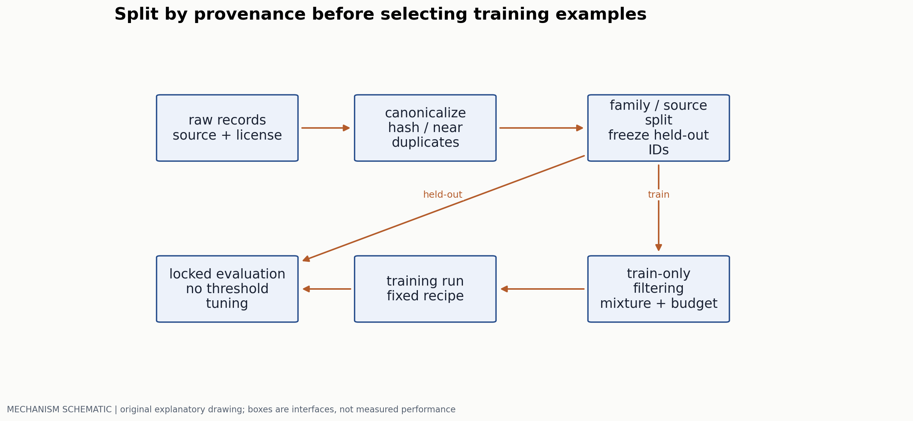
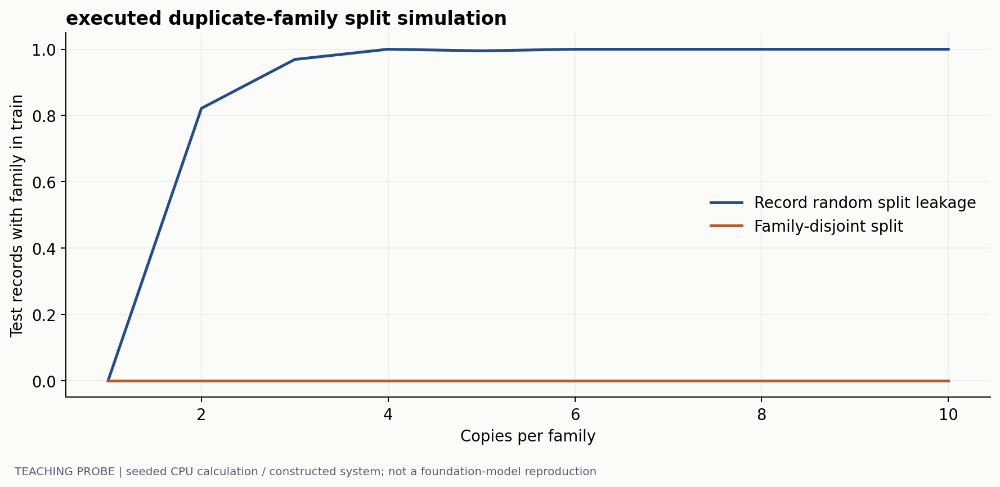
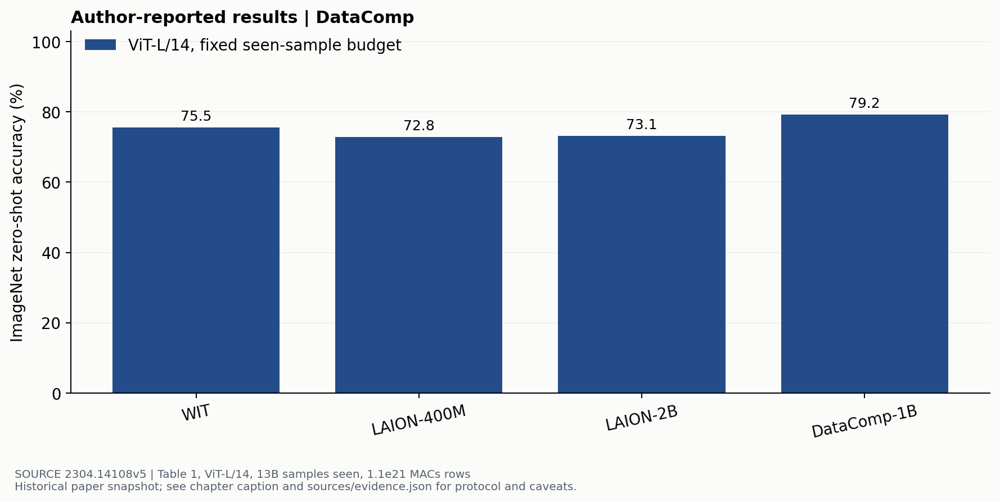

# 数据如何成为可控制的训练变量

> 副标题：来源、去重、切分、过滤、混合与公平比较
> 版本日期：2026-10-16 | 先修：采样、损失权重、第 01 章

## 摘要

“更多高质量数据”同时隐藏了样本来源、选择器、训练次数与评测定义。一个过滤策略可能提高某个 benchmark，又损失某种语言或细节；记录数增多也可能只是同一内容重复出现。本章以 provenance 和近重复族为单位组织数据流水线，推导混合采样如何改变实际梯度权重，再以 DataComp 的固定训练预算比较说明数据研究应该控制哪些变量。所有数字区分候选池、独特样本与训练中累计看见的样本。

## 1. 一条数据需要保留的身份

图文对至少有内容、来源 URL/记录 ID、采集时间、许可信息、处理版本和关联的原始资源身份。视频还需要片段边界，音频需要说话人/会话来源，机器人轨迹需要 embodiment 与时间同步信息。只保存 caption 与图像文件名，会让后续很难追踪泄漏和许可边界。



数据清洗也不能抹掉谱系。resize、OCR、翻译、合成改写都应附在原始记录之下，而不是获得一个看似全新的独立样本身份。否则一个页面的截图、OCR 文本和改写 caption 可能被误分到训练与测试两边。

## 2. 为什么要按重复族切分

精确哈希只能识别同字节对象；重压缩图片、裁剪图、同一视频的相邻帧和文本改写需要近重复识别。可以使用感知特征、文本 shingles、局部敏感哈希等候选机制，再用阈值或人工验证建立重复族。阈值会在漏检重复与合并不同样本之间取舍。

若每个内容有 $m$ 份复制，记录独立以概率 $p$ 分入训练，那么一个族同时出现在两边的概率为：

$$
P(\mathrm{family\ overlap})=1-p^m-(1-p)^m.
$$

这个量按“族”定义；测试记录的泄漏比例是另一个分母，不能直接把两者当成同一个百分比。下面实际模拟的是测试记录的族是否已在训练出现。



建立重复族时若采用 connected components，还要注意链式合并：A 接近 B、B 接近 C，不意味着 A 与 C 的内容足够相同。过度聚类会删掉有效多样性；过细聚类会留下泄漏。应检查阈值附近的真实样本，并保存去重前后各来源、语言和概念的变化。

## 3. 过滤器实际在优化什么

图文相似度高可能表示对齐较好，也可能偏爱容易描述的常见对象、英文短句或训练编码器熟悉的风格。OCR 密集图、少数语言与专业图表可能因此被系统性剔除。过滤分数应被视作有偏测量，而不是“质量”的客观定义。

过滤器应先在与最终测试隔离的开发集合上校准，再冻结阈值。除了最终保留量，还要记录各模态长度、来源覆盖和少数群体分布；不然一个分数上升可能来自把困难样本排除了，而非可迁移能力提高。

合成 caption 或偏好数据也需要闭环核验：生成器是否能看到原图，是否把视觉不确定内容补成确定事实，拒绝/纠错规则是否引入固定语言模式。用同一个模型既生成又评分可能强化它自身的盲点，不能仅靠自评高分确认真实性。

### 先定义过滤器要保留什么

假设目标是筛出“文字被图像支持、可用于训练”的图文对。使用一个固定打分器输出 $s\in[0,1]$；在与最终测试隔离的 1000 条开发记录上，人工标注其中 800 条符合目标、200 条不符合。记录有事先可取得的来源类别：200 条 OCR 类，其中 160 条符合；800 条其他类，其中 640 条符合。

用阈值 $s\geq\theta$ 保留记录，计算 $precision=TP/(TP+FP)$、$recall=TP/(TP+FN)$。得到如下教学表：

| 全局阈值 | 保留条数 | TP | FP | 总 precision | 总 recall | OCR TP/160 | OCR recall |
|---|---:|---:|---:|---:|---:|---:|---:|
| 0.20 | 900 | 760 | 140 | 84.44% | 95.00% | 150 | 93.75% |
| 0.30 | 730 | 680 | 50 | 93.15% | 85.00% | 100 | 62.50% |
| 0.40 | 560 | 540 | 20 | 96.43% | 67.50% | 40 | 25.00% |

为了能复算分层选择，再给出分组计数：OCR 在上述三阈值的 `(TP,FP)` 分别为 `(150,30)`、`(100,10)`、`(40,2)`；其他类分别为 `(610,110)`、`(580,40)`、`(500,18)`。先规定本次工程约束为总 precision 至少 90%、OCR recall 至少 80%，三个单阈值均未同时满足。

试用 OCR 阈值 0.20、其他类阈值 0.30：总 TP 为 150+580=730，FP 为 30+40=70，保留 800 条，总 precision 为 91.25%，总 recall 为 91.25%，OCR recall 为 93.75%。这解释了按来源分层校准怎样改善已声明的目标，而不是把某个阈值当成普遍“高质量”定义。来源标签如果来自分类器，其误差也应进入开发集检查。

```text
freeze source/family split and the human-label definition
score only the training/development partition with a fixed scorer revision
tabulate TP/FP/FN and retained counts by source/language/task slice
choose one declared threshold policy on development data
freeze the policy and write retained record IDs to a manifest
train downstream models under fixed code and compute budgets
evaluate once on the untouched downstream test protocol
```

人工“可用于训练”标签只是过滤目标的代理；下游效果仍需训练实验。DataComp 提供了固定训练代码和计算预算、将数据集作为变量的设计，可用来理解这一步与纯打分准确率的区别。[DataComp §3](https://arxiv.org/html/2304.14108v5) 比较随机子集、全局阈值和分层阈值时，既要记录保留条数，也要记录去重后独特条数、来源组成、实际训练 exposure 与下游能力。开发阈值可被选择，最终测试不能继续参与选择。

## 4. 混合采样改变了隐含的训练目标

假设来源 $k$ 有 $n_k$ 个样本，采样比例取 $q_k=n_k^\tau/\sum_j n_j^\tau$。$\tau=1$ 按数量采样，$\tau=0$ 对来源等概率。后者会显著提高小来源单条样本的重复率，而不产生新的独立信息。

如果每次抽一个来源、再抽一个样本，则单个样本的概率为 $q_k/n_k$。训练中累计看见的样本数 $D_{seen}$ 与独特样本数 $D_{unique}$ 不同，重复 exposure 也不同于候选池大小。

多模态还需要选择 loss 归一化单位。将全 batch 有效 token 合并后平均，会让长序列来源贡献更多目标位置；按样本平均则让每条样本权重近似一致。应将采样概率、有效 token 数、loss 系数和 gradient accumulation 一起核算，不能只报告一组“数据占比”。

```text
freeze provenance groups and held-out IDs
fit filtering rules on training/development data only
sample source k with recorded q[k]
sample a record within k, apply versioned transforms
log unique IDs, repeated exposures and effective target tokens
```

对于图文、语音与视频混合，把“一条记录”当同一成本单位还会漏掉编码后长度差别。固定样本数的实验未必固定训练 FLOPs；固定 token 数也未必固定各模态信息量。

### 两个数据源的采样概率

设来源 A 有 1,000,000 条，来源 B 为 10,000 条，来源采样概率为

$$
q_k=\frac{n_k^\tau}{\sum_jn_j^\tau},\qquad
P(\text{record }i\in k)=q_k/n_k.
$$

| 配方 | q(A) | q(B) | 单条 A 被抽概率 | 单条 B 被抽概率 |
|---|---:|---:|---:|---:|
| 按数量，τ=1 | 100/101 | 1/101 | 约 $9.901\times10^{-7}$ | 约 $9.901\times10^{-7}$ |
| 按来源，τ=0 | 1/2 | 1/2 | $5\times10^{-7}$ | $5\times10^{-5}$ |

第二行中每条 B 被抽概率是每条 A 的 100 倍；相较第一行，B 自身概率提高 50.5 倍。两个比较的分母不同，应直接写出倍数含义。

若独立有放回抽取 1,010,000 条 exposures，第一种配方对 A/B 的期望曝光分别为 1,000,000/10,000，每条平均期望 1 次；第二种对 A/B 各 505,000 次，相当于 A 每条期望 0.505 次、B 每条 50.5 次。这些是期望，并不表示第一种恰好无重复地遍历一遍。单条被抽中概率 p 时，D 次抽取后至少见过一次的概率为 $1-(1-p)^D$；记录 unique IDs 才能区分重复训练与新增信息。

### 采样比例怎样进入 loss

取每条 A 含 100 个有效目标 token，每条 B 含 1000 个；按来源各 50%抽取。在长期累计位置数中，A:B 为 $0.5\times100:0.5\times1000=1:10$。若将全 batch 所有有效 token loss 求和后除总 token 数，B 占约 10/11 的目标位置；若先对每条样本的 token 求均值、再对样本平均，则两来源的记账权重各约 1/2。

设第 i 条样本有效长度为 $U_i$，两种归约明确写成

$$
L_{global\ token}=\frac{\sum_i\sum_{t=1}^{U_i}\ell_{it}}{\sum_iU_i},
\qquad
L_{sample}=\frac1B\sum_i\frac1{U_i}\sum_{t=1}^{U_i}\ell_{it}.
$$

“贡献多少位置”与“实际梯度范数”仍有区别；不同模态的难度、loss 尺度和网络路径会改变后者。前者可以从 manifest 与 batch 日志精确核算，后者需要记录梯度统计。视觉输入位置没有 SFT label 时，它们仍产生编码和 attention 计算，不能从有效目标 token 数直接推出完整 FLOPs。

如果目标是按来源权重 $r_A=0.9,r_B=0.1$ 的样本平均 loss，却为采样多样性使用 $q_A=q_B=0.5$，可将样本 loss 乘 $\lambda_k=r_k/q_k$，即 A 乘 1.8、B 乘 0.2；其期望恢复 $\sum_kr_kE[L_i|k]$。这是一种明确的 importance weighting，思路与[CS336 lecture_14 的 importance sampling 示例](https://github.com/stanford-cs336/spring2025-lectures/blob/main/lecture_14.py)对应。若想要不同目标，则直接定义新的 r，不必把每次配比变化解释为无偏修正。

```text
source ~ categorical(q)
record ~ uniform(eligible_IDs[source])
build inputs and labels; count valid target tokens U
sample_loss = sum(valid_token_losses) / U
weighted_loss = (r[source] / q[source]) * sample_loss
aggregate with the declared batch/distributed reduction
log source, record_ID, family_ID, U, lambda and cumulative exposures
```

变长分布式 batch 还需核对全局分母。若各卡各自按有效 token 平均，再简单平均梯度，会让有效 token 少的卡拥有不同隐含权重；应按框架的 sum/mean 梯度约定推导缩放。用“相同记录、不同 padding 长度”和“两卡有效长度不同”的教学 batch，可以直接检验实际目标是否与公式一致。

### 课程与回放也应进入同一本账

一份最小训练卡可以给两个拟议阶段：阶段一固定视觉塔与 LLM，仅更新 connector，使用低分辨率与短序列；阶段二选择性更新 LLM、提高分辨率，并加入独立记录的纯文本回放。这里的阶段设计是实验变量，不能由其常见性推断效果。为比较是否发生语言遗忘，应固定一套纯文本 held-out 任务与视觉/OCR 任务，按相同训练计算画检查点曲线；同时列每阶段 q、loss 归约、学习率、可训练模块、视觉长度和独特样本/曝光。训练完成后，读者应能从这些记录重建“模型实际受了多少次、哪类、哪种权重的监督”。

## 5. DataComp 如何把数据变成实验变量



DataComp [1] 固定训练代码和预算，把数据选择作为比较对象。图中 LAION-2B 的最终训练数据集记录数更多（区别于 DataComp 的上游候选池），并没有在该设置下自动获得比所有其他来源更高的准确率。它支持“数据来源和选择值得独立研究”，不支持“一个相似度阈值在所有任务上最优”。

这里累计看见的 13B 是训练曝光，不是数据集含 13B 个独特图文对；MACs 与 FLOPs 也需要声明换算约定。WIT 私有，限制了完全独立复现和等内容对照；数据源、许可、内容分布与过滤规则共同变化，不能把全部差异归给一个过滤算子。

### 5.1 真正的 filtering 消融怎样做

从同一候选池构造随机子集、单阈值过滤、语言/来源平衡过滤三组。既做固定保留条数，也做固定训练计算的比较；记录实际 exposure 和有效 token。对 OCR、少数语言和细粒度属性分别报分，检查整体收益是否牺牲了某类能力。

先冻结评测配置和开发/测试边界，再选择阈值。若重复尝试大量阈值并只展示最好的 test 值，数据研究也会发生 benchmark overfitting；第 10 章的多重比较问题同样适用。

## 6. 数据卡和训练卡应让别人能重做什么

数据卡记录来源、许可、采集时间、筛选规则、排除范围、去重方法和已知缺失；训练卡记录 checkpoint、混合权重、分阶段冻结、实际看见样本数、有效 token 和训练计算估计。对于无法再分发的资源，至少给出可重复检索的标识和处理程序，并明确哪些步骤不能被第三方完全重现。

按如下顺序排查训练退化更有效：检查数据版本与模板；检查模态占位和 label mask；检查按来源的 loss 与长度；再看去重和采样分布；最后才把问题解释为模型容量不足。一个统一平均 loss 可能掩盖某个来源几乎没有有效监督。


## 参考文献与证据

[1] Gadre et al. DataComp: In search of the next generation of multimodal datasets. 2023. 实验定义、Table 1 与 filtering ablations。[原文](https://arxiv.org/html/2304.14108v5)  
[2] Stanford CS336. Data lecture，作为数据决策、实验与来源追踪的组织参照。[原文](https://github.com/stanford-cs336/spring2025-lectures/blob/main/lecture_14.py)  
